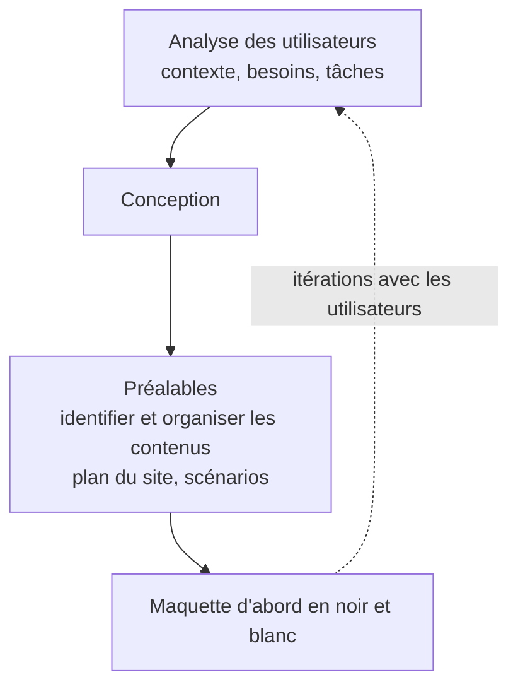

> [!note]
> **Version simple – l'essentiel en 3 minutes**
> Un **document numérique** (une page web par exemple), c'est de l'information affichée sur un écran, avec **le contenu d'un côté et sa mise en forme de l'autre**, et souvent des images, sons ou vidéos. Dans ce cours, on apprend à créer **l'interface** : la partie que l'utilisateur voit et avec laquelle il agit.
> 
> - **IHM** (interface homme-machine) = tout ce qui permet à une personne de **commander, contrôler ou surveiller** un système. Une bonne IHM est **intuitive, claire, accompagnée d'aide et personnalisable**.
> - **Spécifications** = la liste de ce que le système doit faire.
> - **Maquette (ou prototype)** = une simulation des écrans, **sans vraies données ni calculs**.
> - **Front web** = tout ce qu'on voit et avec quoi on interagit sur une page.
> - **Principes** : partir de ce que font les utilisateurs, utiliser des **métaphores** (classeur, gomme, crayon…), aller des **objets vers les actions**, prévoir de **l'aide** si une action dure plus de 3 secondes.
> - **Prototypage** : comprendre les utilisateurs (contexte, besoins, tâches), puis concevoir de façon **itérative**, **avec** les utilisateurs, et **en noir et blanc d'abord**.

---

## 1. Objectif de la ressource R1.02

Apprendre les **techniques de création de documents numériques sur le web** en réponse à des **besoins client**. On s'intéresse à la **création d'interfaces utilisateur** pour des applications web ou des sites web, **pas** à la mécanique sous-jacente (ressources R1.01, R1.03, R1.04, R1.05…).

## 2. Document numérique sur le web

- **Définition** : représentation de l'information consultable à l'écran d'un appareil électronique (définition Wikipédia citée dans le cours).
- **Caractéristique principale** : **séparation de l'information et de sa présentation** (le contenu d'un côté, la mise en forme de l'autre).
- Possibilité d'**insérer des contenus multimédias**.

## 3. Savoirs de référence à étudier

- **Spécifications d'interfaces utilisateur et maquettage** : sketch, scénarios, persona…
- **Technologies d'affichage du Web** : HTML, CSS…
- **Tester la conformité** des sites web aux standards d'accessibilité **W3C / WAI** (World Wide Web Consortium / Web Accessibility Initiative).

**Mots-clés** : IHM, front web, maquettage.

## 4. Vocabulaire

| Terme | Définition |
| --- | --- |
| **IHM** (interface homme-machine, interface utilisateur) | Ensemble des dispositifs matériels et logiciels permettant à un utilisateur d'**interagir** (commander, contrôler ou superviser) avec un système interactif. |
| **Spécifications** | Ensemble **explicite d'exigences** à satisfaire par un système. |
| **Maquette ou prototype** | Modèle original qui possède toutes les qualités techniques et toutes les caractéristiques de fonctionnement d'un nouveau produit. **En IHM** : définition de la présentation et de l'organisation, **simulation des écrans sans accès aux données ni calculs**. |
| **Front web** | Éléments de la page internet ou de l'application web qu'un utilisateur peut **voir** et avec lesquels il peut **interagir directement**. |

### 4.1 Objectifs d'une IHM

- **Transparence** : l'interface se fait oublier.
- **Intuitive, visuelle et concise.**
- **Explicative** (menu d'aide) et **flexible** (personnalisable).
- Idée à retenir : **« l'IHM suggère des possibilités, l'utilisateur choisit »**.

### 4.2 Types d'interaction

| Type | Exemples |
| --- | --- |
| **Textuelle** | Alphanumérique, lignes de commande… |
| **Graphique** | Action sur des icônes, manipulation directe de dessins… |
| **Augmentée** | Clavier projeté, lunettes… |

## 5. Principes généraux des spécifications d'interface utilisateur

1. **Partir des activités des utilisateurs.**
2. **Utiliser des métaphores liées au domaine** : désigner une chose par une autre qui lui ressemble (classeur, ouvrir/fermer, gomme, crayon, lecture, arrêt…).
3. **Partir des objets pour aller vers les actions** : cela diminue la **profondeur des menus**.
4. **Fournir une aide en ligne** : informer, guider, aider **si l'action dure plus de 3 secondes**.
	- Au minimum : les **fonctionnalités générales** et le **fonctionnement des boîtes de dialogue complexes**.
	- Prévoir une **aide sur l'aide**, une **aide contextuelle** et du **guidage**.

## 6. Méthodes de prototypage

- **Analyse des utilisateurs** : le **contexte**, les **besoins**, les **tâches**.
- **Conception**, avec trois caractéristiques : **itérative**, **incluant les utilisateurs**, **pluridisciplinaire**.
- **Préalables** : identification des contenus du site, organisation de ces contenus (**site map**, **scénario**).
- On commence **en noir et blanc** (les couleurs viennent plus tard, voir la page sur le mock-up).