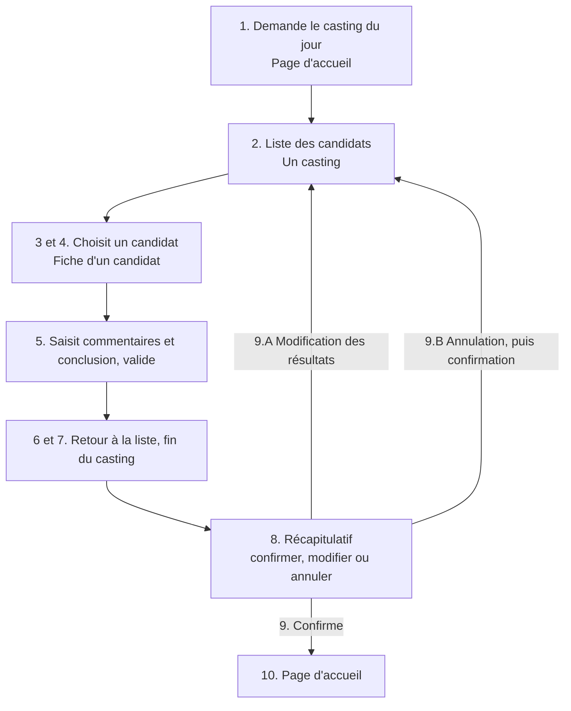

> [!note]
> **Version simple – l'essentiel en 3 minutes**
> Un **scénario** raconte, **étape par étape**, ce que fait un utilisateur pour atteindre un objectif et ce que répond le système. On l'écrit dans un **tableau à deux colonnes** (l'utilisateur / le système), et on note **quelle interface** est affichée à chaque étape.
> 
> - **En-tête (cartouche)** : le **nom** du cas d'utilisation, **qui** agit, **sur quel système**, les autres intervenants, le niveau, et les **préconditions** (ce qui doit être vrai avant de commencer).
> - **La première ligne est toujours une action de l'utilisateur.** Ensuite on alterne utilisateur / système.
> - On écrit des **actions simples et sans détail technique** : « l'utilisateur **définit** l'objet de sa recherche », pas « il tape dans la barre de recherche ».
> - **Séquence nominale** = le déroulement normal. **Séquence alternative** = une variante. **Séquence d'exception** = une erreur. Les deux dernières s'écrivent dans des **extensions**, numérotées comme **9.A.1** (ligne 9, extension A, opération 1).

> [!warning]
> **Les erreurs classiques**
> - Commencer par une action du **système** au lieu d'une action de l'**utilisateur**.
> - Décrire l'interface au pixel près (« clique sur le bouton bleu en haut à droite ») au lieu de l'**intention** (« demande à visualiser… »).
> - Mélanger le déroulement normal et les cas d'erreur dans la **même** séquence au lieu de les mettre en **extension**.

---

## 1. Où on en est

C'est la sous-étape **1-3** de l'étape 1 (spécifications des interfaces utilisateur) : les scénarios, **avec la liste des interfaces** utilisées.

## 2. Le cartouche (l'en-tête du tableau)

| Champ | Signification | Exemple du cours |
| --- | --- | --- |
| **Cas d'utilisation** | L'**objectif** du scénario | Évaluer les candidats |
| **Acteur primaire** | Celui qui **réalise** le cas d'utilisation | Responsable de casting |
| **Système** | Le système étudié | Système informatique de gestion des castings |
| **Intervenants** | Les **autres utilisateurs** que l'acteur primaire | (vide ici) |
| **Niveau** | Ici **toujours « objectif utilisateur »** (voir R2.01) | Objectif utilisateur (sous-cas d'utilisation de « Gérer un casting ») |
| **Préconditions** | Conditions de **réalisation** du scénario | Le casting a été défini et organisé, les candidatures validées, les candidats pointés ; le responsable s'est identifié et le système a affiché la page d'accueil avec la liste des castings. |

## 3. Les opérations

Chaque ligne a un **numéro**, une **description** (dans la colonne de l'acteur ou du système) et le **nom, éventuellement le numéro, de l'interface utilisée**.

- **La première opération est toujours une action de l'utilisateur sur le système.**
- On décrit des **interactions simples** : « Le système affiche, demande les informations sur… », « L'utilisateur choisit, confirme, demande à… ».
- **Pas de verbe** :
	- impliquant un choix sur l'interface (ou le minimum) : clique, déplace, sélectionne, formulaire, affiche telle page… ;
	- marquant une intention : veut, souhaite, désire… ;
	- indiquant une possibilité : peut, permet… ;
	- indiquant une non-action : ne choisit pas…

**Exemples du cours**

| Situation | À écrire | À éviter |
| --- | --- | --- |
| **Barre de recherche** | L'utilisateur **définit l'objet de sa recherche** | L'utilisateur saisit le produit recherché dans la barre de recherche |
| **Message de confirmation** | Le système affiche la confirmation de la saisie ou de la modification et propose de passer à la suite (ex : pop-up) ; l'utilisateur demande à passer à la suite (ex : fermer le pop-up) ; le système affiche la page d'accueil | (détailler le composant technique) |

## 4. Exemple complet : « Évaluer les candidats » (séquence nominale)

| N° | Responsable de casting | Système informatique de gestion des castings | Interface |
| --- | --- | --- | --- |
| 1 | Demande à visualiser le casting du jour |   | 1. Page d'accueil |
| 2 |   | Affiche la liste des personnes présentes devant passer le casting | 2. Un casting |
| 3 | Demande à visualiser les informations d'une personne |   | 2. Un casting |
| 4 |   | Affiche les informations sur la personne choisie | 3. Fiche d'un candidat |
| 5 | Saisit ses commentaires et sa conclusion pour la personne puis valide |   | 3. Fiche d'un candidat |
| 6 |   | Affiche la liste des personnes présentes devant passer le casting | Un casting |
| 7 | Indique que c'est la fin du casting |   | Un casting |
| 8 |   | Affiche un récapitulatif des commentaires et des conclusions et demande de choisir entre confirmation, modification et annulation | 4. Récapitulatif casting |
| 9  | Confirme les résultats |   | Récapitulatif casting |
| 10 |   | Affiche la page d'accueil | Page d'accueil |

La **ligne 9** (la confirmation des résultats) est celle à laquelle s'appliquent les extensions ci-dessous.

## 5. Séquences et extensions

- **Séquence nominale** : le déroulement normal.
- **Séquence alternative** : une variante de la séquence nominale.
- **Séquence d'exception** : le cas d'une **erreur**.
- **Extension** : la façon de **représenter** les séquences alternatives ou d'exception.

### 5.1 Comment numéroter une extension

Exemple : **9.A.1**

| Morceau | Signification |
| --- | --- |
| **9** | Numéro de la ligne de l'opération **à laquelle l'extension s'applique** |
| **A** | Lettre qui distingue les **différentes extensions** concernant une même ligne (9.A, 9.B…) |
| **1** | Numéro de l'**opération dans l'extension** |
| « Retour à l'étape 2 » | Numéro de la **ligne de retour** dans le scénario nominal |
| Titre de l'extension | Le **nom** de l'extension (ex : « Modification des résultats ») |

### 5.2 Extensions de l'exemple

**Extension 9.A – Modification des résultats**

| N° | Responsable de casting | Système | Interface |
| --- | --- | --- | --- |
| 9.A.1 | Demande une modification des résultats |   | Récapitulatif casting |
| 9.A.2 |   | Retour à l'étape 2 | Un casting |

**Extension 9.B – Annulation des résultats**

| N° | Responsable de casting | Système | Interface |
| --- | --- | --- | --- |
| 9.B.1 | Demande une annulation des résultats |   | Récapitulatif casting |
| 9.B.2 |   | Demande confirmation de l'annulation |   |
| 9.B.3 | Confirme l'annulation des résultats |   |   |
| 9.B.4 |   | Retour à l'étape 2 | Un casting |

### 5.3 Écrire la « nouvelle version » du scénario

Le cours montre aussi comment présenter le scénario quand une extension **remplace une partie** du déroulement nominal : la ligne concernée (ici « Le responsable du casting confirme les résultats ») est remplacée par l'opération de l'extension (« demande une modification des résultats »), suivie d'un retour à l'étape voulue.

> [!tip]
> **Remarque.** Dans les diapos, le retour se fait à l'étape 2 (extensions) ou à l'étape 3 (nouvelle version). L'important est d'indiquer **le bon numéro de ligne** du scénario nominal vers lequel on revient.