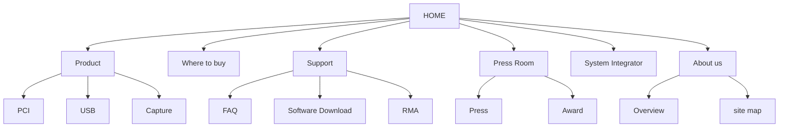

> [!note]
> **Version simple – l'essentiel en 3 minutes**
> Le **maquettage**, c'est dessiner les écrans **avant** de les programmer. On part du plus général (la structure d'une page) vers le plus précis.
> 
> - **Zoning (gabarit d'écran)** : on découpe l'écran en **grandes zones** (en-tête, contenu, barre latérale, pied de page…) et on décide ce que fait chaque zone. En général, **moins de 5 zonings** pour tout un site.
> - On place les éléments en pensant au **regard** (on lit en **Z** en Occident) et à la **souris** (le centre est le plus facile à atteindre).
> - **Éléments communs** : ce qui revient sur plusieurs pages (haut de page, bas de page, barre latérale…). On les dessine une seule fois.
> - **Plan du site (site map)** : un schéma qui montre comment on circule entre les pages. Les titres de page doivent être **intuitifs**.
> - **Wireframe** : la maquette « **fil de fer** ». Seulement la **position** des éléments, **ni détail ni couleur**. Les images sont représentées par un rectangle barré d'une **croix**.
> - **Outil du cours : Figma.** Le papier ne sert qu'à faire des **sketchs** (croquis) avant les wireframes.

---

## 1. Outils de prototypage

| Famille | Exemples | Avis du cours |
| --- | --- | --- |
| **Papier** | Croquis à la main | **Limité**, éventuellement pour les sketchs |
| **Outils de présentation** | Photoshop, PowerPoint, Adobe Acrobat | Possible mais pas fait pour ça |
| **Logiciels spécialisés** (wireframe, collaboratifs…) | **Figma** ([https://www.figma.com/fr/](https://www.figma.com/fr/)) | Palette complète d'objets graphiques, prototypage **horizontal et vertical**. Utilisé en TP. |

**Figma** : webdesign **collaboratif en ligne**. On y fait des **wireframes** (prototype fil de fer) et des **mock-ups** (prototype avec interaction).

## 2. Étape 2-1 : charte graphique (2ème partie)

### 2.1 Sous-étape 2-1-1 : zoning ou gabarit d'écran

Le **zoning** définit les **grandes zones** de l'écran : leur **définition**, leur **fonction** et les **connexions entre elles**. À l'échelle du site, ce sont des **repères de guidage** pour l'utilisateur. On compte **en général moins de 5 zonings par site**.

- Dans un zoning, une **image** se représente par une **croix** dans un rectangle.
- Il peut d'abord prendre la forme d'un **sketch** : esquisse, croquis approximatif préalable aux wireframes.

**Exemple 1 : le gabarit le plus classique**

```javascript
+------------------------------------+
|              Header                |
+----------------------+-------------+
|                      |             |
|       Content        |   Sidebar   |
|                      |             |
+----------------------+-------------+
|              Footer                |
+------------------------------------+
```

**Exemple 2 : gabarit d'une application (diapo du cours)**

```javascript
+--------------------------------+-----------+
|         Menu principal         | Id écran   |
+--------------------------------+-----------+
|             Barre d'outils                 |
+-----------+--------------------------------+
| Zone de   |                                |
| sélection |                                |
|    ou     |   Zone principale de travail   |
| Menu      |                                |
| secondaire|                                |
+-----------+--------------------------------+
|  Barre d'état (message à lecture optionnelle) |
+--------------------------------------------+
```

### 2.2 Optimiser le zoning

- **Parcours visuel naturel** : en **Z** (en Occident), pour une exploration rapide de l'écran.
- Le parcours est **canalisable** : on peut **hiérarchiser et regrouper**, **mettre en évidence**, penser à l'**accessibilité à la souris**.
- Les gabarits d'écran tiennent compte de la **visibilité** et de l'**accessibilité**.

**Accessibilité à la souris selon les zones de l'écran** (schéma du cours)

| Peu accessible | Accessible | Peu accessible |
| --- | --- | --- |
| Accessible | **Très accessible** | Accessible |
| Peu accessible | Peu accessible | Peu accessible |

Le cours montre aussi une carte du **parcours du regard** : une zone **toujours survolée**, une zone **peut-être survolée** et une zone **rarement survolée**. Les éléments importants vont dans la première.

### 2.3 Sous-étape 2-1-2 : identification des éléments communs

Un site a **plusieurs zonings** pour ses différentes pages. Les **éléments communs** à ces zonings sont typiquement : le **haut de page**, le **bas de page**, la **barre latérale**… On les conçoit une fois, puis on les réutilise partout.

### 2.4 Sous-étape 2-1-3 : plan du site (site map)

- **Représentation du parcours de navigation** dans le site.
	- **Navigation nominale** : pensée comme « naturelle » par le concepteur.
	- **Non exhaustive** (on ne dessine pas tous les liens).
- **Description des liens** entre pages.
- **Pages regroupées** par **couleur** ou par **positionnement**.
- Importance du **choix des titres de page** : c'est ce qui rend le parcours **intuitif**.

Extrait simplifié de l'exemple du cours :



## 3. Étape 2-2 : wireframe

Le **wireframe** est le **premier type de maquette** utilisé dans le cours.

- **Maquette fil de fer.**
- **Structure de base** : positionnement des éléments graphiques.
- **Ni détail, ni couleur.**

**Deux sous-étapes**

1. **2-2-1** : wireframe des **éléments communs**.
2. **2-2-2** : wireframe des **écrans**, en réutilisant les éléments communs.

Si besoin, on commence par des **sketchs** avant d'établir les wireframes.

Exemple du cours (application mobile) : en haut Menu, Logo et Search ; puis une photo (croix), un nom, des détails et des logos sociaux ; une grande image ; trois compteurs (Likes, Shares, Comments) ; en bas une barre de cinq icônes (Camera, Chat, Home, Alerts, Settings).

### 3.1 IHM WIMP et fenêtres

**WIMP** = **W**indows, **I**cons, **M**enus, **P**ointer (fenêtres, icônes, menus, pointeur).

- **Fenêtre de dialogue ou pop-up** : la **plus petite possible** en restant lisible ; positionnée à l'ouverture **au plus près de l'objet** concerné, **sans le recouvrir**.
- **Homogénéité** des pages et des fenêtres : les **boutons d'action généraux** (Valider, Annuler…) sont **toujours à la même place**.