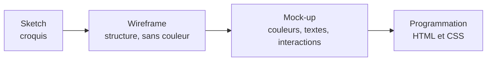
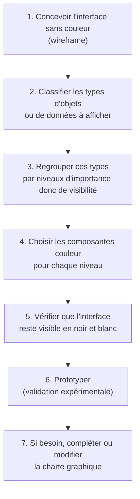
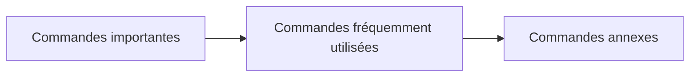

> [!note]
> **Version simple – l'essentiel en 3 minutes**
> Le **mock-up**, c'est le wireframe **habillé** : on ajoute les **couleurs, les textes, les vraies interactions**. C'est là qu'on **finalise la charte graphique**.
> 
> - **Couleurs** : on conçoit d'abord sans couleur, on classe les informations par **importance**, on donne **plus de visibilité** aux plus importantes, puis on vérifie que l'interface **reste lisible en noir et blanc**.
> - **Menus** : **2 à 7 éléments** par menu, ordonnés du **plus important au moins important**, tous de la **même taille**. Préférer **la largeur à la profondeur** (plutôt un menu large que des sous-menus imbriqués).
> - **Icônes** : seulement pour les fonctions **fréquentes**, **homogènes**, **accompagnées de texte** (info-bulle ou texte à côté).
> - **Textes** : foncé sur clair, aérés, lignes de **50-55 caractères**, alignés à **gauche**.
> - **Choix du composant selon la tâche** : 1 choix parmi peu → **boutons radio** ; plusieurs choix → **cases à cocher** ; une valeur numérique → **glissière ou molette** ; une action → **bouton**.
> - **Mise en évidence** : peu de moyens différents, toujours les mêmes, et qui s'arrêtent quand l'état disparaît.

> [!warning]
> **Les erreurs classiques**
> - Choisir les couleurs **avant** d'avoir dessiné la structure.
> - Remplacer le **texte par des icônes seules** (l'utilisateur ne devine pas toujours leur sens).
> - Utiliser une **liste déroulante** quand 2 à 6 choix tiendraient en **boutons radio** ou **cases à cocher**.
> - Mettre en évidence **trop d'éléments de trop de façons différentes**.

---

## 1. Étape 2-3 : le mock-up

Le **mock-up** est le **second type de maquette** utilisé dans le cours.

- **Prototype d'interface utilisateur.**
- **Structure, contenu, fonctionnalités.**
- **Interactions.**
- **Définition finale de la charte graphique.**

**Deux sous-étapes**

1. **2-3-1** : mock-up des **éléments communs**.
2. **2-3-2** : mock-up des **écrans**, en réutilisant les éléments communs.

## 2. Méthode pour déterminer les couleurs

Pour l'étape 4, on choisit :

- la **teinte** en fonction de la **sémantique de l'objet** ;
- la **saturation** (pureté ou gris) et la **luminance** (luminosité ou noir et blanc) en fonction de la **visibilité souhaitée**.

## 3. Éléments communs (2-3-1)

### 3.1 Les menus

Un **menu** regroupe des **choix d'actions** dans des **contrôles typés**. La **barre de menus** est une liste de commandes.

| Type de menu | Principe |
| --- | --- |
| **Déroulant** | Un ensemble d'items qui s'ouvre en **cliquant sur le libellé** dans la barre de menus |
| **Hiérarchique** | Des options complémentaires, indiquées par un **triangle plein** dans un item de menu |
| **Contextuel** | Items accessibles **hors de la barre de menus**, là où se trouve la souris |
| **Détachable** | Contient généralement une **palette** qui se transforme en **fenêtre utilitaire** |

**Organisation d'un menu**

- **Sur une seule ligne**, de la **largeur de la fenêtre**.
- Contrôles **regroupés par famille** dans un cadre.
- **Ordonnés dans le sens de la lecture** : les éléments les **plus importants**, puis les **plus fréquemment utilisés**, puis les autres ; ou selon la **chronologie supposée des actions**.
- **2 à 7 items par menu** et **moins de 30 items** au total, sinon on **hiérarchise** ou on utilise des **onglets**.
- **Au moins 3 items sans défilement vertical** (scroll) dans les listes simples et les listes combinées simples.
- **Items et boutons de même taille** dans un même menu.
- **Un bouton sélectionné par défaut.**

Le sens de lecture de la barre de commandes va de gauche à droite, celui d'une barre d'outils verticale de haut en bas.

**Critères de choix d'un composant de sélection**

- **2 à 6 items** : **boutons radio** (un seul choix) ou **cases à cocher** (plusieurs choix).
- Préférer les **listes simples** (hauteur constante) aux **listes déroulantes**.
- Préférer les **listes combinées simples** aux **listes déroulantes**.
- **Privilégier la largeur à la profondeur** et utiliser la **sémantique des tâches**.

| Type de liste | Particularité |
| --- | --- |
| **Liste simple** | **Hauteur constante** ; à sélection unique ou multiple |
| **Liste combinée simple** | **Hauteur constante** |
| **Liste déroulante** | Hauteur **différente** fermée et ouverte (à éviter quand on peut) |

### 3.2 Les icônes

Une **icône** est une **représentation métaphorique** de la fonction désignée. On l'utilise pour des **boutons**, des **champs de texte**, des **bulles d'aide**…

**Recommandations**

- **Limiter** les icônes aux **fonctions fréquentes**.
- Veiller à l'**homogénéité** des icônes.
- **Associer du texte** aux icônes : bulles d'aide, icône + texte.
- **Tester** les icônes auprès de **panels d'utilisateurs**.
- **Faire évoluer** les représentations graphiques.

### 3.3 Les textes

**Principes**

- **Regrouper** les informations connexes ou homogènes.
- **Contraster** : lettres **sombres sur fond clair**.
- **Aérer** : séparer les paragraphes, environ **un espace toutes les 5 lignes**.
- **Utiliser** les **polices standards** des navigateurs.
- **Adapter** la **taille de la police** à la résolution de l'écran.

**Longueur des lignes** : éviter les lignes trop courtes. Longueur idéale : **50-55 caractères (8 à 10 mots)**, ou **30-35 caractères** en double colonne.

**Justification et alignement**

| Cas | Règle |
| --- | --- |
| **Textes** et **listes de données alphanumériques** | **Alignés à gauche** (culture occidentale) |
| **Texte justifié** (droite et gauche) | Esthétique, mais gêne parfois la lisibilité pour les gros caractères (espaces variables) |
| **Nombres entiers** | Justifiés à **droite** |
| **Nombres décimaux** | Alignés sur la **virgule** |
| **Grands nombres** | Chiffres groupés **par 3** |

## 4. Écrans (2-3-2) : choisir les éléments en fonction de la tâche

| Tâche | Cas | Éléments d'interface adaptés |
| --- | --- | --- |
| **Sélection** | Alternatives **exclusives** (un seul élément) | Bouton radio ; interrupteur à glissière (2 choix) ; liste |
| **Sélection** | Alternatives **non exclusives** (plusieurs éléments) | Cases à cocher ; liste |
| **Sélection** | **Valeurs numériques** | Molette d'incrément ; glissière (rectiligne) ; potentiomètre (rotatif) |
| **Sélection** | **Paramètres, propriétés** | Fenêtre de dialogue |
| **Sélection** | **Ligne dans un menu** | Inversion vidéo (couleur) de l'élément sélectionné |
| **Déclenchement** | D'une **action indirecte** | Bouton poussoir (bouton d'action) ; menu ; icône |
| **Déclenchement** | D'une **action directe** | Poignée de manipulation pour transformation ; curseur (glissé-déposé) |
| **Saisie** | **Texte, quantités** | Zone de saisie |
| **Saisie** | **Valeurs numériques** | Zone de saisie préformatée (ex : JJ / MM / AAAA) ; sélecteur ou molette |
| **Saisie** | **Tracés, positions** | Fenêtre + curseur |
| **Rétroaction** | **Défilement, attente** | Barre de défilement ; curseur modifié (par exemple un sablier) |
| **Rétroaction** | **Contrôle des saisies obligatoires** | Astérisque |
| **Rétroaction** | **Contrôle des formats** | Pré-affichage du format attendu, message d'erreur |
| **Rétroaction** | **Valeurs numériques** | Potentiomètres |

## 5. Mise en évidence et sons

**Mise en évidence**

- **Limiter et homogénéiser** le nombre de moyens utilisés : dans tout le site et sur un même objet.
- Elle **ne doit pas nuire** à la perception de l'**état de l'objet**.
- Elle **doit s'arrêter** dès que l'état correspondant disparaît, ou dès que l'action de l'utilisateur qui l'a déclenchée est terminée.

**Sons**

- **Peu nombreux**, **identifiables**, **paramétrables**.
- **Complétés par un affichage** (le son ne doit jamais être la seule information).

## 6. La suite du cours

Les étapes 3 (**programmation du prototype final** : éléments communs puis écrans, en HTML et CSS) et 4 (**diagnostic de qualité et d'accessibilité**, avec remédiation éventuelle) commencent **à partir de novembre**. Voir le planning sur la page principale de la ressource.