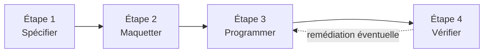

> [!note]
> **Version simple – l'essentiel en 3 minutes**
> Cette ressource apprend à **fabriquer ce que l'utilisateur voit et touche** sur un site ou une application web (le « **front** »), en répondant à un **besoin client**. On ne s'occupe pas de la mécanique cachée derrière (c'est le rôle d'autres ressources, R1.01, R1.03, R1.04, R1.05…).
> 
> - **Une méthode en 4 étapes** : (1) **spécifier** (qui utilise le site, pour faire quoi, quelle identité graphique), (2) **maquetter** (dessiner les écrans), (3) **programmer** le prototype en HTML/CSS, (4) **vérifier** la qualité et l'accessibilité.
> - **Maquette = dessin des écrans avant de coder.** D'abord le **wireframe** (schéma « fil de fer » : juste la position des éléments, sans couleur), puis le **mock-up** (version finale avec couleurs, textes et interactions).
> - **L'outil du cours : Figma.**
> - **On part toujours des utilisateurs** : leurs activités, leurs besoins, leurs tâches. On les représente avec des **persona** (utilisateurs fictifs) et on décrit leurs objectifs sous forme de **scénarios**.
> - **Règles d'or du visuel** : peu de couleurs (7 maximum), de bons **contrastes**, jamais la couleur comme seule information, une police **sans empattement** pour les menus, des **minuscules** (pas de texte tout en majuscules), éviter italique, souligné et clignotement, et surtout de la **cohérence** partout.
> - **Évaluation** : un **mini-projet** réalisé surtout en TP.

> [!note]
> **Comment lire ces pages**
> Chaque page commence par une **version simple** (encadré bleu), suivie de la **version détaillée** fidèle au cours. Les pages suivent l'ordre du cours : introduction, spécifications (charte graphique, scénarios), maquettage (zoning, wireframe), puis mock-up.

---

## Les 4 étapes de la conception d'un site web

| Étape | Sous-étapes | Où la trouver |
| --- | --- | --- |
| **1. Spécifications des interfaces utilisateur** | 1-1 Spécification succincte du site (contexte, persona, objectifs) ; 1-2 Charte graphique (1ère partie : couleurs, polices) ; 1-3 Scénarios | Pages « 2 – Spécification succincte et charte graphique » et « 3 – Scénarios » |
| **2. Maquettage** | 2-1 Charte graphique (2ème partie : zoning, éléments communs, plan du site) ; 2-2 Wireframe ; 2-3 Mock-up | Pages « 4 – Maquettage : zoning, plan du site et wireframe » et « 5 – Mock-up : éléments d'interface et couleurs » |
| **3. Programmation du prototype final** | 3-1 Éléments communs ; 3-2 Écrans (HTML, CSS) | À partir de novembre (cours C1 HTML CSS) |
| **4. Diagnostic de qualité et d'accessibilité** | Tests de conformité aux standards W3C / WAI, puis remédiation éventuelle | À partir de novembre (cours C2 Structuration et accessibilité) |

Le cours est en **deux parties** : d'abord **spécifications et maquettage**, ensuite **affichage web** (étapes 3 et 4, à partir de novembre).

## Planning (2026-2027)

| Semaine | Date | Cours (1 h) | TD | TP |
| --- | --- | --- | --- | --- |
| 4/39 | 21/09/2026 | C1 : Spécifications, maquettage |   |   |
| 5/40 | 28/09/2026 |   |   | TP1 : prise en main du logiciel |
| 6/41 | 05/10/2026 |   | TD1 : présentation du mini-projet | TP2 : mini-projet |
| 7/42 | 12/10/2026 |   |   | TP3 : mini-projet |
| 8/43 | 19/10/2026 |   |   |   |
| 44 | 26/10/2026 | **Vacances de Toussaint** |   |   |
| 9/45 | 02/11/2026 |   |   | TP4 : mini-projet |
| 10/46 | 09/11/2026 |   |   | TP5 : mini-projet |
| 11/47 | 16/11/2026 | C1 : HTML, CSS |   | TP6 : mini-projet |
| 12/48 | 23/11/2026 | C2 : structuration, accessibilité |   | TP1 : HTML, CSS |
| 13/49 | 30/11/2026 |   |   | TP2 : HTML, CSS |
| 14/50 | 07/12/2026 |   |   | TP3 : mini-projet |
| 15/51 | 14/12/2026 |   |   | TP4 : mini-projet |
| 52 et 53 | 21/12 et 28/12/2026 | **Vacances de Noël** |   |   |
| 16/1 | 04/01/2027 |   |   | TP5 : mini-projet |
| 17/2 | 11/01/2027 |   |   | TP6 : mini-projet |

**Évaluation** : mini-projet réalisé principalement en TP. Les étapes 3 et 4 (HTML, CSS, accessibilité) démarrent à partir de novembre.

---

[[R1.02 – Développement d'interfaces Web/1 – Introduction et vocabulaire|1 – Introduction et vocabulaire]]

[[2 – Spécification succincte et charte graphique]]

[[3 – Scénarios]]

[[4 – Maquettage  zoning, plan du site et wireframe]]

[[5 – Mock-up  éléments d'interface et couleurs]]

[[TP3 – Résumé et questions (scénarios)]]