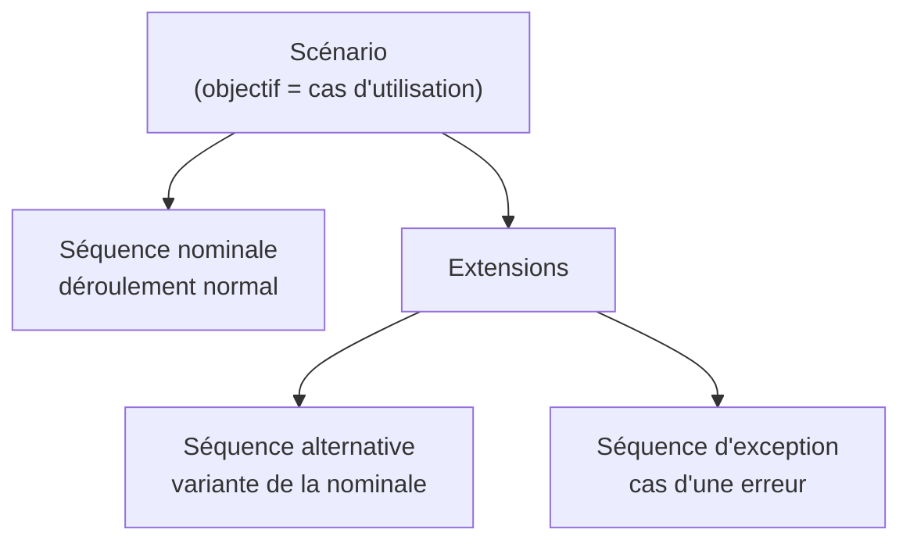

> [!note]
> **Version simple – l'essentiel en 2 minutes**
> Un **scénario** raconte, étape par étape, **ce que fait l'utilisateur et ce que répond le système** pour atteindre **un objectif précis**.
> 
> - **Cas d'utilisation = l'objectif** du scénario. **Acteur primaire = celui qui le réalise** (l'utilisateur).
> - Pour spécifier les interfaces, on écrit les scénarios au **niveau « objectif utilisateur »**.
> - **La 1ère opération est toujours une action de l'utilisateur** sur le système.
> - On écrit des **actions concrètes et réalisées** (« L'utilisateur choisit son produit »), pas des intentions, des possibilités, des négations ou des détails d'écran.
> - **Séquence nominale** = le déroulement normal. **Extensions** = les variantes (**alternatives**) et les erreurs (**exceptions**).
> - Une opération marquée de **deux étoiles (**)** est le **point de départ d'extensions**. Les **lettres A, B…** distinguent les extensions d'une même opération (5.A, 5.B…).

> [!note]
> Périmètre : **TP3 uniquement** (semaine du 12 octobre, diapositives 20 à 24). Les questions gardent la numérotation de l'interro (**4 à 15**).

---

## Résumé détaillé

### Les notions de base (diapositive 20)

| Notion | Définition |
| --- | --- |
| **Cas d'utilisation** | L'**objectif** du scénario |
| **Acteur primaire** | Celui qui **réalise** le cas d'utilisation |
| **Niveau des scénarios** | **Niveau objectif utilisateur** (celui qu'on utilise pour spécifier les interfaces) |

### Comment écrire les opérations (diapositives 21 et 22)

- **La première opération** est **toujours une action de l'utilisateur sur le système**.
- Une opération est un fait **concret, positif et réalisé**. Dans l'exercice, les phrases **barrées** (à exclure) sont :
	- « L'utilisateur clique sur l'onglet Invitations » → détail de manipulation d'écran, trop bas niveau
	- « L'utilisateur remplit le formulaire » → idem, trop détaillé
	- « L'utilisateur veut changer de concert » → une **intention**, pas une action
	- « L'utilisateur peut annuler sa saisie » → une **possibilité**, pas une action
	- « L'utilisateur ne choisit pas de produit » → une **négation** (cela se traite dans une extension)
- Les phrases **conservées** sont des actions nettes : « Le système affiche la page d'accueil », « Le système demande l'identité de l'utilisateur », « L'utilisateur choisit son produit », « L'utilisateur confirme le résumé », « L'utilisateur demande à gérer ses sorties », « L'utilisateur confirme sa saisie ».
- **Barre de recherche** : on écrit l'opération « **L'utilisateur définit l'objet de sa recherche.** »

> Les raisons données pour les phrases barrées sont une façon de les retenir ; le corrigé du document indique seulement lesquelles barrer.

### Les séquences (diapositive 23)

| Élément | Ce qu'il décrit |
| --- | --- |
| **Séquence nominale** | Le **déroulement normal** du scénario |
| **Séquence alternative** | Une **variante** de la séquence nominale |
| **Séquence d'exception** | Le cas d'une **erreur** |
| **Extension** | Des séquences **alternatives ou d'exception** |

### Lire un extrait de scénario (diapositive 24)

Exemple : l'employé de l'entreprise choisit un intérimaire.

| N° | Utilisateur | Système |
| --- | --- | --- |
| 5** | L'employé de l'entreprise choisit cet intérimaire. |   |
| 6 |   | La plate-forme affiche la page d'accueil. |
| **Extensions** |   |   |
| 5.A | L'employé de l'entreprise ne veut pas choisir. |   |
| 5.A.1 | L'employé de l'entreprise indique qu'il ne veut pas choisir. |   |
| 5.A.2 |   | La plate-forme affiche la page d'accueil. |
| 5.B | L'employé de l'entreprise ne choisit pas cet intérimaire. |   |
| 5.B.1 | L'employé de l'entreprise demande à revenir à la liste. |   |
| 5.B.2 |   | Retour en 2. |

- ***\*** à côté de 5 : l'opération 5 est le point de départ de deux extensions** (ici 5.A et 5.B).
- **A et B** : elles **différencient les deux extensions** de l'opération 5.
- Chaque extension a ses propres sous-opérations numérotées (5.A.1, 5.A.2…) et peut finir par un **retour** à une opération de la séquence nominale (« Retour en 2 »).

---

## Questions et réponses

> [!note]+ **4.** Dans un scénario, à quoi correspond le cas d'utilisation ?
> À l'**objectif du scénario**.

> [!note]+ **5.** Dans un scénario, qu'est-ce que l'acteur primaire ?
> Celui qui **réalise le cas d'utilisation**.

> [!note]+ **6.** Quel est le niveau des scénarios que nous utiliserons pour spécifier les interfaces ?
> Le **niveau objectif utilisateur**.

> [!note]+ **7.** Quelle est la caractéristique de la première opération des scénarios que nous établirons ?
> Ce sera **toujours une action de l'utilisateur sur le système**.

> [!note]+ **8.** Parmi les opérations suivantes, barrez celles qui ne pourront pas apparaître dans nos scénarios.
> À **barrer** :
> 
> - ~~L'utilisateur clique sur l'onglet Invitations.~~
> - ~~L'utilisateur remplit le formulaire.~~
> - ~~L'utilisateur veut changer de concert.~~
> - ~~L'utilisateur peut annuler sa saisie.~~
> - ~~L'utilisateur ne choisit pas de produit.~~
> 
> À **garder** :
> 
> - Le système affiche la page d'accueil.
> - Le système demande l'identité de l'utilisateur.
> - L'utilisateur choisit son produit.
> - L'utilisateur confirme le résumé.
> - L'utilisateur demande à gérer ses sorties.
> - L'utilisateur confirme sa saisie.

> [!note]+ **9.** Dans un scénario, quelle opération représentera le fait qu'un utilisateur utilise une barre de recherche ?
> « **L'utilisateur définit l'objet de sa recherche.** »

> [!note]+ **10.** Que décrit la séquence nominale d'un scénario ?
> Le **déroulement normal** du scénario.

> [!note]+ **11.** Que décrit la séquence alternative d'un scénario ?
> Une **variante** à la séquence nominale.

> [!note]+ **12.** Que décrit la séquence d'exception d'un scénario ?
> Le cas d'une **erreur**.

> [!note]+ **13.** Que représente une extension dans un scénario ?
> Des **séquences alternatives ou d'exception**.

> [!note]+ **14.** Dans l'extrait de scénario, que signifient les deux étoiles à côté du numéro de l'opération 5 ?
> L'opération 5 est le **point de départ de deux extensions**.

> [!note]+ **15.** Dans l'extrait de scénario, quelle est l'utilité des lettres A et B ?
> Elles permettent de **différencier les deux extensions** de l'opération 5.

---

## Fiche de révision éclair

- Cas d'utilisation → **objectif**
- Acteur primaire → **celui qui réalise** le cas d'utilisation
- Niveau → **objectif utilisateur**
- 1ère opération → **action de l'utilisateur**
- Barre de recherche → **« L'utilisateur définit l'objet de sa recherche »**
- Nominale → **normal** · Alternative → **variante** · Exception → **erreur** · Extension → **alternatives + exceptions**
- ** → **départ de 2 extensions** · A, B → **distinguer les extensions**