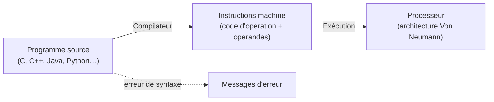

> [!note]
> **Version simple**
> Un **ordinateur** est une machine qui **traite l'information toute seule** : il la reçoit, la range, la transforme, puis la restitue. Son nom (« informatique ») vient de *information* + *automatique*.
> 
> En 1945, **John von Neumann** propose le plan de base qu'on utilise encore : un **processeur** (le cerveau qui calcule), une **mémoire** (où l'on met les programmes ET les données) et des **entrées/sorties** (pour parler au monde extérieur).
> 
> Les programmes que tu écris (C, Python, Java…) ne sont pas compris tels quels par la machine : un **compilateur** les traduit en **instructions** que le processeur sait exécuter.

---

# Version détaillée

## 1. Objectifs du cours (R1.03)

Comprendre :

- de quoi est composé un ordinateur (microprocesseur, mémoires, disque dur…) ;
- quels sont les modèles sous-jacents au fonctionnement d'une machine ;
- comment s'exécutent des programmes sur un ordinateur ;
- quel est le lien entre le logiciel et le matériel ;
- comment se fait l'interface avec l'extérieur (fonctionnement des divers périphériques).

Format : **7 CM, 7 TD, 3 TP + SAÉ**.

Plan du diaporama : qu'est-ce qu'un ordinateur (architecture de Von Neumann) → types de mémoires → fonctionnement d'un processeur → représentation de l'information.

## 2. Qu'est-ce qu'un ordinateur ?

> [!note]
> Un ordinateur est une **machine de traitement de l'information**.

Il sait réaliser quatre opérations :

1. **acquisition** de l'information ;
2. **stockage** de l'information ;
3. **transformation** de l'information par son traitement ;
4. **restitution** de l'information.

Deux grandes familles d'informations :

- les **données** : texte, nombres, son, images ;
- les **instructions** qui composent un programme.

Le mot **informatique** est la contraction de *information* et *automatique*.

### Récapitulatif : décortiquer la définition

| Mot | Sens |
| --- | --- |
| Machine | technologie (électronique, mécanique…) |
| Traitement | opérations |
| Automatique | autonome (sans intervention humaine à chaque étape) |
| Information | connaissance sur quelque chose ou quelqu'un |

## 3. Les différentes « vues » d'un ordinateur

On peut regarder un ordinateur sous trois angles :

- la vue **service** (ce qu'il rend à l'utilisateur) ;
- la vue **fonctionnelle** (quelles fonctions, quelles unités) ;
- la vue **matérielle** (les composants physiques).

## 4. Architecture de Von Neumann (1903-1957)

- L'**architecture** d'un système à microprocesseur = l'**organisation de ses unités + leurs interconnexions**.
- Un microprocesseur seul ne suffit pas : il faut l'insérer dans un **système de traitement de l'information**.
- **1945** : John Von Neumann propose l'architecture interne d'une **machine universelle** de traitement de l'information, composée de :
	- le **microprocesseur** (unité centrale de traitement = **CPU**) ;
	- une **mémoire principale (MP)** qui contient les **instructions et les données** pendant l'exécution d'un programme ;
	- des **interfaces d'E/S** pour communiquer avec l'extérieur.
- Le choix d'une architecture est toujours **le résultat d'un compromis** :
	- entre performances et coûts ;
	- entre efficacité et facilité de construction ;
	- entre performances d'ensemble et facilité de programmation.

> Pour l'origine historique de cette architecture, voir l'annexe **First Draft of a Report on the EDVAC (Von Neumann, 1945)** dans le dossier Annexes.

## 5. Le matériel

- Un ordinateur est constitué de plusieurs parties : souris, écran, clavier, **unité centrale**, etc.
- À l'intérieur de l'unité centrale : une **carte mère**, une **carte vidéo**, des **disques**.
- Sur la carte mère : un **microprocesseur**, de la **mémoire** (ROM, RAM)…
- Dans le microprocesseur : la **puce**.

> TP1 (annexe) : identifier les composants d'une carte mère (question 3).

## 6. Du programme à son exécution : la compilation

- Pour écrire un programme, on utilise un **langage de programmation** (C, C++, Java, Python…) avec une **syntaxe** (caractères spéciaux, noms de variables…) et une **grammaire** très précises, par exemple `if (condition) …`.
- La machine, elle, ne comprend que des **instructions** = **code d'opération + opérandes**.
	- **Opérande** : donnée, quantité ou valeur entrant dans une opération arithmétique ou logique (la valeur utilisée dans un traitement).
- Il faut donc **traduire** le programme en instructions : c'est le rôle du **compilateur**.
- Quand il ne peut pas traduire, il **indique des erreurs**.

