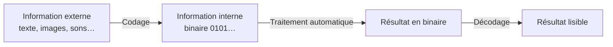

> [!note]
> **Version simple**
> Une machine ne comprend que **0 et 1** (deux niveaux électriques). Tout ce qu'on lui donne (nombres, lettres, images, sons) doit donc être **codé en binaire**, puis **décodé** pour nous être montré.
> 
> - Les **entiers positifs** s'écrivent en base 2 (et en hexadécimal pour que ce soit lisible par les humains).
> - Les **entiers négatifs** utilisent le **complément à 2** : on garde la moitié des combinaisons pour les négatifs, et l'addition marche toujours.
> - Les **caractères** utilisent une table : ASCII (vieux, 128 caractères) puis **Unicode / UTF-8** (tous les alphabets du monde).
> 
> Un **octet = 8 bits**, et un **mot** fait 8, 16, 32 ou 64 bits selon le processeur.

---

# Version détaillée

## 1. Principe : coder, traiter, décoder

**À la main** : les informations sont les données du problème et les résultats ; le traitement passe des données aux résultats par une méthode quelconque.

**Par une machine** :

1. **Codage** : on représente les données dans un langage compréhensible par la machine (par exemple le binaire) ;
2. **Traitement automatique** : la machine produit les résultats dans le même type de représentation (la méthode doit donc être connue) ;
3. **Décodage** : on retransforme ces informations en une forme lisible (texte, image…).

- **Information externe** (manipulée en Système, R1.04) : formats multiples (textes, images, sons), acquise par des micros, capteurs, scanners.
- **Information interne** (manipulée en R1.03) : binaire 0101… ; il faut des **unités d'échange** qui transforment l'information en binaire.

## 2. Choix de la représentation

- **Langage** : binaire pour des raisons techniques (pas obligatoire).
- **Assignation sémantique** : on associe un mot du langage à chaque information (choix arbitraire), par ex. `MOV = 110011`, `INT = 001100`.
- **Non-ambiguïté** : un mot ne peut pas désigner plusieurs informations. Contre-exemple : `MOV = 0`, `INT = 00` → que veut dire `000` ? (MOV puis INT, INT puis MOV, ou 3 MOV ?)
- L'assignation est arbitraire, mais mieux vaut choisir celle qui **facilite les traitements** :
	- **caractères** : codes standards respectant l'ordre alphabétique (UTF) ;
	- **nombres** : faciliter les opérations arithmétiques et mathématiques ;
	- **autres informations** : au cas par cas, parfois plusieurs représentations selon les opérations (ex. les couleurs, voir TP2).

## 3. Deux niveaux physiques

- Un processeur = un ensemble de composants (quelques centaines de milliers de transistors par composant) qui fonctionnent selon **deux états logiques, 0 et 1** (logique binaire).
- Ils correspondent à **deux niveaux électriques** : 0 et +5 V ou +3,3 V.
- Une information logique (0/1) peut représenter des chiffres, des nombres (entiers, réels), des caractères, des chaînes de caractères.
- Autres possibilités de codage (extension du binaire) : hexadécimal, binaire, UTF…

## 4. Systèmes de numération

Un système de numération est un ensemble de règles permettant de représenter les nombres. On utilise principalement :

| Système | Symboles |
| --- | --- |
| Décimal (base 10) | 0 1 2 3 4 5 6 7 8 9 |
| Binaire (base 2) | 0 et 1 (un chiffre = un **bit**, *binary digit*) |
| Hexadécimal (base 16) | 0-9 puis A B C D E F |

Par convention, un nombre s'écrit par **juxtaposition de chiffres**, chacun ayant un **poids égal à une puissance de la base**. Les chiffres s'écrivent de gauche à droite par poids décroissant ; le poids dépend donc du **rang** du chiffre et de la base.

Exemple : `1010` en base 2 = 1×8 + 0×4 + 1×2 + 0×1 = 8 + 2 = **10**.

### Entiers naturels en binaire

Un entier N s'écrit `an-1 … a1 a0` avec chaque `ai` valant 0 ou 1, et

$$
N = a_{n-1}\cdot 2^{n-1} + \dots + a_1\cdot 2 + a_0
$$

Les opérations classiques fonctionnent bien.

| Décimal | 0 | 1 | 2 | 3 | 4 | 5 | 6 | 7 | 8 | 9 |
| --- | --- | --- | --- | --- | --- | --- | --- | --- | --- | --- |
| Binaire (4 bits) | 0000 | 0001 | 0010 | 0011 | 0100 | 0101 | 0110 | 0111 | 1000 | 1001 |

> Blague du cours : « dans le monde, il y a 10 catégories de personnes : celles qui connaissent le binaire et celles qui ne le connaissent pas. »

### L'hexadécimal

Il permet une **représentation simplifiée des nombres binaires, à l'usage des humains** : 1 chiffre hexa = 4 bits. Exemple : `1101 1001` = `D9`.

## 5. Taille des nombres : octet et mot

- Les ordinateurs travaillent sur un **nombre fixe de bits**.
- **Octet** = 8 bits.
- **Mot** = 8, 16, 32 ou 64 bits (dépend du processeur) :
	- Zilog Z80 → 8 bits ;
	- Intel 80386 et 80486 → 32 bits ;
	- Core i7 → 64 bits ;
	- certaines cartes vidéo → 256, 512 bits, voire plus.
- La **taille des bus** = 1 mot (selon le processeur).

## 6. Entiers relatifs : valeur absolue et complément à 2

Principe : utiliser **la moitié des mots possibles pour les positifs et l'autre moitié pour les négatifs** (sur n bits on a 2ⁿ mots). On cherche une représentation où **la somme d'un nombre et de son opposé donne 0** et où les opérations classiques fonctionnent.

| Méthode | Principe |
| --- | --- |
| **Valeur absolue** | Le bit de poids fort donne le signe (0 positif, 1 négatif), les autres bits donnent la valeur absolue. |
| **Complément à 2** | Un positif s'écrit comme un entier naturel (premier bit à 0). Un négatif N s'écrit comme l'entier naturel 2ⁿ + N (seconde moitié). |

Pour obtenir le complément à 2 d'un nombre :

4. **inverser tous les bits**, puis **ajouter 1** ;
5. ou : **recopier jusqu'au premier 1** (inclus), puis **inverser** les bits suivants.

Exemple sur 4 bits : `+3 = 0011` ; `-3` = inverser → `1100`, +1 → `1101`. Vérification : `0011 + 1101 = 1 0000` → sur 4 bits, le 1 de débordement disparaît, il reste **0**.

Conséquence : autant de possibilités qu'avant, mais **la valeur maximale est divisée par 2** : sur n bits, de −2ⁿ⁻¹ à 2ⁿ⁻¹ − 1.

### Réels

Notation scientifique : **mantisse et exposant**, soit 2 entiers relatifs. Mais les opérations ne sont pas simples.

> Utilité de savoir compter : le cours donne un exemple en C/C++ (débordement d'entiers). Voir aussi TP1 questions 14 et 15 (annexe).

## 7. Représentation des caractères

- **ASCII** : 7 bits + 1 bit de parité, 128 combinaisons (*American Standard Code for Information Interchange*).
- **EBCDIC** : 8 bits, 256 caractères, utilisé principalement par IBM.
- **ANSI** : utilisé par certains logiciels (Windows), ASCII + extensions multilingues pour les alphabets occidentaux.
- **Mojibakes** : phrases où des caractères sont remplacés par d'autres sans rapport. C'est un problème d'**encodage / décodage** : celui qui écrit utilise une norme différente de celui qui lit.
- **Unicode** : créé pour coder les textes quel que soit le système d'écriture. C'est une **table de correspondance caractère → code** (*charset*) ; **UTF-8** en est l'**encodage** (*encoding*) le plus répandu.
	- UTF-8 : 1 à 4 octets ;
	- UTF-16 : 2 ou 4 octets ;
	- UTF-32 : 4 octets.

> Le fichier annexe **Table UTF-8** donne le détail : l'ASCII standard = codes sur 1 octet de l'UTF-8 (premier bit toujours 0) ; les caractères accentués sont codés sur 2 octets dont le premier est `11000011`.

## 8. Retour sur la machine de Turing (diapos 17-18)

Pour concevoir une machine automatique de traitement de l'information, la théorie dit : la **machine de Turing** (Alan Turing, 1912-1954) est une machine théorique qui peut calculer de façon autonome **tout ce qui est calculable**. Il suffit donc de concevoir une machine qui sait faire **au moins l'équivalent** (elle peut faire plus). Von Neumann propose une architecture simple équivalente : le problème est résolu.

Tout n'est pas calculable (**Kurt Gödel**, 1906-1978, théorème d'incomplétude) : un système logique suffisamment puissant pour décrire l'arithmétique des entiers admet des propositions ni démontrables ni réfutables, dites **indécidables**.

Description d'une machine de Turing :

- un **ruban infini** divisé en cases, chaque case contenant un symbole d'un alphabet fini (avec un « symbole blanc ») ;
- une **tête de lecture/écriture** qui lit/écrit un symbole et se déplace à gauche ou à droite ;
- un **registre d'état** (nombre d'états fini, avec un état de départ) ;
- une **table d'actions** : selon le symbole lu et l'état courant, quoi écrire, comment déplacer la tête et quel est le nouvel état.

Les limites dues au matériel (coût, fiabilité, taille limitée, temps de traitement…) ne s'évitent pas : on cherche à les **minimiser**.

> Annexes liées : **Turing 1936**, **Décidabilité / problème de correspondance de Post**, **TP2 – Couleurs**.