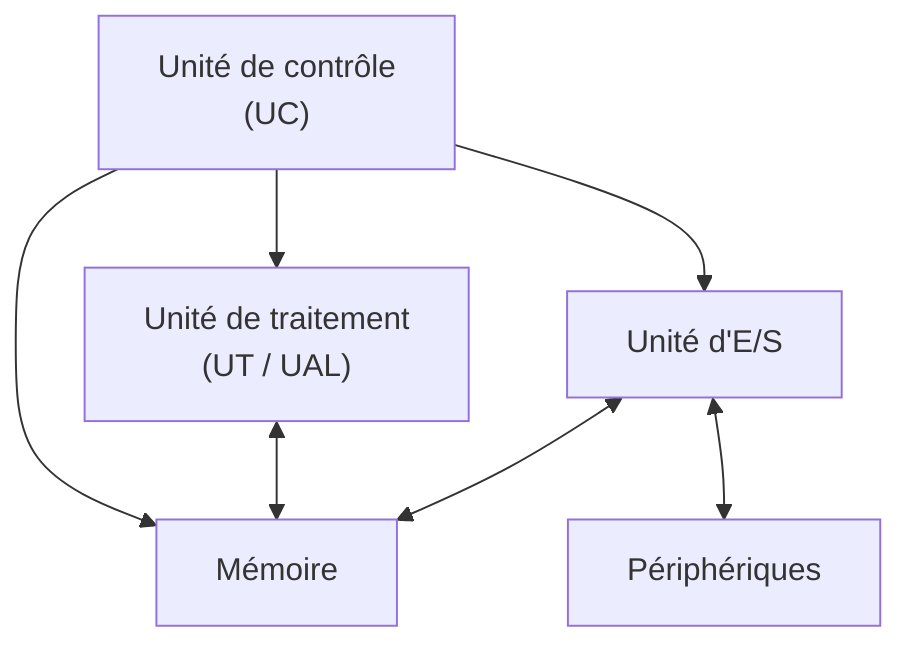
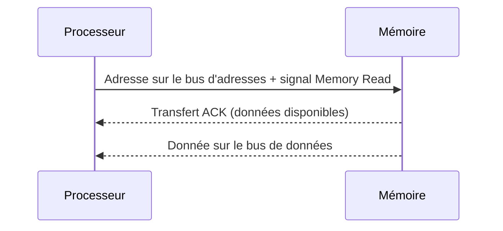

> [!note]
> **Version simple**
> L'ordinateur de Von Neumann = **4 unités** reliées par des **bus** (des « fils ») :
> 
> - l'**unité de traitement** (UT) qui fait les calculs ;
> - l'**unité de contrôle** (UC) qui donne les ordres (chapitre 5) ;
> - la **mémoire** qui stocke tout (chapitre 4) ;
> - l'**unité d'entrées/sorties** (E/S) qui gère les périphériques : disques, clavier, écran, réseau…
> 
> Les **bus** transportent les adresses, les données et les signaux de contrôle. Quand un composant est plus lent qu'un autre, on utilise un **buffer** (une file d'attente) et des **accusés de réception** (handshaking).

---

# Version détaillée

## 1. L'unité de traitement (UT)

- **Rôle** : effectuer les opérations sur les informations.
- La machine de Turing peut calculer tout ce qui est calculable ; les opérations qu'elle sait faire (il y en a très peu) sont donc **suffisantes** pour un ordinateur. Il suffit que l'UT sache faire au moins l'équivalent ; en général elle sait en faire beaucoup plus, pour être plus efficace et plus rapide.
- L'**assignation sémantique** est choisie pour faciliter les opérations : entiers naturels en base 2, relatifs en complément à 2, réels en notation scientifique (mantisse + exposant), caractères dans l'ordre alphabétique…
- **Opérations implémentées** :
	- arithmétiques (`+ - * /`) ;
	- logiques (ET, OU, NON, OU exclusif) ;
	- décalages (logiques, arithmétiques, cycliques) ;
	- comparaisons (`=`, `≠`, `<`, `>`, `≥`…) ;
	- mathématiques (sin, log…) ;
	- vectorielles.
- **Fonctionnement** : les opérandes sont placés dans les registres `OP1` et `OP2` (un registre = une mémoire ne contenant qu'une information), on envoie la commande d'opération, le résultat arrive dans le registre `Res`. Le registre `état` indique le résultat si l'opération est une comparaison, ou les erreurs sinon (ex. division par 0).

### L'unité centrale de traitement (UC) – vue d'ensemble

| Rôle | Composition |
| --- | --- |
| Exécute les programmes en mémoire centrale ; cycle de chargement, décodage et exécution des instructions ; stocke les résultats intermédiaires dans des registres | **Registres** (mémorisation temporaire), **UAL** (opérations), **unité de commande** (orchestre), **bus** (communication des résultats), **jeu d'instructions** |

## 2. L'unité d'entrées/sorties (E/S)

- **Pilote les périphériques**. Son architecture dépend beaucoup des périphériques.
- Il existe des **standards de connexion** (USB, HDMI, SATA…). Parfois il faut des **extensions** de l'UE/S (cartes spécialisées).

### Périphériques de stockage

| Technologie | Principe | Particularités |
| --- | --- | --- |
| **Optique** (CD/DVD) | Un laser éclaire le disque, un capteur mesure la lumière réfléchie ; un trou = pas de lumière réfléchie ; la gravure se fait en faisant des trous au laser | Mécanique (usure, fragilité) |
| **Magnétique** (disque dur) | Revêtement magnétique ; un capteur lit les orientations du champ ; l'enregistrement crée un champ magnétique | Mécanique, supports peu chers au regard de la capacité |
| **Charges électriques** (flash, carte SD, SSD) | Des charges sont piégées dans la puce ; lecture par le champ électrique créé ; écriture par un champ qui piège des charges ; **effacement nécessaire avant écriture** | Pas de mécanique : plus rapide mais plus cher à capacité égale |

**Solutions mixtes** : disque magnétique + disque SSD (plus petit) ; le système d'exploitation copie sur le SSD les fichiers les plus utilisés.

### Périphériques d'entrée/sortie

Transmission d'informations dans un sens ou dans les deux : clavier (touches appuyées/lâchées), souris (déplacements x/y + boutons), imprimante (caractères + codes de commande), scanner (pixels), caméra (pixels ou vidéos encodées MP4…), **écran** (le plus complexe).

### Cartes graphiques

- L'écran est le périphérique qui demande le plus de calculs (3D, jeux…).
- Autrefois on dotait l'unité de traitement d'opérations spécialisées ; la solution la plus efficace est de doter l'UE/S de sa **propre unité de traitement : le GPU** (*Graphics Processing Unit*).
- Les GPU sont très spécialisés (calcul vectoriel et matriciel : translations, rotations…) et très performants, de l'ordre de **500 milliards d'opérations/s**.

### Périphériques de communication

- Transmission **bit par bit** ; **débit** = nombre de bits par seconde (de quelques centaines de milliers à quelques milliards).
- **Protocoles** : ajout d'informations de balisage, de contrôle, de correction d'erreurs…
- Supports : fil, onde, fibre optique, infrarouge.
- Exemples : Ethernet, Wifi, Bluetooth, USB, HDMI, FireWire…

## 3. Les bus

Un bus = un ensemble de « fils » (50 à 100) connectant des unités fonctionnelles.

| Bus | Contenu | Sens |
| --- | --- | --- |
| **Bus d'adresses** | Adresses mémoire auxquelles le processeur veut accéder (lire ou écrire) | Unidirectionnel |
| **Bus de données** | Instructions et données depuis ou vers le processeur | Bidirectionnel |
| **Bus de contrôle** | Ordres et signaux de synchronisation de l'unité de commande vers tous les composants (et signaux de réponse) | Directionnel (aller + réponses) |

Deux grands bus sur un ordinateur :

- le **bus système** (interne, *front-side bus* FSB) : le processeur communique avec la mémoire centrale (RAM) ;
- le **bus d'extension** (bus d'E/S) : les composants de la carte mère (USB, série, parallèle, cartes PCI, disques durs…) communiquent entre eux, et on peut ajouter des périphériques via des connecteurs d'extension (*slots*).

### Exemples de débits

**PCI-Express (bus interne/local, 100 MHz)** :

| Génération | x1 | x4 | x8 | x16 |
| --- | --- | --- | --- | --- |
| PCIe 1.1 | 250 Mo/s | 1 Go/s | 2 Go/s | 4 Go/s |
| PCIe 2.0 | 500 Mo/s | 2 Go/s | 4 Go/s | 8 Go/s |
| PCIe 3.0 | 1 Go/s | 4 Go/s | 8 Go/s | 16 Go/s |
| PCIe 4.0 | 2 Go/s | 8 Go/s | 16 Go/s | 32 Go/s |
| PCIe 5.0 | 4 Go/s | 16 Go/s | 32 Go/s | 64 Go/s |
| PCIe 6.0 | 8 Go/s | 32 Go/s | 64 Go/s | 128 Go/s |

**Bus externe** (connexion carte mère / contrôleur disque) : USB 1.0 : 1,5 Mbit/s ; USB 1.1 : 12 Mbit/s ; USB 2.0 : 480 Mbit/s ; USB 3.0 : 4,8 Gbit/s.

### Fonctionnement d'un bus : lecture d'un mot en mémoire

- **Memory Read** : le processeur signale qu'il a placé l'adresse sur la ligne.
- **Transfert ACK** : la mémoire répond que les données sont disponibles.

## 4. Handshaking et buffering

Les transferts de données d'E/S sont de deux types :

- **Boucle ouverte** : les données sont transférées et leur réception correcte est *supposée* après un certain délai (ex. le service de mail). Généralement suffisant.
- **Boucle fermée** : il y a **accusé de réception** (*acknowledgement*) (ex. la procédure d'approche d'un aéroport).

**Bufferisation des E/S** : le temps de traitement des interfaces pose problème : si l'interface est rapide, il faut maintenir les données ; si elle est lente, on perd du temps à y accéder (exemple du temps d'attente chez le médecin). Solution : un **buffer d'interface = une FIFO** (dont il faut déterminer la taille). *Buffering* = stockage des données avant leur utilisation.

> Annexe **TP1 – Architecture** : questions 1 à 5 (schéma Von Neumann, schéma du PC, carte mère, calcul de débits des bus mémoire et périphériques). La correction des calculs de débit est dans la page de l'annexe.