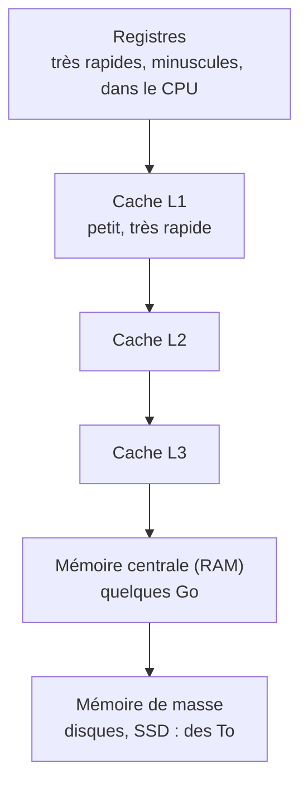
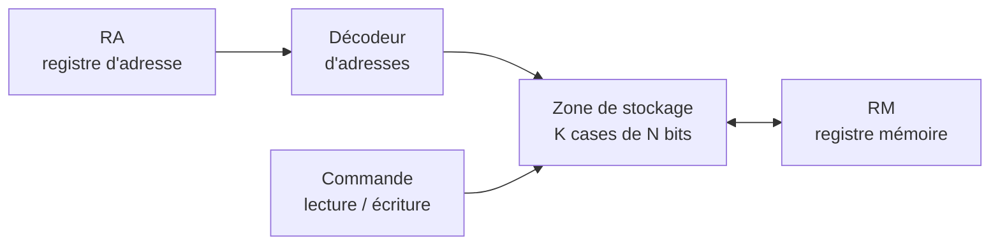

> [!note]
> **Version simple**
> La **mémoire** est un grand tableau de cases numérotées : le numéro d'une case est son **adresse**. Pour **lire**, on donne une adresse et on récupère une **copie** du contenu ; pour **écrire**, on donne l'adresse et la valeur, et l'ancienne valeur est **écrasée**.
> 
> La mémoire idéale (infinie, instantanée) n'existe pas : on utilise donc une **hiérarchie** (registres → caches L1/L2/L3 → RAM → disque). Le **cache** est une petite mémoire très rapide qui contient une copie de ce dont on a besoin en ce moment ; quand il est plein, on remplace les données les moins utiles (LRU ou LFU).

---

# Version détaillée

## 1. Cahier des charges

- On doit pouvoir **stocker** des informations, les **conserver** et les **retrouver**.
- Quelles informations ? Toutes celles manipulées : données du problème, résultats intermédiaires, résultats finaux (et les instructions du programme).
- La **mémoire centrale** mémorise les programmes utilisateurs et le système d'exploitation ; sa taille est aujourd'hui de quelques Go (4, 8, 16, voire 32 Go sur un PC) ; elle est sur une carte mémoire et communique avec le processeur via les bus de données et d'adresses.
- **Cellule** : chaque cellule est numérotée (adresse). Les mémoires sont généralement **adressables par octets** ; taille d'une cellule : octet = 8 bits (*byte*), *word* = 16 bits, *double word* = 32 bits, *quad word* = 64 bits (selon les machines).

## 2. Types de mémoire

| Type | Description |
| --- | --- |
| **Registres** | Mémoire non permanente interne au CPU. Registre mot (registre d'instruction) : 32 ou 64 bits. Registre adresse (compteur ordinal) : contient l'adresse d'un mot. |
| **Mémoire cache** | Stocke les données récemment accédées ; quelques centaines de Ko à quelques Mo mais rapide ; interne ou externe au CPU ; entre le CPU et la RAM (ou un disque, ou un autre cache). |
| **Mémoire centrale / principale (MP)** | Mémoire à semi-conducteurs : mémoire vive (RAM) et mémoire morte (ROM) et dérivées (PROM, EPROM…). |
| **Mémoire de masse** | Permanente, secondaire ou auxiliaire ; grande capacité : magnétique (disques durs), optique (CD, DVD, Blu-ray), électrique (flash). |

## 3. Capacité et temps d'accès

- **Mot mémoire** (*word*) : nombre de bits pouvant être lus ou écrits simultanément par le processeur (32 bits autrefois, 64 aujourd'hui).
- **Capacité** : nombre de bits (registres) ou d'octets que la mémoire peut contenir. Unités : **Ko = 1024 octets, Mo = 1024 Ko, Go = 1024 Mo, To = 1024 Go**. Exemples : 1 à 2 To pour des disques durs internes, 4 Go pour certaines RAM.
- **Temps d'accès** :
	- disque dur : environ **10 ms** (HDD) ; SSD : **70 à 300 µs** ;
	- mémoire : de l'ordre de la **nanoseconde** (10⁻⁹ s) ;
	- registre : environ **10 fois plus court** que le temps d'accès mémoire.
- **Cycle mémoire** : temps minimal entre 2 accès mémoire. **Débit** : nombre d'informations lues ou écrites par seconde.
- Exemple de calcul : une mémoire centrale de **1 Méga-mots de 16 bits** = 1 × 1024 × 1024 × 2 octets × 8 = **16 777 216 bits**.

## 4. Mémoire adressable : principe

- Les informations sont représentées en binaire, au **format fixe** (plus simple, c'est du matériel) : ce sont des mots de **N bits** (le plus souvent 64 bits : 2⁶⁴ ≈ 18 milliards de milliards). Si cela ne suffit pas, on découpe sur k × N bits (plus long).
- Une zone peut contenir **K informations** (K registres). Pour les **retrouver** :
	- balayer les K informations (**mémoire associative**, utilisée dans des cas très particuliers : recherche par modèle, ex. commence par 0110 et finit par 0000) ;
	- ou savoir **où** elle est : son **adresse** (**mémoire adressable**, plus simple et plus rapide, c'est celle retenue).
- Les adresses sont en binaire de taille fixe **t** telle que **2ᵗ ≥ K**. La taille des adresses dépend du **nombre** d'informations, pas de leur taille. Exemple : 1000 informations → adresses sur 10 bits (2¹⁰ ≥ 1000).
- On fabrique des mémoires dont le nombre d'informations est une puissance de 2 : K = 2¹⁰ ≈ 1000 ; M = 2²⁰ ≈ 1 million ; G = 2³⁰ ≈ 1 milliard (ordre de grandeur pour les mémoires d'ordinateur) ; T = 2⁴⁰ ≈ 1000 milliards (disques).
- L'adresse est mise dans un registre (**RA**, registre d'adresse) et traitée par un **décodeur d'adresses (DA)** qui l'associe à la position de l'information (association unique). L'information lue ou à écrire passe par le **registre RM** (registre mémoire), le même pour lire et écrire puisqu'on ne fait jamais les deux en même temps.

### Lecture

1. Mettre l'adresse dans **RA** ;
2. le décodeur d'adresses associe l'adresse à la position de l'information ;
3. donner l'ordre de **lecture** à la mémoire ;
4. la mémoire **copie** l'information dans **RM** ;
5. récupérer l'information dans RM.

### Écriture

6. Mettre l'adresse dans **RA** ;
7. le décodeur associe l'adresse à la position ;
8. mettre l'information à écrire dans **RM** ;
9. donner l'ordre d'**écriture** ;
10. la mémoire **remplace** l'information stockée à cette position par celle de RM.

### Conséquences pour la programmation

- Chaque information doit être désignée par une **adresse unique** : toute variable doit avoir un **nom** (le nom = l'adresse, associé à un contenu).
- Quand on **lit**, on récupère une **copie** (l'original reste) : utiliser la valeur d'une variable ne la perd pas (`a ← x` ne modifie pas x).
- Quand on **écrit**, l'ancienne valeur est **remplacée** : `a ← x` perd l'ancienne valeur de a.

## 5. Caractéristiques d'une mémoire

- **Capacité** = K × N / 8 octets. Exemple : 2³⁰ (1 Giga) informations de 64 bits = **8 Go**. Un PC de 8 Go ne contient qu'1 G informations (de 8 octets).
- **Opérations possibles** :

| Type | Lecture / écriture |
| --- | --- |
| **ROM** (*Read Only Memory*) | Lecture seule, informations stockées à la construction |
| **PROM** (*Programmable ROM*) | Lecture seule, écriture **une seule fois** par un dispositif spécial |
| **EPROM / EEPROM / Flash** | Lecture, écriture après effacement (UV pour EPROM, électrique pour EEPROM) : clés USB, cartes SD |
| **RAM** (*Random Access Memory*) | Lue et écrite autant de fois qu'on veut : celle des ordinateurs |

- **Volatilité** : toujours conservées (ROM, PROM, Flash, EPROM/EEPROM) ; tant que sous tension (RAM) ; très peu de temps, quelques ms (**DRAM**, qui doit être réécrite à intervalles réguliers, celle de nos ordinateurs). Sous-types de RAM : **SRAM** (statique), **DRAM** (dynamique), **SDRAM** (dynamique synchrone).
- **Vitesse** : un accès comprend 2 étapes (décodage de l'adresse, puis copie dans RM). Le décodage est bien plus long ; si on accède à des **adresses consécutives**, on ne le fait qu'une fois, ensuite le décodeur passe à l'information suivante.
- **Prix** : dépend de la capacité et surtout de la technologie/vitesse (une RAM de 8 Go peut coûter de 30 € à 120 € selon sa vitesse). La DRAM (DDR4) est moins chère à produire, très intégrée (grande capacité, faible encombrement et consommation) et rapide : c'est pourquoi on l'utilise.

## 6. Hiérarchie des mémoires et cache

- **Machine idéale** : mémoire illimitée, temps d'attente nul → n'existe pas. Problème de coût → **hiérarchie de mémoires**, optimisée par le gestionnaire de mémoire.
- Le temps d'une mémoire est surtout lié au **décodage d'adresse** : plus la mémoire est grande, plus l'adresse est grande et plus c'est long ; un registre n'a pas d'adresse et est très rapide. On sait fabriquer des mémoires de petite taille (quelques dizaines de Ko) très rapides, mais elles sont **très chères**.
- Pendant l'exécution d'un programme, on n'utilise à un instant donné que de **toutes petites parties** de la mémoire (instructions en cours, informations à traiter, zone des résultats). **Idée** : copier ces parties dans une petite mémoire rapide (l'**antimémoire** ou **cache**). On perd du temps à copier mais on en gagne ensuite ; ça vaut le coup si le temps perdu est faible devant le temps gagné.

### Gestion du cache

- Au départ le cache est vide ; on y met ce dont on a besoin ; il est vite plein (petit) ; il faut **remplacer**. Si les informations remplacées ont été **modifiées**, il faut d'abord les recopier en mémoire.
- Un remplacement = (1) choisir la zone à libérer, (2) la recopier du cache vers la mémoire, (3) copier les nouvelles informations de la mémoire vers le cache.
- **Choisir la zone à libérer** :
	- **LFU** (*Least Frequently Used*) : la moins souvent utilisée (on constate le présent) ;
	- **LRU** (*Least Recently Used*) : celle qui n'a pas été utilisée depuis le plus longtemps (on mise sur le futur).
	- Pas de réponse théorique ; en pratique les deux se valent.
- **Transferts** : par **blocs** d'adresses consécutives (quelques centaines d'octets), à grande vitesse (plusieurs Go/s). Si un bloc n'a pas été modifié (instructions, tableau seulement parcouru), on évite la copie cache → mémoire.

### Niveaux de cache

L'idéal (cache grand ET très rapide) est trop cher : on utilise des **caches de caches**.

- **L1** : petit mais très rapide, accessible directement par les unités ;
- **L2** : taille moyenne, moins rapide ;
- **L3** : plus grand et encore moins rapide, mais plus rapide que la mémoire.

Si l'information n'est pas en L1, on la cherche en L2, puis en L3, puis en mémoire (rapidement car adresses consécutives).

Au niveau 1, il y a **2 caches** : un pour les **instructions** (jamais besoin de le recopier en mémoire lors d'un remplacement) et un pour les **données**. Les caches L1 et L2 et le **gestionnaire de cache** (qui applique la politique de remplacement) sont dans la même puce que l'UT et l'UC (microprocesseur) ; le L3 peut l'être aussi ou être externe. Un cache peut aussi être un **préchargeur d'instructions** (petit cache d'anticipation).

> Annexe **TP1 – Architecture** : questions 9 à 13 et 16 (DRAM/SRAM, RAM/ROM, shadowing, classement des mémoires, RAID, intérêt du cache).