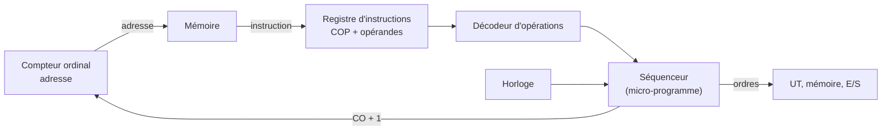

> [!note]
> **Version simple**
> L'**unité de contrôle (UC)** est le chef d'orchestre. Elle va chercher **une instruction** en mémoire, la **décode**, donne les **ordres** aux autres unités, puis passe à l'instruction **suivante** (celle juste après en mémoire). Elle se repère grâce au **compteur ordinal** (l'adresse de l'instruction courante) et suit le rythme d'une **horloge**.
> 
> L'idée géniale (Turing + Von Neumann) : le **programme est rangé dans la mémoire comme n'importe quelle donnée**, donc la même machine peut exécuter n'importe quel programme : elle est **universelle**.

---

# Version détaillée

## 1. Rôle de l'unité de contrôle

- **Piloter les autres unités** pour aboutir au résultat attendu en fonction des informations relatives au problème.
- Elle doit être **autonome** (machine *automatique*).
- Elle dispose de la **mémoire** (stocker/retrouver), de l'**unité de traitement** (traiter) et de l'**unité d'E/S** (collecter les informations et présenter les résultats).

## 2. Retour sur la machine de Turing

- La **bande** sert de **mémoire** et d'**unité d'E/S** (on écrit le problème, on lit le résultat).
- Elle sait : écrire sur la bande, la décaler d'un cran à droite ou à gauche, s'arrêter.
- Une **table de transition** lui dit quoi faire selon son **état actuel** et ce qu'elle **lit**.
- À chaque étape : elle lit, puis selon l'état et le symbole : écrit, décale ou s'arrête, et **change d'état**.
- Une machine de Turing est construite pour **un seul type de problème** (sa table = son programme) ; de même, l'ordinateur d'une voiture (ABS) ne sait faire que doser le freinage. Mais on veut une machine **universelle**.

### Le dialogue imaginaire Von Neumann / Turing

- Von Neumann : l'ordinateur doit être une machine universelle capable de traiter automatiquement des informations.
- Turing : ma machine peut être universelle si on écrit la table de transition **sur la bande** au lieu de la figer à la construction.
- Von Neumann : il suffit donc que l'équivalent de la table (le **programme**) soit mis **dans la mémoire**.
- Remarque : l'**ENIAC** n'était pas universelle : son programme était représenté par des fils qu'il fallait **rebrancher** à chaque programme.

> Annexes liées : **Turing 1936** et **First Draft of a Report on the EDVAC (1945)**.

## 3. L'instruction

**Machine de Turing** : une ligne de la table = *état actuel, caractère lu, caractère à écrire, traitement, état suivant*. Les 2 premiers éléments servent à **trouver** l'instruction, les 3 suivants à l'**exécuter**.

**Machine de Von Neumann** : une instruction indique **quel traitement** sur **quelle(s) information(s)** :

- l'**opération** à faire (réalisable par la mémoire, l'UT ou l'UE/S) ;
- la ou les **informations à traiter** : soit une **valeur fixe** (ex. ajouter 10, codée classiquement), soit une information stockée désignée par son **adresse**.
- Le tout est dans la mémoire : c'est donc un **mot binaire**.

### Format d'instruction

- **Combien d'opérandes ?** Dépend de l'opération, en général 2 (exceptionnellement 3).
- **Taille** : le code d'opération dépend du nombre d'opérations définies (de l'ordre de quelques centaines) ; celle des opérandes dépend des valeurs ou des adresses.
- Si l'instruction tient sur 64 bits : 1 mot mémoire ; sinon on la découpe en N mots (plus lent : N lectures). La plupart tiennent sur un mot, quelques-unes sur plusieurs.
- Le constructeur définit un nombre fini d'instructions et un langage binaire (arbitraire, format fixe ou variable) pour les représenter.

## 4. Démarrage : bootstrap et BIOS

- L'UC cherche l'instruction à faire en mémoire : elle doit connaître son adresse. Au démarrage on prend une **adresse fixe, toujours la même**.
- Or la RAM perd tout quand on l'éteint : il faut une mémoire **ROM ou flash** pour y placer la première instruction.
- Un ordinateur possède donc une mémoire non volatile contenant son programme de démarrage, le **bootstrap**, rôle du **BIOS** (*Basic Input Output System*) :
	1. teste le matériel (mémoire, périphériques utiles) ;
	2. cherche un support (clé USB, disque, CD-ROM ou réseau) où trouver le système d'exploitation ;
	3. copie le **noyau du SE** en mémoire ;
	4. l'exécute.
- Ensuite le SE s'auto-complète (services, pilotes) puis permet, via une interface graphique, de charger et exécuter d'autres programmes.

## 5. Exécution d'une instruction et instruction suivante

Quand l'UC a récupéré l'instruction, elle : (1) **décode** le code d'opération ; (2) envoie les **adresses des opérandes** à la mémoire ; (3) envoie ces informations à l'UT ou à l'UE/S ; puis passe à la suivante.

**Trouver l'instruction suivante** : Turing (selon l'état et le caractère lu, mémoire associative) ; Von Neumann (par adresse, mémoire adressable). Deux solutions : chaque instruction contient l'adresse de la suivante, ou les instructions sont placées à des **adresses consécutives** : c'est la deuxième qui a été choisie. Conséquence : on écrit les instructions **dans l'ordre** (notion de **séquence**, vue en algo).

### Les composants de l'UC

- Le **compteur ordinal (CO)** contient l'adresse de l'instruction ;
- avec cette adresse on lit l'instruction en mémoire et on la met dans le **registre d'instructions (RI)** : `COP | opérandes` ;
- le **code d'opération (COP)** est décodé par le **décodeur d'opérations (DO)** ;
- chaque opération déclenche la séquence prévue dans le **séquenceur** ;
- ces séquences envoient des ordres aux autres unités ;
- le rythme est donné par une **horloge** ;
- à la fin, le compteur ordinal est **incrémenté** et on recommence.

## 6. Traduction des structures de contrôle

Les structures algorithmiques sont traduites en instructions avec des **ruptures de séquence** (sauts) relatives.

**Alternative** :

| Algorithme | Instruction machine | Opérandes |
| --- | --- | --- |
| `a ← 4` | Affectation | adresse de a, 4 |
| `Si (a < b)` | Comparaison | adresse de a, adresse de b |
|   | Condition ≥ | +4 (saute au Sinon) |
| `a ← a + 1` | Incrémenter | adresse de a |
| `b ← b − 1` | Décrémenter | adresse de b |
| `Sinon` | Sans condition | +2 (saute le Sinon) |
| `a ← 10` | Affectation | adresse de a, 10 |
| `b ← 2 * b` | Multiplication | adresse de b, 2 |

**Boucle** `Tant que (a < b)` : comparaison, condition ≥ (+4 : sortie de la boucle), corps (incrémenter a, décrémenter b), puis **Sans condition −4** (retour à la comparaison).

## 7. Le séquenceur et l'horloge

- À chaque code d'opération correspond une suite fixe d'ordres (**micro-programme**) définie par le constructeur.
- Exemple d'une **addition** : (1) envoyer l'adresse du 1er opérande à la mémoire ; (2) ordre de lecture ; (3) récupérer dans le registre mémoire et envoyer dans OP1 de l'UT ; (4) idem pour l'opérande 2 ; (5) ordre d'addition à l'UT ; (6) récupérer le résultat dans le registre de résultats.
- Ces opérations se font **dans l'ordre**, certaines peuvent être simultanées, et il faut respecter les **temps** (on ne lit pas le résultat avant que l'UT ait fini).
- C'est le rôle de l'**horloge** : plus elle va vite, plus l'ordinateur va vite, mais pas plus vite que ce que supportent les unités et la mémoire (**overclocking**). De plus la **consommation électrique croît comme le carré de la vitesse** : ça chauffe vite !

## 8. RISC ou CISC (première approche)

- Au début les UC étaient simples, avec peu d'instructions ; puis on a augmenté leur nombre (**CISC**, *Complex Instruction Set Computer*).
- On s'est aperçu que beaucoup d'instructions ne servaient quasiment jamais (compilateurs) ; on a donc réduit le jeu d'instructions (**RISC**, *Reduced*) et mis la complexité de l'électronique au service de la **vitesse**.

## 9. Vitesse

- 1ers microprocesseurs (**1971**) : horloge à **1 MHz**, 2 à 4 cycles par instruction (≈ **300 000 instructions/s**).
- Aujourd'hui : horloges de **3 à 5 GHz** (3 à 5000 fois plus) et souvent moins d'un cycle par instruction ; jusqu'à **30 milliards d'instructions/s**, soit une vitesse multipliée par 100 000 (dont 5000 dus à l'horloge).
- Certains traitements (éclairage d'une scène 3D) demandent malgré tout d'énormes quantités d'opérations.

## 10. Modes d'adressage des opérandes

On peut désigner un opérande par sa **valeur**, son **adresse**, ou n'importe quoi qui permette d'obtenir son adresse, par exemple une adresse qui désigne un mot mémoire contenant l'adresse de l'opérande (**indirect**). Cela permet d'adapter les instructions aux structures de données (tableaux, pointeurs…) et de mettre en place des mécanismes de sécurité pour les SE (protéger certaines adresses).

## 11. Récapitulatif : l'architecture de Von Neumann

- Seulement **4 unités** (UC, UT, UE/S et mémoire).
- **Tout est dans la mémoire** (informations et instructions).
- L'UC enchaîne automatiquement les instructions en séquence (compteur ordinal) ; des instructions spéciales permettent les **ruptures de séquence** (boucles, alternatives).
- L'UT sait faire au moins les opérations de la machine de Turing → l'ordinateur est une machine automatique de traitement **universelle**.
- Tout ce qui est calculable peut l'être, mais c'est limité par : le **temps de calcul**, la **taille de la mémoire**, la capacité d'**écrire le programme**.
- **Conséquence** : les instructions sont des informations comme les autres, donc un programme peut **modifier ses propres instructions** (virus) ou **fabriquer de nouvelles instructions** exécutées par le même ordinateur (**compilateur**) ou par un autre (**compilation croisée**).

> Annexes liées : **Notions sur la machine analytique de Babbage (Menabrea, 1842)** (cartes perforées, « moulin » et « magasin » avant l'heure), **The Computer and the Brain** (contrôle mémorisé), TP1 questions 7 à 8 (où sont effectués les calculs ? séquenceur et ordonnanceur).