> [!note]
> **Version simple**
> Le **processeur** est une **puce de silicium** contenant des milliards de transistors (loi de Moore). Pour aller plus vite sans augmenter indéfiniment la fréquence (ça chauffe), on a empilé des astuces :
> 
> - le **pipeline** (travailler à la chaîne : pendant qu'une instruction s'exécute, on prépare la suivante) ;
> - le **parallélisme** (plusieurs unités de calcul, architecture **superscalaire**) ;
> - la **prédiction de branchement** (deviner quel chemin prendra un `si`) ;
> - les **caches** ;
> - plus tard, les **multicœurs** (chapitre 7).
> 
> On compare deux grandes philosophies : **CISC** (beaucoup d'instructions complexes) et **RISC** (peu d'instructions simples, câblées, rapides). Les performances se mesurent avec des **benchmarks** (MIPS, MFlops, SPEC).

---

# Version détaillée

## 1. La puce et sa fabrication

- Une **puce** est un carré de **silicium** constitué de millions de transistors. L'intégration suit la **loi de Moore** : aujourd'hui **50 milliards de transistors par processeur**.
- **Fabrication** :
	1. le silicium (sable : après l'oxygène, le constituant le plus répandu sur Terre) ;
	2. un barreau de silicium fabriqué dans un four à très haute température ;
	3. un **wafer** (disque de silicium) de 30 cm de diamètre ; le silicium est un **semi-conducteur** (certaines parties peuvent être plus ou moins conductrices) ;
	4. dépôt de couches de substrat : produit photosensible, zones imprimées par ultraviolets, acide pour le décapage, dépôt d'impuretés pour créer la connectivité ;
	5. création de transistors interconnectés : plusieurs puces par wafer ;
	6. découpage de la puce et tests ;
	7. mise en boîtier et connexion des pattes avec les points de contact : la puce devient un **microprocesseur** (densité de plusieurs centaines de millions de transistors/mm²).
- **Exemple** : l'Apple A11 Bionic = 4,3 milliards de transistors, 1 869 565 fois plus que le premier microprocesseur, l'Intel 4004. S'il était encore gravé à 10 µm il couvrirait la surface d'un grand salon ; gravé à 10 nm il mesure moins de 90 mm².
- Plus c'est **gravé fin**, plus ça peut aller vite et consommer moins… mais plus ça **chauffe** → **stagnation des fréquences**.

## 2. Le pipeline

Principe : découper l'exécution d'une instruction en étapes, chaque étape étant faite par un étage différent, pour que **plusieurs instructions soient en cours en même temps** (recouvrement).

```mermaid
gantt
    title Pipeline à 3 étages (idée générale)
    dateFormat X
    axisFormat %s
    section Instruction 1
    Chercher :a1, 0, 1
    Décoder :a2, 1, 2
    Exécuter :a3, 2, 3
    section Instruction 2
    Chercher :b1, 1, 2
    Décoder :b2, 2, 3
    Exécuter :b3, 3, 4
    section Instruction 3
    Chercher :c1, 2, 3
    Décoder :c2, 3, 4
    Exécuter :c3, 4, 5
```

**Utilité** : adapté aux **calculs répétitifs** (même opération sur de nombreuses informations) : calcul vectoriel ou matriciel, traitement d'images, de vidéo, de son. Mais ça ne résout pas le cas des calculs non répétitifs.

## 3. Parallélisme, hyperthreading, superscalaire

- **Parallélisme** : mettre **plusieurs unités de calcul en parallèle** ; on peut faire plusieurs traitements en même temps s'ils sont **indépendants** (l'un n'utilise pas le résultat de l'autre). On en met une dizaine, pas toutes identiques : les opérations les plus utilisées sont sur toutes, les autres sur quelques-unes. Un **distributeur** envoie chaque opération à la première unité libre capable de la faire ; le résultat d'une unité peut servir d'opérande à une autre.
- **Hyperthreading (HT)** = **SMT** (*Simultaneous Multi Threading*) à deux voies : chaque cœur reçoit des instructions 2 par 2 (1 par thread) ; les deux threads partagent registres, cache, pipeline et bus ; un système de contrôle gère les deadlocks. Il existe du SMT à 4 voies (supercalculateurs, serveurs). Gains de **rien à 20 %**, option désactivable dans le BIOS (+30 % d'énergie).
- **Superscalaire** : on envoie **plusieurs instructions au cours d'un même cycle d'horloge**, toutes issues **d'un seul programme**. Différent du **multicœur** où **plusieurs flux d'instructions** s'exécutent simultanément ; chaque cœur peut lui-même être superscalaire.

## 4. Prédiction de branchement

- Le dispositif de recherche d'instructions va chercher des instructions dans le cache pour les mettre dans une **file d'attente** et passe à la suivante (adresse + 1). Mais pour une **rupture de séquence conditionnelle**, la suivante peut être à l'adresse N : comment le savoir ?
- **Première approche** : en général on passe plus souvent dans le *si* que dans le *sinon*, et quand il y a une boucle on boucle. Donc un **saut en avant (+N) n'aura pas lieu**, un **saut en arrière (−N) aura lieu**.
- Si la prédiction est fausse : il faut **vider la file** et la re-remplir à la bonne adresse (perte de temps). Plus la prédiction est bonne, moins on en perd.
- **Prédiction améliorée** : le dispositif a une **mémoire** des résultats réels des ruptures de séquence déjà vues : la première fois il utilise le signe de N, ensuite il utilise ce qui s'est réellement passé. Ça diminue beaucoup les mauvaises prédictions pour un programme « normal ».

## 5. Principe des caches (rappel)

Le cache est une mémoire ultra-rapide qui évite les **états d'attente** : 6 à 15 ns de temps d'accès contre 60 ns pour la mémoire vive. C'est de la **SRAM** (statique) : conserve les données sans rafraîchissement. Il sert de **tampon** entre RAM et processeur : si le processeur a de nouveau besoin des mêmes données (ce qui est fréquent), il les obtient bien plus vite. Vue d'ensemble : un processeur **superscalaire** (2 niveaux) + un cache (3 niveaux).

## 6. Vue fonctionnelle d'une puce

| Unité | Rôle |
| --- | --- |
| **BIU** (*Bus Interface Unit*) | Les informations arrivent de la RAM dans la puce par le bus |
| **CC / DC** | Cache de code / cache de données |
| **BPU** | Unité de prédiction de branchement : chemin optimum |
| **RU** | Station de réservation et buffer de réordonnancement : ordre d'exécution le plus efficace |
| **EU** | Unité d'exécution : exécute les opérations et rend les résultats dans le cache de données |
| **FPU** | Unité de virgule flottante : opérations arithmétiques sur les réels |

Le cache de données transfère ses résultats vers la BIU, qui les transmet à la RAM. **Améliorations continues** : prévision de branchement, analyse du flot de données, **exécution spéculative** ; amélioration du transfert processeur-mémoire (bus plus larges, interface DRAM, caches, bande passante) et des entrées/sorties.

## 7. Cas pratique : le Core i7

Critères pour différencier les processeurs : le **jeu d'instructions**, le **nombre de bits** (32 ou 64), la **vitesse de l'horloge** (cycles/s), le **nombre de cœurs**, le **nombre de transistors**, la puissance (> 700 MIPS).

- **QPI** (*Quick Path Interconnect*) : bus inventé par Intel qui interconnecte les cœurs entre eux et au chipset ; il vise à **remplacer le FSB**. Avec le FSB, toutes les requêtes passent par lui (débit max 12,8 Go/s sur un seul canal) et par le **NorthBridge** (mémoire, carte graphique) et le **SouthBridge** (USB, clavier, ethernet, SATA…). QPI est un bus à **deux voies** : lecture et écriture simultanées.
- **Turbo Boost** (*overclocking automatique*) : gère l'utilisation des cœurs selon la charge ; évite d'utiliser plusieurs cœurs quand un seul suffit ; peut augmenter la fréquence d'un cœur « à la volée » sans affecter les autres.

## 8. Évolution des architectures : du CISC au RISC

|   | **CISC** | **RISC** |
| --- | --- | --- |
| Jeu d'instructions | Complexe | Réduit |
| Programmes | Plus courts, moins de place mémoire | Plus longs (le compilateur décompose les instructions complexes) |
| Temps d'exécution | Variable d'une instruction à l'autre ; la vitesse doit s'aligner sur le temps maximal | **Constant** pour chaque instruction |
| Taille des instructions | Variable | Constante |
| Microcode | Oui (micro-instructions : transforme les instructions en opérations élémentaires ; augmente la surface de silicium, d'où des défauts) | **Supprimé** : instructions câblées |
| Registres et adressage | — | Adressage simplifié, **multiplication des registres internes** |

Le RISC a été développé par **IBM à partir de 1975**, freiné au début par le prix des mémoires (code plus volumineux) ; des travaux parallèles sur les compilateurs l'ont soutenu. Tendances : multiplication des unités d'exécution, usage intensif des caches, branchements prédictifs.

## 9. Évaluation des performances

- Pour l'utilisateur, **performance = temps d'exécution**, difficile à évaluer car cela dépend de la vitesse du microprocesseur, du temps de réponse de la mémoire et des entrées/sorties.
- **Benchmarks** : programmes de test valables sur toutes les machines (problème de représentativité). **SPEC** (*System Performance Evaluation Cooperative*) : consortium de constructeurs, standards communs de test → **SPECmark**.
- Unités : **MIPS** (million d'instructions par seconde), **MFlops** (million d'opérations flottantes par seconde). Problème : le calcul des MIPS dépend du constructeur et des jeux d'instructions, donc non comparable. Ce sont des **indicateurs théoriques** ; pour choisir une machine, on lance des benchmarks avec les programmes types qu'on va utiliser.
- **Systèmes temps réel** (critiques : alarme dans une centrale nucléaire, décrochage d'un A310) : un dépassement de temps = danger. L'évaluation doit être précise : benchmarks, analyse statique des programmes, simulation.

> Annexe **TP1 – Architecture** : question 17 (que prédit la loi de Moore ?).