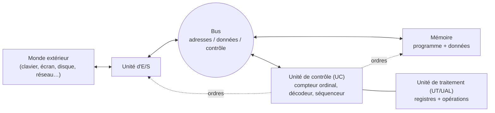

> [!note]
> **R1.03 – Introduction à l'architecture des ordinateurs**
> IUT de Bayonne et du Pays Basque – BUT Informatique – Philippe Roose, Nathalie Vallès – 7 CM, 7 TD, 3 TP + SAÉ
> 
> Objectif : comprendre de quoi est composé un ordinateur (microprocesseur, mémoires, disque dur…), quels sont les modèles sous-jacents à son fonctionnement, comment s'exécutent les programmes, quel est le lien entre logiciel et matériel, et comment se fait l'interface avec l'extérieur (périphériques).

## Plan du cours

Le **diaporama principal (177 diapos)** est le cours. Une sous-page par chapitre, chacune avec une **version simple** d'abord, puis la **version détaillée**. Les documents annexes (TP, articles historiques, table UTF-8…) sont dans le dossier **📎 Annexes** et sont reliés aux chapitres concernés.

1. Introduction : qu'est-ce qu'un ordinateur ? (diapos 1 à 12)
2. Représentation de l'information (diapos 13 à 33)
3. Architecture de Von Neumann : unité de traitement, E/S, bus (diapos 34 à 54)
4. La mémoire et le cache (diapos 55 à 97)
5. L'unité de contrôle et l'exécution des instructions (diapos 98 à 124)
6. Le processeur : fabrication, pipeline, parallélisme, CISC/RISC (diapos 125 à 156)
7. Évolutions de l'architecture : multicœurs et supercalculateurs (diapos 157 à 172)
8. Codage des images, des vidéos et identification d'objets (diapos 173 à 177)

## Le grand schéma à retenir

> Idée centrale du cours : **tout est dans la mémoire** (données ET instructions) et l'UC enchaîne automatiquement les instructions. C'est ce qui rend l'ordinateur « universel ».

## Fil conducteur : de la machine de Turing à l'ordinateur

- Turing (1936) : une machine théorique capable de calculer tout ce qui est calculable.
- Von Neumann (1945) : une architecture simple équivalente à cette machine, avec le **programme stocké en mémoire**.
- Le reste du cours = comment cette idée est réalisée concrètement (binaire, mémoire, cache, pipeline, multicœurs…).

[[1 – Introduction  qu'est-ce qu'un ordinateur]]

[[2 – Représentation de l'information]]

[[3 – Architecture de Von Neumann  unité de traitement, E-S, bus]]

[[4 – La mémoire et le cache]]

[[5 – L'unité de contrôle et l'exécution des instructions]]

[[6 – Le processeur  fabrication, pipeline, parallélisme, CISC-RISC]]

[[7 – Évolutions de l'architecture  multicœurs et supercalculateurs]]

[[8 – Codage des images, des vidéos et identification d'objets]]

[[Annexes]]