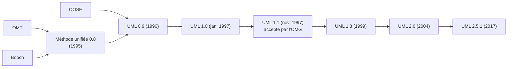
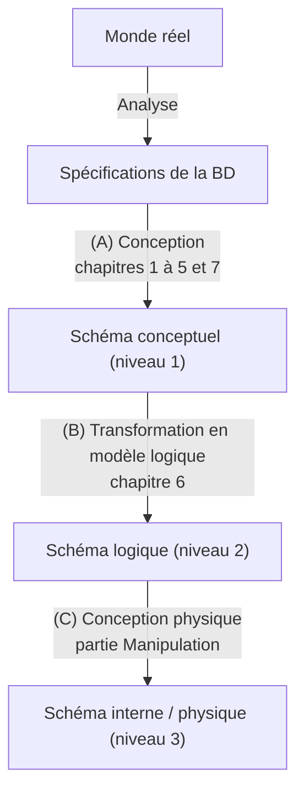
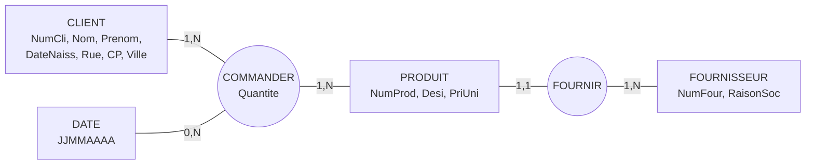

> [!note]
> **Version simple**
> Une **base de données (BD)**, c'est un endroit où on range des informations de façon organisée pour pouvoir les retrouver et les modifier facilement. Le logiciel qui la gère s'appelle un **SGBD**, et on lui parle avec le langage **SQL**.
> 
> Avant de créer une BD, on la **dessine** (comme un architecte fait un plan avant de construire) en 3 étapes :
> 
> 1. **Conceptuel** : on décrit *quoi* stocker (entités, liens), sans penser à l'ordinateur.
> 2. **Logique** : on traduit en tables (modèle relationnel).
> 3. **Physique** : on écrit le code SQL pour un SGBD précis (MySQL, Oracle…).

---

# Version détaillée

## 1. Qu'est-ce qu'une base de données ?

- **Définition 1.1 – Base de données** : ensemble organisé d'informations avec un objectif commun. Peu importe le support (papier, fichiers…) dès lors que les données sont rassemblées de manière organisée dans un but précis. Plus précisément : un ensemble structuré permettant de stocker de grandes quantités d'informations pour faciliter leur exploitation (ajout, mise à jour, recherche).
- **Définition 1.2 – BD informatisée** : ensemble structuré et cohérent de données **enregistrées sur des supports accessibles par l'ordinateur**, représentant des informations du monde réel, interrogeables et modifiables par des utilisateurs et/ou plusieurs applications en parallèle, de façon optimale.
- **Définition 1.3 – BD relationnelle** : BD structurée suivant les principes du **modèle relationnel**.

## 2. SGBD et SQL

- **SGBD** (DBMS en anglais) : logiciel(s) assurant la **structuration, le stockage, la consultation, la mise à jour et la maintenance** des données d'une BD relationnelle. Exemples : **Oracle**, MySQL, PostgreSQL, MS SQL Server…
- **SQL** (*Structured Query Language*) : langage normalisé permettant la **définition, la manipulation, l'interrogation et le contrôle** d'une BD relationnelle.

**Exemples d'applications** : gestion du personnel / des étudiants / des inscriptions, réservation de places d'avion ou de train, comptes clients des banques, lignes de bus et cartographie, e-commerce, gestion de production et de vente.

## 3. Modélisation et Modèle Conceptuel de Données (MCD)

- **Modélisation** = produire un **modèle** (un objet d'imitation pour reproduire quelque chose). Ici : modéliser les **données d'un Système d'Information (SI)** qui seront stockées dans une BD.
- Objectif : décrire le SI et ses données **sans référence à une solution informatique particulière** → *modélisation conceptuelle*.

> [!note]
> Le **MCD** : décrit de façon formelle les données et leurs liens, sans tenir compte des choix d'organisation, d'automatisation ou techniques. Il précise les choix de gestion (signification des invariants, structure, liens). Il exprime le **QUOI** sur les données. C'est une *image invariante* du SI en termes de données.

**Deux formalismes** couramment utilisés pour le MCD :

- le modèle **Entité-Association** de **Merise** (et ses dérivés) ;
- le **diagramme de classes d'UML**.

Ils fournissent les **concepts** et les **règles d'utilisation** pour décrire les données sous forme d'un **modèle / schéma de niveau conceptuel**.

> **MCD** = une **abstraction** (modèle abstrait). **SCD** (Schéma Conceptuel des Données, sous forme de schéma E/A ou de diagramme de classes) = une **instance** possible, un modèle **concret** du MCD.

## 4. Un peu d'histoire

### Merise, modèle E/A et SQL

| Date | Événement |
| --- | --- |
| 1970 | Modèle relationnel de Codd |
| Années 70 | Premiers prototypes de SQL |
| 1974-78 | Le noyau de MERISE est établi par une équipe d'ingénieurs et chercheurs aixois |
| 1976 | Modèle Entité-Relation de Peter Chen (et Entité-Association de P. Moulin puis H. Tardieu) |
| 1978 | Développement de MERISE, méthode française de conception de SI, sous l'égide du ministère de l'industrie |
| 1979 | Première version de **SQL** (ORACLE) |
| 1983-1989 | La méthode MERISE, tomes 1 à 3 |
| 1986-1989 | SQL ANSI puis SQL-1 (ISO et ANSI) |
| 1992 | SQL-2 ; ingénierie des SI : MERISE (Nanci, Espinasse) |
| Fin années 90 | PHP-MySQL |
| 1999 | SQL-3 |
| 2001 | MERISE encore la méthode de conception de SI la plus pratiquée en France |

**MERISE** = *Méthode d'Etude et de Réalisation Informatique pour les Systèmes d'Entreprise*. Le modèle E/A est né en France au début des années 70 (Moulin et al.), mais la paternité est attribuée à l'Américain Peter **Chen** (modèle « Entité-Relation »).

### UML

**UML** (*Unified Modeling Language*) est né de la **fusion** de trois méthodes objet des années 90 : **OMT, Booch et OOSE**. Des acteurs industriels (IBM, Microsoft, Oracle, DEC, HP, Rational, Unisys…) proposent UML 1.0 à l'**OMG** (*Object Management Group*) qui l'accepte en novembre 1997 (version 1.1). UML 2.0 approuvé en 2004 ; version en cours : **UML 2.5.1 (décembre 2017)**.

UML = langage standardisé de modélisation des logiciels : **14 types de diagrammes** (7 structurels + 7 comportementaux). Le **diagramme de classes** fait partie des diagrammes structurels (statiques).



## 5. Conception d'une BD : modélisation à 3 niveaux

| Niveau | Modèle | Rôle |
| --- | --- | --- |
| 1 – Conceptuel | MCD (Merise E/A ou UML) | Organisation des données, dégagée des contraintes de mise en œuvre. **Indépendant d'un SGBD.** |
| 2 – Logique | Modèle relationnel | Transcription (dérivation) du MCD dans un formalisme adapté à l'implantation. Modèle mathématique définissant des relations et des opérations dessus : origine des BD relationnelles. |
| 3 – Physique | SQL du SGBD choisi | Façon dont les données sont effectivement stockées. **Spécifique à un SGBD** (Oracle, MySQL, PostgreSQL, MS SQL Server…). |



Le concepteur passe du monde réel au schéma conceptuel (1), le traduit en schéma logique (2) puis le crée avec le **LDD** (Langage de Définition de Données). Les utilisateurs manipulent ensuite la BD avec le **LMD** (Langage de Manipulation de Données).

## 6. Fil rouge : clients, produits, fournisseurs

**Spécifications**

- Les **clients** : numéro de client, nom, prénom, date de naissance, rue, code postal, ville.
- Ils **commandent** des produits à une date donnée et en une quantité donnée.
- Les **produits** : numéro, désignation, prix unitaire.
- Chaque produit est **fourni** par **un fournisseur unique** (un fournisseur peut fournir plusieurs produits).
- Les **fournisseurs** : numéro, raison sociale.

### Niveau 1 : schéma Entité/Association (MCD Merise)



Principaux concepts du niveau 1 : type/classe d'entité, type/classe d'association, propriétés, cardinalités, identifiant. Chaque schéma doit être complété par une **description textuelle** : dictionnaire des données, règles de gestion, tout commentaire pertinent.

### Niveau 2 : schéma relationnel (modèle logique)

```plain text
CLIENT      (num, nom, prenom, dateNaiss, rue, CP, ville)
FOURNISSEUR (num, raisonSoc)
PRODUIT     (num, desi, priUni, #numFour)
COMMANDE    (#numCli, #numProd, dateCommande, quantite)
```

Concepts du niveau logique : relation, attribut, clé primaire, clé étrangère, domaine. À compléter aussi par dictionnaire de données, règles de gestion, commentaires.

### Niveau 3 : script SQL (modèle physique)

```sql
CREATE TABLE CLIENT (
  num INTEGER PRIMARY KEY,
  nom VARCHAR(30) NOT NULL,
  prenom VARCHAR(30),
  dateNaiss DATE,
  rue VARCHAR(50) NOT NULL,
  CP VARCHAR(5) NOT NULL,
  ville VARCHAR(20) NOT NULL,
  CONSTRAINT date_ok CHECK (dateNaiss < CURDATE())
);
CREATE TABLE FOURNISSEUR (
  num INTEGER PRIMARY KEY,
  raisonSoc VARCHAR(30) NOT NULL UNIQUE
);
CREATE TABLE PRODUIT (
  num INTEGER PRIMARY KEY,
  desi VARCHAR(30) NOT NULL UNIQUE,
  priUni FLOAT NOT NULL,
  numFour INTEGER NOT NULL,
  FOREIGN KEY (numFour) REFERENCES FOURNISSEUR(num),
  CONSTRAINT prix_ok CHECK (priUni > 0 AND priUni <= 10000)
);
CREATE TABLE COMMANDE (
  numCli INTEGER NOT NULL,
  numProd INTEGER NOT NULL,
  dateCommande DATE NOT NULL,
  quantite INTEGER,
  CONSTRAINT quantite_ok CHECK (quantite > 0),
  PRIMARY KEY (numCli, numProd, dateCommande),
  FOREIGN KEY (numCli) REFERENCES CLIENT(num),
  FOREIGN KEY (numProd) REFERENCES PRODUIT(num)
);
```

Principaux concepts du niveau physique : table, attribut/champ, clé primaire/étrangère, contrainte, requêtes SQL de création, insertion, interrogation. But : créer et remplir la structure de BD pour conserver les données aussi longtemps que nécessaire, les interroger et les mettre à jour.

## 7. Pourquoi un Schéma Conceptuel (niveau 1) ?

- Donne une **description concise** des données, associations et contraintes grâce aux concepts d'un modèle de haut niveau (abstrait).
- Permet de se concentrer sur les **spécifications** des données sans se soucier du stockage.
- Facilite la **communication** avec les utilisateurs et acteurs du projet (pas de détails d'implémentation).
- Doit être **validé** : toutes les opérations de haut niveau identifiées doivent pouvoir être spécifiées et les besoins fonctionnels satisfaits.