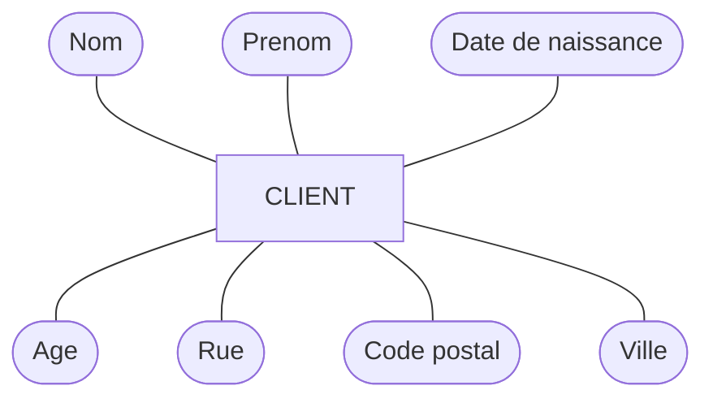
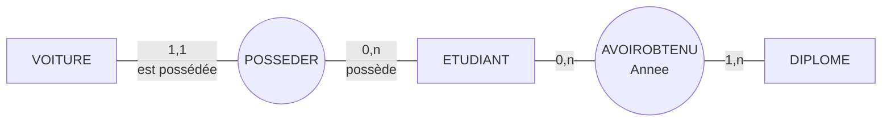
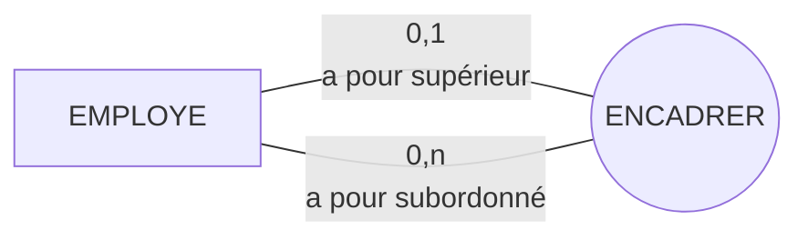
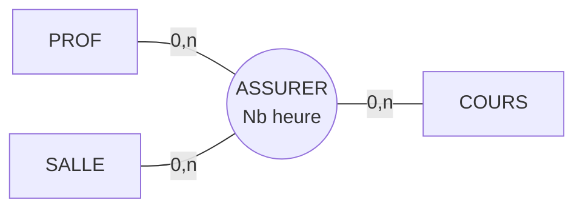
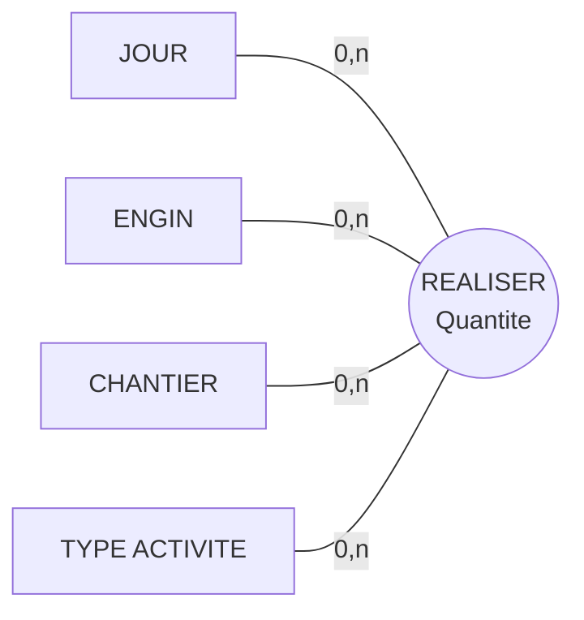
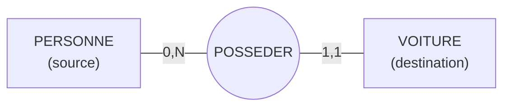

> [!note]
> **Version simple**
> Le modèle **Entité-Association** décrit le monde avec 5 briques :
> 
> - **Entité** : une « chose » (l'étudiant Etcheverry, une voiture).
> - **Association** : un lien entre des choses (l'étudiant *possède* la voiture).
> - **Propriété** : une caractéristique (la couleur de la voiture).
> - **Identifiant** : ce qui permet de distinguer chaque entité (un numéro unique).
> - **Cardinalité** : combien de fois, au minimum et au maximum, une entité peut participer à un lien (`0,1` `0,N` `1,1` `1,N`).
> 
> On dessine ensuite des rectangles (entités) reliés à des ovales (associations).

---

# Version détaillée

## II.1 Introduction

- **E/A** = Entité-Association (en anglais **E/R**, *Entity-Relationship*). Autres noms : formalisme Individu-Relation, Entity-Relationship [Chen 76], Entité-Relation.
- C'est un **modèle conceptuel** conçu dans les années 1970, qui permet de construire un **schéma conceptuel des données** avec une **représentation graphique**.

## II.2 Entités, associations et propriétés

- **Entité** : individu ou objet de l'univers du discours, concret ou abstrait, qui possède une existence intrinsèque et une certaine stabilité permettant de le repérer au cours du temps. *Ex : l'étudiant ETCHEVERRY, la voiture immatriculée 4030 NM 64, le diplôme DUT.*
- **Association** : regroupement d'entités dans lequel chaque entité joue un rôle précis. *Ex : ETCHEVERRY possède la voiture 4030 NM 64 ; MARTIN et LURO ont obtenu le DUT (en 1982 et 1985).*
- **Propriété** : caractéristique d'une entité ou d'une association. *Ex : le département de naissance d'ETCHEVERRY est 64 ; la couleur de la voiture est rouge ; l'année d'obtention du DUT par MARTIN est 1982.* Une propriété = **un nom + une valeur** appartenant à un **domaine** (défini dans le dictionnaire de données).

## II.3 Types d'entité et types de propriété

- **Type (ou classe) d'entité** : ensemble d'entités définies par un même ensemble de types de propriété, jouant un rôle identique, et représentant une classe naturelle d'objets. *Ex : PERSONNE, ETUDIANT, VOITURE, DIPLOME, CLIENT.*
- **Type de propriété** (ou type d'attribut) : nom d'une caractéristique associée à un type d'entité ou à un type d'association. *Ex : le département de naissance des étudiants, l'année d'obtention des diplômes.*
- Un type d'entité est décrit par : un **nom**, une **liste de types de propriété**, une **définition** précisant sa signification dans la BD.

### Les 3 sortes de types de propriété

| Sorte | Définition | Exemple |
| --- | --- | --- |
| **Simple / atomique** | Non divisible | Nom |
| **Composée / complexe** | Subdivisée en types simples | Adresse = Rue + Code postal + Ville + Pays |
| **Dérivée** | Valeur calculée | Âge, calculé à partir de la date de naissance |

> [!warning]
> **Privilégier les types de propriété simples !**

## II.4 Types d'association

- **Type (ou classe) d'association** : ensemble d'associations entre plusieurs types d'entité, ayant la même sémantique (mêmes caractéristiques). *Ex : POSSEDER entre ETUDIANT et VOITURE ; AVOIROBTENU entre ETUDIANT et DIPLOME.*
- Décrit par : un **nom** et une liste de types d'entité (pas forcément distincts) avec leurs **rôles**, ex. `Posseder(est possedée : VOITURE, possède : ETUDIANT)` ; et une **description** de sa signification.
- Une association peut avoir ses **propres propriétés**.

**Propriétés portées par une association** :

- un étudiant a obtenu un diplôme lors d'une **année** donnée ;
- une commande d'un produit par un client concerne une certaine **quantité** ;
- un professeur donne un cours dans une salle durant un **nombre d'heures**.

### Dimension d'un type d'association

La **dimension** = nombre de « pattes » de l'association.

- **Binaire** (dim. 2), **ternaire** (dim. 3), **n-aire** (dim. n). Le cas le plus fréquent : binaire.
- **Réflexif / récursif** : met en jeu au moins deux fois le **même** type d'entité.

*Association binaire réflexive (dimension 2).*

*Association ternaire (dimension 3).*

*Association quaternaire (dim. 4). Exemple d'occurrence : le 15/01/2009, le bulldozer F324 a réalisé sur le chantier C024 une activité de déblaiement de 300 m3.*

### Association réflexive / récursive

Matérialise une association entre un type d'entité et **lui-même**. Une occurrence établit un lien entre une occurrence de l'entité et une **autre** occurrence de ce même type. Si l'association est **non symétrique**, il faut faire porter le **rôle** sur chaque segment (ex. « parent de » / « enfant de »).

> [!warning]
> **Conseil de nommage** : donnez des noms **significatifs, courts, sans espace ni caractères accentués** (é, à, è…) ou « exotiques » (ç, °…), même si certains exemples du cours n'en tiennent pas compte.

## II.5 Occurrences

| Concept (type) | Occurrence | Exemple |
| --- | --- | --- |
| Type de propriété | Valeur particulière | *Couleur* → Bleu, Rouge |
| Type d'entité | Entité ou instance | *CLIENT* → Albert Dupont, James West, Marie Martin |
| Type d'association | Lien particulier reliant les occurrences des entités participantes | *HABITER* → (DUPONT René, Charente), (DURAND Paul, Charente) |

## II.6 Identifiants

- **Objectif** : chaque occurrence d'un type d'entité doit pouvoir être repérée de manière **unique et sans ambiguïté**.
- **Identifiant** : un type de propriété ou un **ensemble** de types de propriété dont la valeur permet de distinguer toutes les occurrences. *Ex : numéro de client, numéro INE d'un étudiant, numéro SS.*
- **Notation graphique** : les composants de l'identifiant sont **soulignés**.

### Bien choisir son identifiant

1. Si plusieurs identifiants sont candidats, choisir celui qui **n'est pas composé**.
2. **Ne pas choisir un identifiant pouvant varier** dans le temps (ex. plaque d'immatriculation pour VEHICULE).
3. Si aucun candidat satisfaisant, **en ajouter un** (artificiel, unicité garantie : code, numéro…).

> Problème : comment distinguer plusieurs « Dupont Albert » ? Solution : ajouter une propriété `Numero` (1, 2, 3…).

## II.7 Cardinalités

- **But** : exprimer le nombre **minimum** et **maximum** de participations de chaque occurrence d'entité à une association.
- **Lien** = couple (type d'entité, type d'association) = une « patte ». Chaque lien porte `Cmin,Cmax`.
- Cmin vaut **0 ou 1**, Cmax vaut **1 ou N** (parfois une valeur numérique > 1 : 2, 3…).

| Cardinalité | Signification |
| --- | --- |
| `0,1` | Participe **au maximum une fois** (peut ne pas participer) |
| `0,N` | Peut **ou non** participer, plusieurs fois possible |
| `1,1` | Participe **exactement une fois** |
| `1,N` | Participe **au moins une fois** |

> [!tip]
> **Le calcul des cardinalités se fait par rapport à la table d'occurrences du type d'association.**

### Comment lire une cardinalité ?

- **Lecture en partant de PERSONNE** (`0,N`) : pour une occurrence de PERSONNE, combien d'occurrences dans POSSEDER ? Au minimum 0 (une personne peut ne pas avoir de voiture), au maximum N (propriétaire plusieurs fois). *Autre lecture (association binaire) : une personne possède de 0 à plusieurs voitures.*
- **Lecture en partant de VOITURE** (`1,1`) : pour une occurrence de VOITURE, combien dans POSSEDER ? Exactement 1 : **une voiture a un et un seul propriétaire**.

**Exemple ternaire** (CLIENT, PRODUIT, DATE autour de COMMANDER) :

- CLIENT `1,N` : un client commande de 1 à N fois ;
- PRODUIT `0,N` : un produit est commandé de 0 à N fois ;
- DATE `0,N` : à une date donnée, il y a aucune ou plusieurs commandes.

### Exercice du cours (cardinalités à deviner) – corrigé du diaporama

| Énoncé | Côté 1 | Côté 2 |
| --- | --- | --- |
| Un employé travaille dans un seul département | EMPLOYE `1,1` | DEPARTEMENT `1,N` |
| Une commande est passée par un client | CLIENT `1,N` | COMMANDE `1,1` |
| Un employé peut diriger un département | EMPLOYE `0,1` | DEPARTEMENT `1,1` |
| Une commande contient des produits (avec quantité) | COMMANDE `1,N` | PRODUIT `0,N` |

### Exemple de lecture sur un bibliothèque (abonné / livre)

Pour `ABONNE 0,n — Emprunter (dateEmprunt) — 0,1 LIVRE` : un abonné peut n'avoir emprunté aucun livre ou plusieurs, mais un livre est emprunté au plus par un abonné à la fois (certains abonnés et certains livres n'ont aucun lien dans la table d'occurrences, d'où le 0).