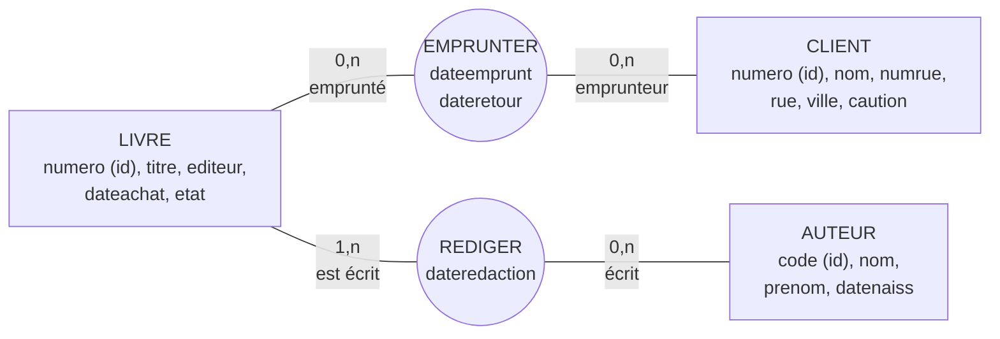

> [!note]
> **Version simple**
> C'est le chapitre « on applique ce qu'on vient d'apprendre ». On lit l'énoncé d'une bibliothèque et on suit une méthode :
> 
> 1. On repère les **objets qui ont une vie propre** → entités (Livre, Auteur, Client).
> 2. On repère leurs **caractéristiques** → propriétés.
> 3. On repère les **liens** → associations (Emprunter, Rédiger).
> 4. On choisit les **identifiants** et les **cardinalités**, puis on justifie tout dans un dictionnaire.

---

# Version détaillée

## Énoncé – Gestion d'une bibliothèque

- Un client qui s'inscrit pour emprunter des livres verse une **caution**. Il aura le droit d'effectuer **10 emprunts au maximum en même temps**.
- Les emprunts durent **au maximum 15 jours**.
- Un livre est caractérisé par son **numéro** dans la bibliothèque (identifiant), son **titre**, son **éditeur** et son (ses) **auteurs**.
- Les auteurs sont caractérisés par leurs **nom, prénom et date de naissance** ; chaque livre est **écrit à une date donnée**.
- Pour chaque client, on veut retrouver les emprunts effectués (nombre, numéro, titre du livre, date de l'emprunt).
- Chaque semaine, on édite la **liste des emprunteurs en retard** : nom et adresse, date de l'emprunt, numéro(s) et titre du ou des livres.
- On veut connaître pour chaque livre sa **date d'achat** et son **état** (emprunté ou non).

## Étape 1 – Trouver les types d'entité

On cherche les objets ayant une **existence propre** et un **intérêt pour au moins un traitement** de l'application.

| Candidat | Retenu ? | Pourquoi |
| --- | --- | --- |
| Livre | Oui | Objet central |
| Auteur | Oui | Caractérisé par nom, prénom, date de naissance |
| Client | Oui | Emprunte des livres |
| Bibliothèque | Non | Il n'y en a qu'une : pas besoin de la modéliser |
| Éditeur | Non | Simple **propriété** de Livre dans cet énoncé |

## Étape 2 – Les types de propriété

- **LIVRE** : `numero` (identifiant), `titre`, `editeur`, `dateachat`, `etat`.
- **AUTEUR** : `nom`, `prenom`, `datenaiss`.
- **CLIENT** : `nom`, `caution`, et l'**adresse**, qui est une propriété *composée* → on la décompose en `numrue`, `rue`, `ville` (on privilégie les propriétés simples).

## Étape 3 – Les types d'association et leurs propriétés

- **EMPRUNTER** (CLIENT ↔ LIVRE) : propriétés `dateemprunt`, `dateretour`. Rôles : *emprunté* (côté livre), *emprunteur* (côté client). Les rôles sont facultatifs.
- **REDIGER** (LIVRE ↔ AUTEUR) : propriété `dateredaction`. Rôles : *est écrit* / *écrit*.
- Les règles « 10 emprunts max » et « 15 jours max » ne se dessinent pas : ce sont des **contraintes** (voir plus bas).

## Étape 4 – Identifiants et cardinalités

- On **ajoute** `code` comme identifiant d'AUTEUR : ni nom, ni prénom, ni date de naissance ne garantissent l'unicité (et on préfère un identifiant non composé).
- On ajoute `numero` comme identifiant de CLIENT.

**Hypothèses retenues pour les cardinalités**

- Un livre a **au moins un** auteur → `1,n` côté LIVRE/REDIGER.
- On enregistre des auteurs pour lesquels la bibliothèque **n'a pas encore acheté de livres** → `0,n` sur la patte AUTEUR/REDIGER.
- On enregistre un client qui **n'a pas encore emprunté** (inscription) → `0,n` sur la patte CLIENT/EMPRUNTER.
- Un livre peut ne jamais avoir été emprunté → `0,n` côté LIVRE/EMPRUNTER.
- Dans cette proposition, un même livre **ne peut pas être emprunté à plusieurs reprises par le même client** (l'identifiant implicite de l'association est le couple client + livre). *Pour autoriser plusieurs emprunts du même livre par le même client, il faudrait historiser avec une dimension DATE (voir chapitre 4).*

## Étape 5 – Dictionnaire de données et commentaires

| Libellé | Signification | Domaine conceptuel | Taille | Contraintes | Exemple |
| --- | --- | --- | --- | --- | --- |
| numero | Numéro de livre | Numérique | 4 | Identifiant unique | 1234 |
| titre | Titre du livre | Alphanumérique | 100 | Obligatoirement renseigné | Frappe-toi le cœur |
| editeur | Éditeur | Alphanumérique | 50 | Obligatoirement renseigné | Albin Michel |
| … |   |   |   |   |   |

En plus du tableau, il faut :

- **justifier l'ajout de propriétés** pour définir les identifiants ;
- **justifier les cardinalités** ;
- lister les **autres contraintes** non représentées graphiquement.

### Contraintes non graphiques de l'exemple

1. Pour chaque occurrence d'EMPRUNTER, si `dateretour` existe, elle doit être **supérieure** à `dateemprunt`.
2. Pour chaque occurrence de LIVRE, `dateachat` doit être **inférieure** à la `dateemprunt` de toutes les occurrences d'EMPRUNTER qui lui sont liées.
3. Un client a le droit d'effectuer **10 emprunts maximum en même temps** → pour une occurrence de CLIENT, il ne peut y avoir au maximum que **10 occurrences d'EMPRUNTER pour lesquelles **`**dateretour**`** n'est pas renseignée**.
4. Les emprunts durent **au maximum 15 jours**.

## Étape 6 – Tables d'occurrences

On dresse un tableau d'occurrences pour **chaque classe d'entité et chaque classe d'association** (LIVRE, AUTEUR, CLIENT, REDIGER, EMPRUNTER) afin de vérifier les propriétés et les cardinalités.