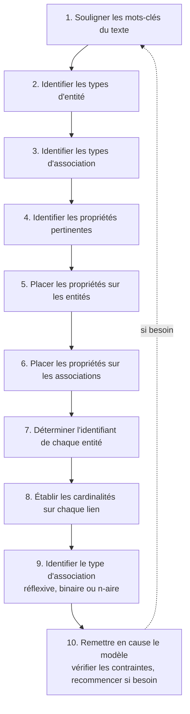
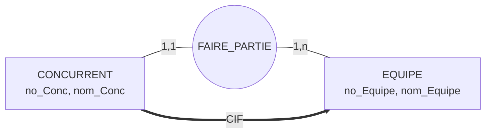
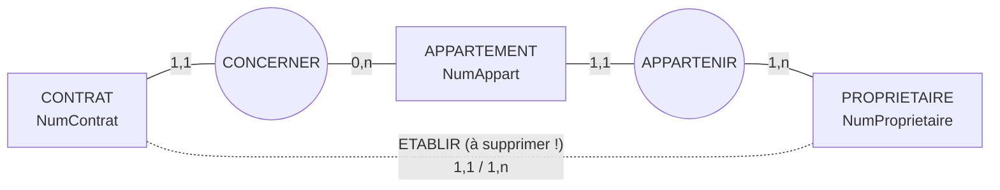
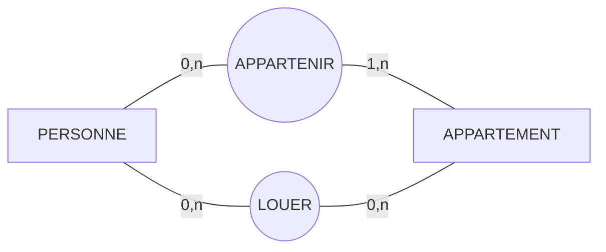
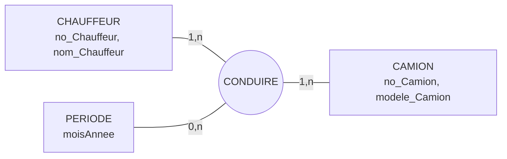
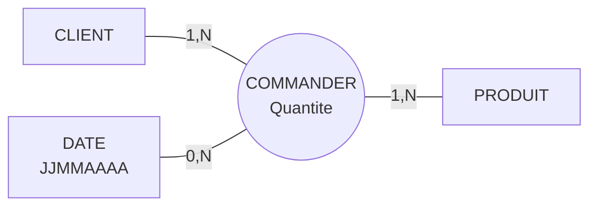

> [!note]
> **Version simple**
> On construit un MCD **à partir du texte de l'énoncé** en suivant 10 étapes (surligner les mots-clés → entités → associations → propriétés → identifiants → cardinalités → vérification). Le résultat doit respecter quelques règles (une entité = au moins une propriété et un seul identifiant, etc.), être accompagné d'un **dictionnaire de données** et de **tables d'occurrences** pour vérifier. Il faut enfin savoir repérer les pièges classiques : associations redondantes (transitives), historisation (une même personne qui fait la même chose à des dates différentes), dates.

---

# Version détaillée

## IV.1 La démarche (méthode descendante)

On part de l'**univers de discours** pour réaliser le schéma. **Attention : il faut traiter le problème selon l'énoncé et non selon ses convictions personnelles.**

## IV.2 Règles de construction (compléments)

- Toute propriété doit être **élémentaire**.
- Un type d'entité possède **au moins une** propriété.
- Pour chaque occurrence d'un type d'entité, **au plus une valeur** par propriété (monovaluée).
- Un type d'entité a **un et un seul identifiant défini**.
- Un type d'entité participe à **au moins une** association.
- Un type d'association **n'a pas d'identifiant propre** : ses occurrences sont identifiées par la **concaténation des identifiants** des entités qu'elle relie (ex. EMPRUNTER → `numeroSecuriteSociale, numeroISBN`).
- Un type d'association peut ne posséder **aucune propriété**.
- Une **cardinalité (min et max) doit être définie sur chaque patte** liant une association et une entité.
- On ne peut pas avoir 2 fois la même propriété pour un même type d'entité / d'association, mais on peut avoir la même propriété (ex. Rue, CP, Ville) sur des entités **distinctes** (CLIENT et FOURNISSEUR).
- Le nom d'un type d'entité doit être **unique** ; idem pour un type d'association.

> Par commodité, « entité », « association », « propriété » peuvent remplacer « type (ou classe) d'entité », « type d'association », « type de propriété ».

## IV.3 Les livrables

- **Schéma Conceptuel de Données** : représentation graphique du résultat de la modélisation.
- **Dictionnaire des données** : toutes les informations du SCD (types d'entité, d'association, de propriété) **+ règles de gestion + commentaires** : explication des cardinalités et hypothèses, dimension des associations, dépendances entre propriétés, toute contrainte non représentable graphiquement.
- **Tables d'occurrences** : confirmer la définition des propriétés et le choix des cardinalités.

### Le tableau du dictionnaire

Chaque type d'entité / d'association possédant des propriétés est détaillé sous forme de tableau d'**au moins 6 colonnes** (dont une divisée en 3, une par niveau conceptuel / logique / physique) :

| Libellé | Signification | Domaine (conceptuel / logique / physique) | Taille | Contraintes | Exemple |
| --- | --- | --- | --- | --- | --- |
| numcli | Numéro de client | numérique | 4 | Identifiant unique | 1234 |
| nom | Nom du client | alphanumérique | 30 | Obligatoirement renseigné | Dupond |
| datenaiss | Date de naissance du client | date |   | Obligatoirement renseigné, inférieure à la date du jour | 01/06/1970 |

**But** : préciser chaque propriété et vérifier la validité des données ; estimer plus tard la place de stockage ; **très important** quand plusieurs personnes travaillent sur une même BD volumineuse.

### Domaine conceptuel (« nature » ou « type »)

Ensemble de définition des valeurs possibles d'une propriété. Aux niveaux logique et physique, on ajoute deux colonnes : *domaine logique* et *domaine physique*.

| Propriété | Domaine / type conceptuel |
| --- | --- |
| Nom d'une personne | Alphanumérique |
| Quantité en stock | Numérique (entier positif) |
| Prix d'un article | Numérique (2 décimales) |
| Sexe | Alphabétique (lettre « M » ou « F ») |
| Date de commande | Date (jour/mois/année) |
| Jour | Alphabétique (liste « Lundi », « Mardi »…) |
| Âge | Numérique (compris entre 0 et 125) |

## IV.4 Exemple et tables d'occurrences

Sur le fil rouge CLIENT / PRODUIT / FOURNISSEUR, une table d'occurrences par entité :

| numcli | nom | prenom | datenaiss | rue | cp | ville |
| --- | --- | --- | --- | --- | --- | --- |
| 1110 | Dupont | Albert | 01/06/1970 | 3 rue des Lilas | 64220 | Saint Jean Pied de Port |
| 2002 | West | James | 03/09/1963 | 33 rue de l'Ouest | 64100 | Bayonne |
| 3333 | Martin | Marie | 05/06/1978 | 68 rue André Malraux | 64200 | Biarritz |
| 5552 | Titgoutte |   | 28/02/1975 | 3 rue Pannecau | 64100 | Bayonne |

Pour une **association**, la table contient en colonnes l'**identifiant de chaque entité participante + les propriétés propres à l'association** :

| COMMANDER : numcli | numprod | jjmmaaaa | quantite |
| --- | --- | --- | --- |
| 1110 | 101 | 22/09/1999 | 1 |
| 1110 | 101 | 02/02/2000 | 1 |
| 3333 | 103 | 22/09/1999 | 2 |
| 3333 | 112 | 22/09/1999 | 5 |

*Remarquez que 1110 commande le produit 101 à deux dates différentes : c'est la dimension DATE qui le permet.*

## IV.5 Dépendances fonctionnelles et CIF

- Une propriété (ou groupe) **X dépend fonctionnellement** de **Y** si, pour une valeur de Y, il correspond **une valeur unique** de X. Notation : `Y → X` (Y détermine X).
- La relation est **transitive** : si `X → Y` et `Y → Z` alors `X → Z`.
- Les propriétés non identifiantes d'une entité dépendent fonctionnellement de l'**identifiant**.
- Une **cardinalité **`**1,1**`** ou **`**0,1**` est la source d'une **dépendance fonctionnelle** : la **CIF** (*Contrainte d'Intégrité Fonctionnelle*).

## IV.6 Association transitive à supprimer

**Association transitive** : toute association pouvant être obtenue par transitivité à partir d'autres associations.

L'association binaire **ETABLIR** entre CONTRAT et PROPRIETAIRE doit être **ôtée** : on retrouve le propriétaire d'un contrat via CONCERNER puis APPARTENIR. On supprime les dépendances transitives pour ne pas surcharger le MCD et pour éviter des **incohérences**.

## IV.7 Associations multiples

Plusieurs associations peuvent lier les mêmes deux types d'entité **à condition que la sémantique soit différente**.

Autre exemple : ETUDIANT et EXAMEN reliés par **reussir** et **passer**.

## IV.8 Historisation et suivi chronologique

Comment gérer la **modification de l'information au cours de la vie du système** ?

### Historisation d'une association

Exemple : CHAUFFEUR – CONDUIRE – CAMION. Un chauffeur se voit attribuer un camion pour une période donnée (un mois calendaire).

**Le schéma avec une simple propriété **`**periode**`** sur CONDUIRE est-il satisfaisant si le même chauffeur peut conduire le même camion sur des périodes différentes ? Non**, car :

- CONDUIRE est binaire : on ne peut enregistrer qu'**une seule fois** une association entre chauffeur_i et camion_j ;
- `periode` est une propriété élémentaire : impossible d'enregistrer plusieurs périodes pour le même couple.

**Solution** : ajouter une **dimension** à l'association en transformant la propriété temporelle en **type d'entité** PERIODE (association ternaire).

### Datation : une date, propriété ou entité ?

- **Date → type de propriété** : si elle est **unique et invariante** dans l'univers du discours (ex. date de naissance d'un client).
- **Date → type d'entité** : si l'association peut se répéter à des dates différentes. Exemple : un même client peut commander le même produit à des dates différentes ; chaque occurrence de la binaire COMMANDER correspond à un lien **unique** entre un client et un produit → le schéma avec une propriété `DateCommande` **ne convient pas**. On crée l'entité DATE :

Les clients commandent des produits à une date donnée et en une quantité donnée : **la quantité commandée dépend du produit, du client et de la date**.

> [!note]
> **Remarque** : le type d'entité DATE n'existe qu'au niveau conceptuel. Lors du passage au schéma relationnel, il n'a **pas de traduction en relation** comme tout autre type d'entité (la date devient un attribut de la relation COMMANDE, voir chapitre 6).