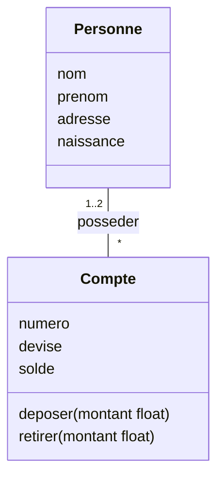
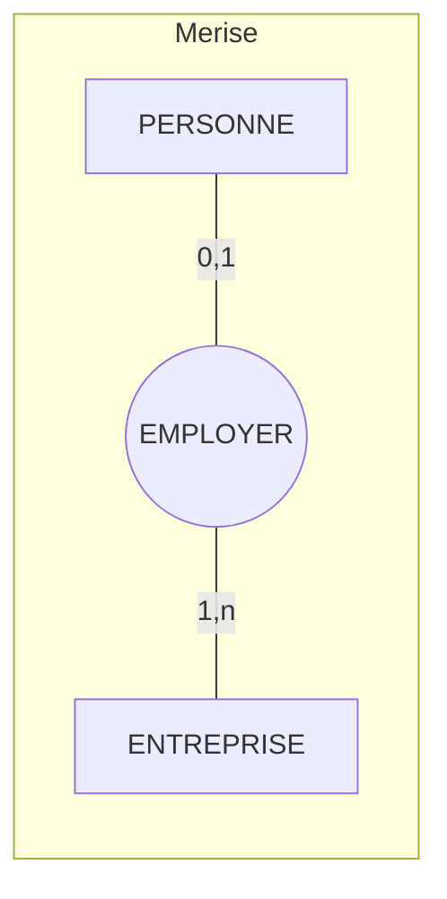
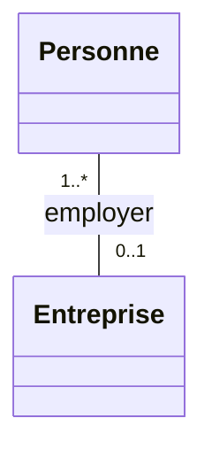

> [!note]
> **Version simple**
> UML propose une autre façon de dessiner le MCD : le **diagramme de classes**. Ce sont les mêmes idées qu'en Merise avec d'autres noms : une *entité* devient une **classe**, une *occurrence* un **objet**, une *cardinalité* une **multiplicité**. Attention : les multiplicités sont **placées de l'autre côté** par rapport à Merise (pour une association binaire).

---

# Version détaillée

## V.1 Le diagramme de classes

Décrit la **structure statique** du système à l'aide de :

- **classes** (attributs, opérations…) ;
- **relations** : association, classe-association, (agrégation, composition, héritage, dépendance… → chapitre 7).



Une classe = un **nom**, des **attributs**, des **opérations** (pas utilisées en modélisation de données). Une association porte un **nom** (optionnel, verbe sur ou sous le lien), des **rôles** (optionnels) et des **multiplicités**.

## V.2 Équivalences Merise ⇔ UML

| E/A de Merise | Diagramme de classes UML |
| --- | --- |
| Type (classe) d'entité | **Classe** |
| Occurrence, entité | **Objet**, instance (ex. `MonLivretA : Compte`) |
| Type (classe) d'association | **Association** / **Classe-association** |
| Cardinalités | **Multiplicités** |
| Contraintes | **Contraintes** (texte entre accolades, notes, langage OCL) |
| Identifiant | Décrit dans le dictionnaire de données |
| Modèle E/A de Merise | **Diagramme de classes UML** |

*OCL = Object Constraint Language (langage mathématique formel).*

### Cardinalités ⇔ multiplicités

| Merise | UML | Remarque |
| --- | --- | --- |
| `1,1` | `1` | (CIF) |
| `1,N` | `1..*` |   |
| `0,1` | `0..1` | (CIF) |
| `0,N` | `0..*` ou `*` |   |

> [!warning]
> **Piège : inversion de la position des multiplicités** pour une association binaire. En Merise la cardinalité d'une classe est écrite **du côté de cette classe** ; en UML la multiplicité est écrite **du côté opposé** (elle dit combien d'objets de la classe d'en face sont liés).

Exemple PERSONNE – EMPLOYER – ENTREPRISE :





En Merise, `0,1` est côté PERSONNE ; en UML, `0..1` est côté Entreprise (les croix du schéma original).

## V.3 Classe-association binaire avec propriétés

Merise : `AUTOMOBILISTE 0,n — LOUER (Date) — 0,n VOITURE`.

UML : une **classe-association** : le nom de l'association est placé sur le lien entre les deux classes ; les propriétés de l'association sont placées dans un **rectangle relié par une ligne en pointillés** au trait matérialisant l'association.

```mermaid
classDiagram
    class Automobiliste {
        Auto_ID
        Nom
        Prenom
        Adresse
    }
    class Voiture {
        Immatriculation
        Marque
        Type
        Puissance
        Annee
    }
    class louer {
        Date
    }
    Automobiliste "*" -- "*" Voiture
    (Automobiliste, Voiture) .. louer
```

## V.4 Classe-association n-aire avec propriétés

Les liens partant de chaque classe participante sont rattachés à un **losange**. Le nom de l'association est placé à côté du losange ou dans le premier compartiment du rectangle contenant les propriétés. Les propriétés sont placées dans un rectangle relié au losange par une ligne en pointillés.

Exemple : CLIENT / PRODUIT / DATE autour de **commander (Quantite)**, plus PRODUIT / FOURNISSEUR avec la multiplicité `1` côté fournisseur.

```mermaid
classDiagram
    class Client {
        NumCli
        Nom
        Prenom
        DateNaiss
        Rue
        CP
        Ville
    }
    class Produit {
        NumProd
        Desi
        PrixUni
    }
    class Fournisseur {
        NumFour
        RaisonSoc
    }
    class Date {
        jjmmaaaa
    }
    class commander {
        Quantite
    }
    Client "1..*" -- "1..*" Produit
    Produit "1..*" -- "1" Fournisseur
    Client "1..*" -- "0..*" Date
    (Client, Produit) .. commander
```

*(Mermaid ne sait pas dessiner le losange n-aire d'UML : ce diagramme en est une approximation.)*

## V.5 MCD version UML : le livrable

- Schéma : **diagramme de classes UML**.
- Description textuelle (**contenu identique au modèle E/A de Merise**) : dictionnaire des données, règles de gestion, commentaires pertinents…
- **Tables d'occurrences**.