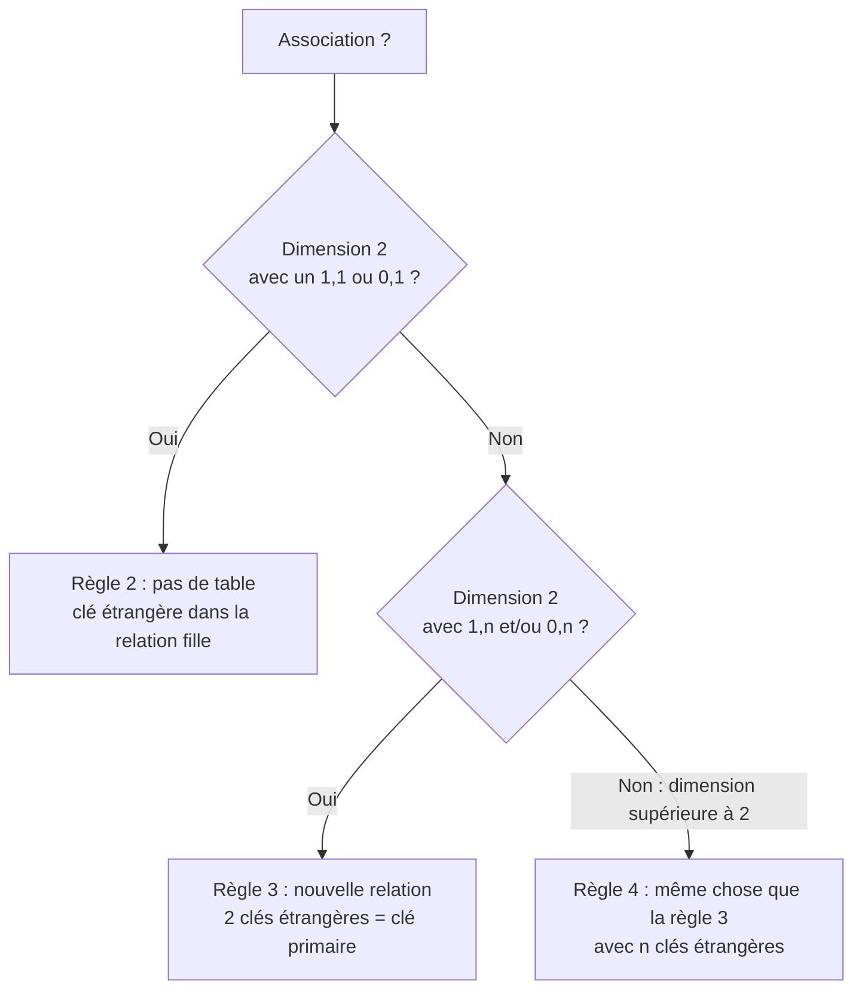
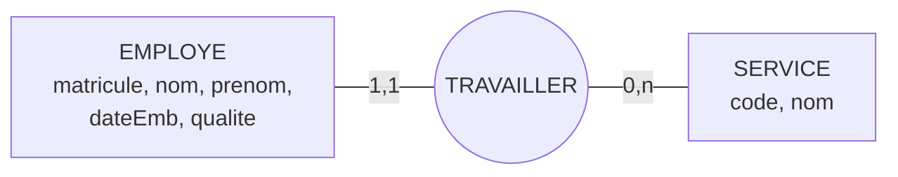
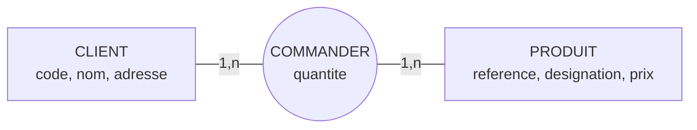
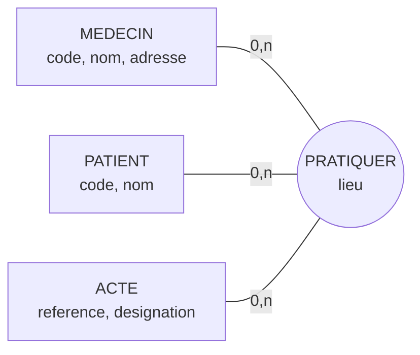
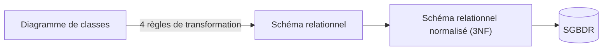

> [!note]
> **Version simple**
> On **traduit** le MCD en **tables** (modèle relationnel) avec 4 règles :
> 
> 1. Chaque entité → une table (propriétés = colonnes, identifiant = clé primaire).
> 2. Association avec un `1,1` (ou `0,1`) → **pas de table**, on met une **clé étrangère** dans la table du côté `1,1`.
> 3. Association avec des `1,N`/`0,N` des deux côtés → **nouvelle table** contenant les identifiants des deux entités (clé primaire composée + clés étrangères) et les propriétés de l'association.
> 4. Association à 3 pattes ou plus → même chose que la règle 3.
> 
> On n'oublie pas de **mettre à jour le dictionnaire de données**.

---

# Version détaillée

## VI.1 Niveaux d'abstraction de la modélisation

- Un modèle **conceptuel** de données (MCD Merise ou diagramme de classes UML) est **indépendant de l'état de l'art technologique**.
- Il existe différentes sortes de SGBD, chacun avec son propre **modèle logique** (dans l'ordre historique) :
	- **SGF** (Systèmes de Gestion de Fichiers), pas vraiment des SGBD ;
	- SGBD **hiérarchiques** (arborescence) ;
	- SGBD **réseau**, ou **CODASYL** (du nom de la norme) ;
	- SGBD **relationnels** (SGBDR) : Oracle, Access, MySQL, PostgreSQL, DB2… ;
	- SGBD **orientés objet** (SGBDOO) : O2, Jasmine, Versant, DB40… (certains SGBDR ont une extension objet) ;
	- SGBD **XML** : Tamino, eXist… (certains SGBDR ont une extension XML).
- On ne sait pas implanter aisément un modèle conceptuel dans une machine : une association de dimension > 2 doit être transformée ; une association porteuse de données n'est pas toujours implantable telle quelle.
- Le **modèle physique** est la représentation du système tel qu'il sera implanté.

> [!warning]
> Ne pas confondre le modèle **conceptuel** (entité-association) avec le **logique** (relationnel), ni le **logique** avec son implantation **physique** (Access, MySQL, PostgreSQL, Oracle…).


| Niveau | Dépendance | Contenu |
| --- | --- | --- |
| Réel (monde physique) |   |   |
| Modèle conceptuel | Indépendant du SGBD | Ex. MEDECIN – EFFECTUER – VISITE |
| Modèle logique | Dépendant du modèle conceptuel, indépendant du SGBD | Codasyl, **Relationnel** (textuel ou graphique), Objet, XML |
| Modèle physique | Dépendant du SGBD | Organisation physique des données, structures de stockage, structures accélératrices (index) |

## VI.2 Niveau logique : concepts du modèle relationnel

*(Les mots manquants du diaporama sont complétés ici.)*

- **Relation** : partie finie du **produit cartésien** de n ensembles (les **domaines**).
- **Attribut** : prend ses valeurs dans un **domaine** (l'ensemble de ses valeurs possibles). Une relation est donc le résultat d'une opération sur les ensembles de valeurs des attributs.
- **Clé (primaire) de relation** : un attribut (ou ensemble d'attributs) tel qu'il ne peut exister qu'une seule valeur de cet attribut pour tous les n-uplets de la table (ressemble à l'identifiant du niveau conceptuel).
- **N-uplet** (tuple) : un enregistrement, une **ligne** de la BD.
- **Cardinalité** de relation : nombre de ses n-uplets (lignes).
- **Degré** (ou arité) de relation : nombre de ses attributs (colonnes). Rien à voir avec la **dimension** d'une association (nombre d'entités reliées).

### Exemple : la table CLIENT

| code | nom | adresse | ville |
| --- | --- | --- | --- |
| AXV508 | Dupont | 15, rue du Canada | Caen |
| BWY405 | Durand | 6, rue Méchin | Cherbourg |
| KAC567 | Duval | 25, rue Blanchi | Alençon |

- Cette table = **relation en extension** : **4 attributs**, **3 n-uplets (tuples)**.
- Le **schéma textuel** = **relation en intention** : `CLIENT (code, nom, adresse, ville)` où `CLIENT` = nom de relation, `code` = clé primaire (soulignée), les autres = attributs.

## VI.3 Opérations de manipulation de données

Langage **SQL** (voir les enseignements de Manipulation de Bases de Données). Opérations de base : **sélection, projection, jointure, union, intersection, différence**, etc.

## VI.4 Règles de passage du modèle conceptuel au schéma relationnel



### Règle n°1 – Toute (classe d')entité devient une relation

- les **attributs** traduisent les **propriétés** de l'entité ;
- la **clé primaire** traduit l'**identifiant** de l'entité.

`EMPLOYE (matricule, nom, prenom, dateEmb, qualite)`

*(Règle identique que le MCD soit en formalisme Merise ou en diagramme de classes UML.)*

### Règle n°2 – Association de dimension 2 avec cardinalité `1,1` (ou `0,1`)

Merise : cardinalité `1,1` / `0,1`. UML : multiplicité `1` / `0..1`. L'association se réécrit en :

- **portant dans la relation fille la clé primaire de la relation mère** ;
- l'attribut ajouté s'appelle **clé étrangère**. Par convention, on la symbolise avec `#` (ce caractère ne fait pas partie du nom du champ dans la BD !) et on la **suffixe avec le nom de la classe d'entité**.



```plain text
EMPLOYE (matricule, nom, prenom, dateEmb, qualite, #codeService)
SERVICE (code, nom)
```

En UML : `Employe 0..* — travailler → 1 Service` donne exactement le même résultat.

> [!tip]
> **Recette (règle 2)** : on hésite parfois sur la relation qui doit porter la clé étrangère. Il faut contrôler que l'attribut est bien **monovalué** (respect de la 1ère Forme Normale). Si on mettait `matricule` dans SERVICE, cet attribut aurait pour valeurs **tous les matricules** des employés du service : faux. Alors que `#codeService` dans EMPLOYE ne peut avoir qu'une valeur (le service où travaille l'employé). **La clé étrangère va côté **`**1,1**`**.**

**Cas particulier de la cardinalité **`**0,1**`** / **`**0..1**` : même règle mais la clé étrangère pourra avoir une **valeur nulle** (un employé qui ne travaille dans aucun service). On ne peut alors plus utiliser aisément le mécanisme de vérification de l'**intégrité référentielle**.

**Remarques**

- Une association `1,1` ne devrait pas être porteuse de propriétés. Si c'est tout de même le cas au niveau conceptuel, la propriété devient **attribut de la relation enfant**.
- Attention aux associations ayant un **minimum de 1 partout** (dimension n:m) : cela peut poser des contraintes lors du (dé)peuplement et nécessiter des outils de gestion évolués (**triggers** par exemple).

### Règle n°3 – Association de dimension 2 avec cardinalités `1,n` et/ou `0,n`

Merise : `1,n` / `0,n`. UML : `1..*` / `0..*`. L'association se réécrit en :

- créant une **relation particulière** qui contient comme attributs les **identifiants des 2 entités** associées :
	- ces attributs constituent à eux 2 la **clé primaire** de la relation ;
	- ils sont individuellement **clés étrangères** ;
- ajoutant les **propriétés de l'association** comme attributs de cette relation.



```plain text
CLIENT    (code, nom, adresse)
PRODUIT   (reference, designation, prix)
COMMANDER (#codeClient, #refProduit, quantite)
```

### Règle n°4 – Association de dimension supérieure à 2

Se réécrit **selon la règle n°3** : relation particulière avec les identifiants de **toutes** les entités (clés étrangères formant ensemble la clé primaire) + propriétés de l'association.



```plain text
MEDECIN   (code, nom, adresse)
PATIENT   (code, nom)
ACTE      (reference, designation)
PRATIQUER (#codeMedecin, #codePatient, #refActe, lieu)
```

### Récapitulatif

| Concept du MCD | Devient… |
| --- | --- |
| Entité | Relation (table) |
| Propriété | Attribut |
| Identifiant | Clé primaire |
| Association avec `1,1` / `0,1` | Clé étrangère dans la relation du côté `1,1` |
| Association avec `n` des deux côtés, ou n-aire | Nouvelle relation (clé primaire = clés étrangères) + ses propriétés |
| Entité DATE (historisation) | Pas de relation : la date devient un attribut (et une partie de la clé) de la relation d'association |

## VI.5 Conclusion du chapitre

- Le schéma relationnel peut se présenter sous **forme textuelle** (nom de table en majuscule, clé primaire soulignée, clé étrangère précédée de `#`) ou **graphique** (comme dans MS Access).
- **Ne pas oublier de mettre à jour le dictionnaire des données** : ajouter les attributs qui sont des clés étrangères, ajouter/renseigner une colonne pour le **type physique** (en précisant le SGBD choisi ou imposé).
- Les règles de passage conceptuel → logique → physique sont **totalement formalisables**, donc **automatisables** avec un **AGL** (Atelier de Génie Logiciel) : il aide à dessiner le modèle E-A et génère automatiquement le schéma de la BD, dans les 2 sens (rétro-ingénierie). Exemples : WinDev (PCSoft), AMCDesignor (Sybase), Rational Rose (IBM), Modelio, BOUML, ArgoUML, **MySQL Workbench** (ex DBDesigner), **Looping** ([looping-mcd.fr](http://looping-mcd.fr/)).

### Dictionnaire mis à jour et calcul de volume

Exemple pour la table EMPLOYE (niveau physique Oracle) :

| Libellé | Signification | Conceptuel | Logique | Physique (Oracle) | Contraintes | Taille | Exemple |
| --- | --- | --- | --- | --- | --- | --- | --- |
| code | Code identifiant chaque employé | numérique | entier | NUMBER | Clé primaire | 5 | 12345 |
| nom | Patronyme de chaque employé | alphabétique | chaîne de caractères | VARCHAR2 |   | 25 | Kükürütx |
| codeService | Code du service où travaille l'employé | alphanumér. | chaîne de caractères | VARCHAR2 | Clé étrangère vers le code unique du Service. Obligatoirement renseigné. | 6 | info02 |

Le dictionnaire sert aussi à **estimer les volumes de données** (utile en informatique embarquée ou pour les gros volumes). Si un entier = 1 octet et un caractère = 1 octet, un enregistrement EMPLOYE = 5 + 25 + 6 = **36 octets** ; pour 1000 employés, il faut **au minimum 36 Ko**, et ainsi de suite pour chaque table.

### Vocabulaire des 3 niveaux

*(Tableau laissé à compléter dans le diaporama, rempli ici.)*

| Niveau conceptuel | Niveau logique | Niveau physique |
| --- | --- | --- |
| Classe d'entité | Relation | Table |
| Classe d'association | Relation ou clé étrangère | Table ou colonne clé étrangère |
| Propriété | Attribut | Colonne / champ |
| Identifiant | Clé primaire | PRIMARY KEY |
| Occurrence | N-uplet (tuple) | Ligne / enregistrement |

Autres remarques de vocabulaire : le « domaine » est aussi appelé « univers du discours » ; on parle aujourd'hui d'« objets métiers » ou d'« ingénierie des besoins ». Au niveau physique, le vocabulaire dépend du SGBDR choisi.

## Pour aller plus loin : notre processus de développement simplifié

Le diaporama présente en transition un processus global : diagramme de contexte / diagramme d'activité → diagramme d'objets → cas d'utilisation et scénarios → **diagramme de classes** → (4 règles de transformation) → **schéma relationnel** → schéma relationnel normalisé (3NF) → SGBDR.

