> [!note]
> **Version simple**
> Le formalisme de base ne permet pas de tout exprimer. Deux solutions : écrire les règles en **commentaires** dans le dictionnaire, ou utiliser des **extensions** :
> 
> - **Héritage** (généralisation / spécialisation) : *un client EST un tiers*, il hérite de ses propriétés.
> - **Contraintes entre associations** (Merise) : exclusion, simultanéité, totalité, inclusion…
> - **CIF sur association n-aire** (Merise) : « un prof, à une période donnée, n'est que dans une salle ».
> - **Contraintes, notes, OCL, agrégation, composition, association réifiée** (UML).

---

# Version détaillée

Certaines contraintes ne sont pas représentables par le seul formalisme de base mais correspondent à des règles que doit satisfaire le modèle pour être **fidèle et cohérent** avec l'activité. Elles sont donc :

- représentées sous forme de **commentaires** associés au (ou dans le) dictionnaire de données ;
- et parfois, avec des **extensions** du modèle E/A étendu de Merise et du diagramme de classes UML.

| E/A de Merise | Diagramme de classes UML |
| --- | --- |
| Généralisation / spécialisation de classes d'entité | Contraintes, OCL, notes |
| Contraintes entre associations : ensemblistes, CIF | Généralisation / spécialisation / héritage |
| Entité complexe | Association de type agrégation, composition |
|   | Association réifiée |

# Partie A – Extensions du modèle E/A de Merise

## VII.1 Généralisation / spécialisation

Cas où des types d'entité **partagent des caractéristiques communes** :

- **Spécialisation** : création de classes d'entité nouvelles, rattachées à une classe plus large, avec des propriétés spécifiques ou supplémentaires. Le type le plus général est caractérisé d'abord → **conception descendante**.
- **Généralisation** : regroupement de caractéristiques communes à plusieurs classes au sein d'une nouvelle classe. Les types les plus particuliers sont caractérisés d'abord → **conception ascendante**.
- En pratique, les deux processus sont souvent **combinés**.

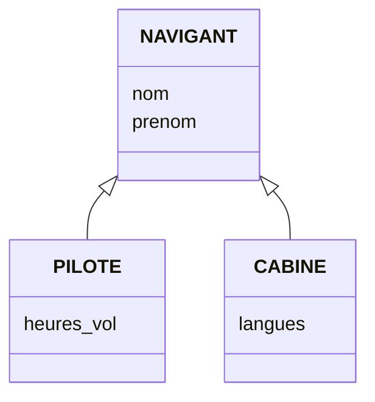

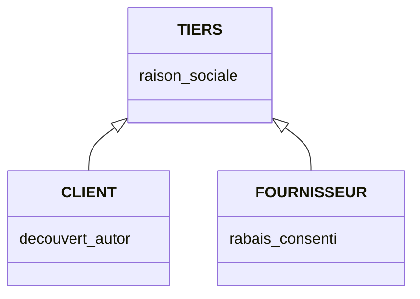

**Exemple** : un tiers peut être à la fois fournisseur et client. La spécialisation consiste à modéliser TIERS (caractéristiques communes), puis à créer CLIENT et FOURNISSEUR comme **sous-types / sous-classes** avec des propriétés supplémentaires et éventuellement des participations particulières à des associations.

**Généralisation** (processus inverse) : VOITURE (Nb places, Puissance, Prix, Numero) et CAMION (Prix, Nb-essieux, Tonnage, Numero) ont des propriétés communes → on les rattache à VEHICULE (Numero, Prix) ; VOITURE garde Puissance et Nb-places, CAMION garde Nb-essieux et Tonnage.

### Héritage

- Une occurrence d'une sous-classe est caractérisée par **toutes les propriétés de la super-classe** (elle en **hérite**) et hérite aussi des **associations** auxquelles participe la super-classe.
- En plus, elle peut avoir des propriétés spécifiques et intervenir dans des associations spécifiques.
- Symbole : **flèche à trait plein dont la pointe est un triangle fermé**, vers le cas le plus général. Pour lire la relation, on utilise le verbe **« être »**.

## VII.2 Contraintes entre associations (inter-associations)

### Contraintes ensemblistes

Elles expriment des **conditions de coexistence** d'occurrences d'association. On les place sur un lien entre deux associations qui partagent une même entité (le **pivot** de la contrainte).

| Contrainte | Symbole | Signification | Exemple |
| --- | --- | --- | --- |
| **Exclusion** | `X` | Une occurrence de l'entité qui participe à Rel_1 ne peut pas participer à Rel_2, et réciproquement | Un article est soit **acheté** à un fournisseur soit **commandé** à une usine, pas les 2 |
| **Simultanéité** (égalité) | `S` ou `=` | Toute occurrence qui participe à Rel_1 participe **simultanément** à Rel_2 (2 inclusions symétriques) | Une COMMANDE est passée par un client ET porte sur des articles |
| **Totalité** | `T` | Toute occurrence participe **au moins à l'une** des relations (ou aux deux) | Un stagiaire est soit candidat, soit inscrit, soit les deux |
| **Exclusion et totalité** (partition, « ou exclusif ») | `XT` ou `+` | Participe à l'une ou à l'autre, **mais pas aux deux** | Une personne réside obligatoirement soit en France, soit à l'étranger |
| **Inclusion** | `I` (flèche) | L'ensemble des occurrences d'une association est inclus dans celui de l'autre (pas réciproquement) | Un employé ne peut être responsable d'un service que s'il y est rattaché |

**Inclusion** : la flèche va de la **portée** (ETRE RESPONSABLE) vers la **cible** (RATTACHER). Le **pivot** = les entités communes à la portée et à la cible.

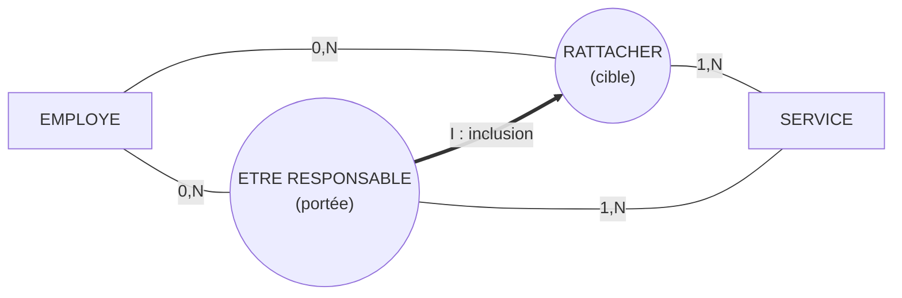

**Totalité** : un centre de formation considère une personne comme stagiaire dès qu'elle pose sa candidature à un stage.

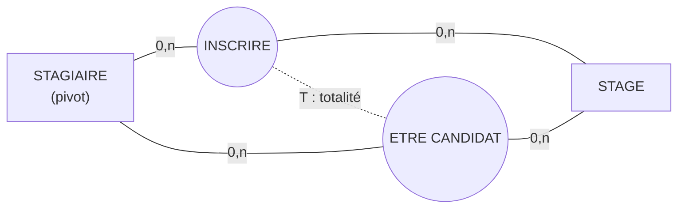

**Exclusion** : un article est soit acheté à un fournisseur soit fabriqué par une usine mais pas les 2.

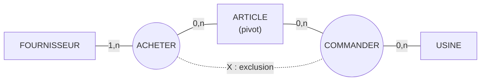

Autres exemples d'exclusion : une personne ne peut pas à la fois EXAMINER et PASSER le même examen ; un BATEAU est soit EN REPARATION dans un port, soit DESSERVIR un port.

### Contrainte d'Intégrité Fonctionnelle (CIF) sur association n-aire

**Exemple** : pour une période d'emploi du temps (ex. mercredi de 9h à 12h), un professeur ne fait cours que dans une **seule** salle. Dans le modèle E/A ternaire PROFESSEUR – FAIRE_COURS – SALLE – PERIODE (toutes en `0,n`), il est pourtant possible d'avoir le même prof dans une autre salle pour la même période.

**Notation** : on indique la **CIF** par un **cercle** reliant les types d'entité **sources** au type d'entité **cible** de la dépendance fonctionnelle (ici sources = PROFESSEUR + PERIODE, cible = SALLE). *CIF1 : un PROFESSEUR, dans une PERIODE, ne fait cours que dans une et une seule SALLE.*

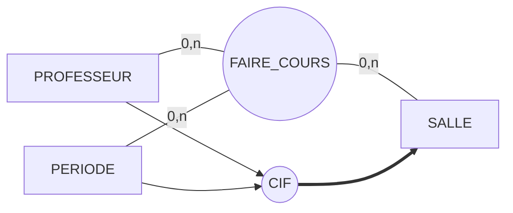

### Décomposition d'une association n-aire (CIF)

**Condition** : le nombre d'entités impliquées dans la CIF doit être **inférieur à la dimension** de l'association.

**Règle** : « **couper la patte** » de l'entité cible, **remplacer la CIF par une association** et adapter les cardinalités.

Exemple : ENTREPRISE + BATIMENT + TYPE-TRAV autour de TRAVAILLER, avec CIF ENTREPRISE → TYPE-TRAV.

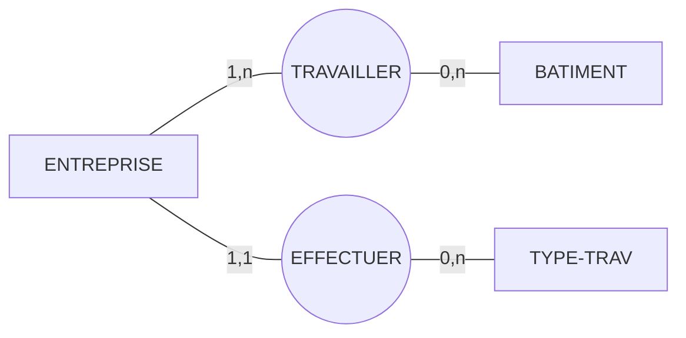

Après décomposition : TRAVAILLER devient binaire (ENTREPRISE–BATIMENT) et EFFECTUER relie ENTREPRISE (`1,1`) à TYPE-TRAV (`0,n`).

## VII.2bis Entité complexe (agrégat, pseudo-entité)

Pour **simplifier** une association n-aire objet d'une CIF, on utilise les **entités complexes**, ou **agrégats**, ou **pseudo-entités** : on regroupe ENSEIGNANT – ENSEIGNER – COURS (avec Semestre et Année) dans un agrégat, qui est ensuite lié à SALLE par AVOIR_LIEU (`1,1` côté agrégat, `0,n` côté SALLE).

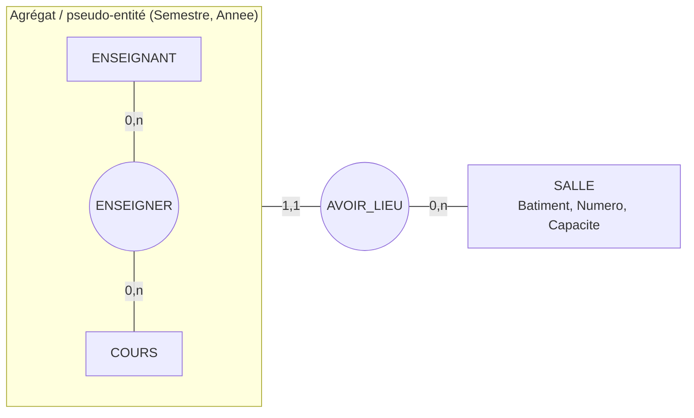

# Partie B – Autres concepts du diagramme de classes UML

## VII.3 Contraintes et notes

**Contraintes** : permettent de spécifier une **propriété qu'un élément modélisé doit vérifier**. Elles peuvent préciser le rôle ou la portée de tout élément d'un modèle UML (classe, attribut, opération, association…) ; par ex. sur une association, restreindre le nombre d'instances visées.

Elles s'expriment :

- en **langage naturel** (dans les notes et/ou commentaires) ;
- et/ou en **OCL** (*Object Constraint Language*), langage mathématique formel.

Graphiquement : un texte **encadré d'accolades**, positionné près de l'élément concerné ; si la contrainte concerne deux éléments, elle est placée sur une **ligne pointillée** qui les relie.

Contraintes usuelles :

- `{ordonnée}` : une relation d'ordre décrit les objets placés dans la collection, l'ordre doit être maintenu (ex. Personne 1 — posseder — 0..* Compte `{ordonnée}`) ;
- `{sous-ensemble}` : une collection est incluse dans une autre (ex. les logements loués par une personne ⊂ ceux qu'elle possède ; le délégué d'un comité est parmi ses membres) ;
- `{ou-exclusif}` : pour un objet donné, une seule association est valide (ex. une personne est soit enseignant, soit étudiant d'une université).

**Notes** : affichent un commentaire ou toute information textuelle (spécification d'une opération, contrainte sur la classe ou ses instances), p. ex. `{solde > 0}` sur la classe Compte.

## VII.4 Généralisation / spécialisation / héritage (UML)

- La **généralisation** décrit une relation entre une classe générale (classe de base / parent / **super-classe**) et une classe spécialisée (**sous-classe**).
- La sous-classe est **intégralement cohérente** avec la classe de base mais comporte des informations supplémentaires (attributs, opérations, associations). En UML (et la plupart des langages objet), cela se traduit par l'**héritage**.
- Lecture avec le verbe **« être »** ; symbole : flèche à trait plein avec triangle fermé vers le cas le plus général.

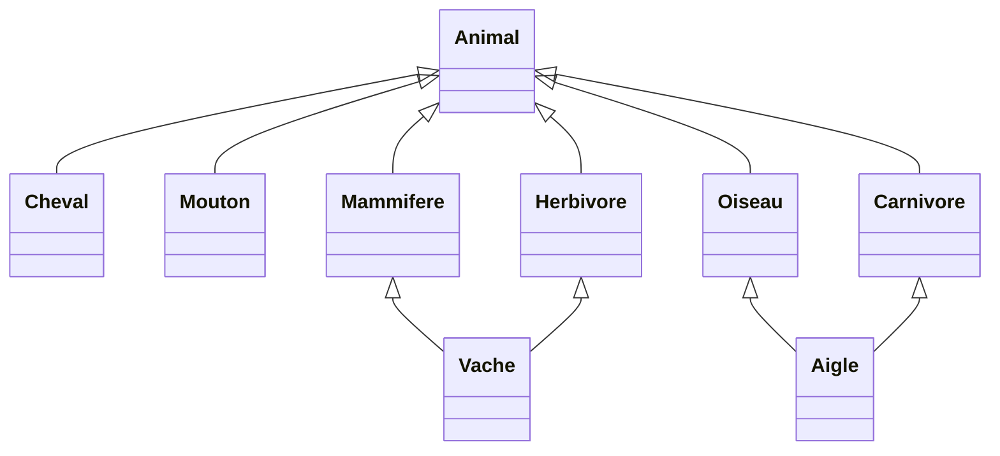

**Types d'héritage** : une super-classe peut avoir **plusieurs sous-classes** ; une sous-classe peut avoir **plusieurs super-classes** → généralisation **multiple** (ex. Aigle est un Oiseau et un Carnivore ; Vache est un Mammifère et un Herbivore).

**Contraintes sur hiérarchies de classes** (intersection / disjonction) :

| Contrainte | Signification |
| --- | --- |
| `{Disjoint}` ou `{Exclusif}` | Une sous-classe ne peut être sous-classe que d'une seule super-classe |
| `{Chevauchement}` ou `{Inclusif}` | Une sous-classe peut être sous-classe de plusieurs super-classes (généralisation multiple possible) |
| `{Complete}` | La généralisation est terminée : plus possible de rajouter de nouvelles sous-classes |
| `{Incomplete}` | Il est possible de rajouter de nouvelles sous-classes (ex. Cours → Maths, Géographie, Histoire) |

## VII.5 Association, agrégation, composition

Trois niveaux emboîtés : **association** ⊃ **agrégation** ⊃ **composition**.

### Agrégation

- Association particulière qui exprime une **union marquée** et une **relation de subordination** entre deux instances (un **agrégat** et une instance **agrégée**).
- Relation d'inclusion de type **« possède »** ou **« a pour partie »**. **Asymétrique, transitive**.
- À un même moment, une instance agrégée peut être impliquée ou non dans plus d'une association.
- L'instance agrégée **peut vivre sans l'agrégat** et inversement : **cycles de vie indépendants**.

### Composition

- **Agrégation forte** entre un **composite** et un **composant**.
- Relation de type **« est le possesseur exclusif de »** ou **« est composé (physiquement) de »**.
- Exprime une **dépendance existentielle** : si le composite est détruit (ou copié), ses composants le sont aussi. Les composants peuvent cependant être détruits avant le composite.
- À un instant donné, un composant ne peut être lié qu'à **un seul** composite.

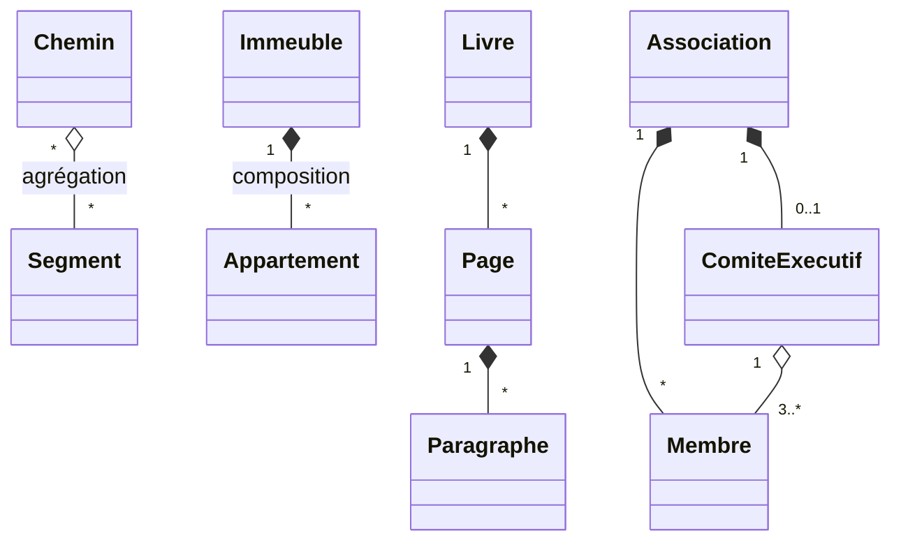

- La destruction d'un **livre** entraîne la destruction de ses pages et paragraphes (composition).
- La fin d'une **association** fait disparaître ses membres et son comité exécutif ; mais la dissolution du **comité** n'engendre pas l'exclusion de ses membres (agrégation).

## VII.6 Association réifiée

Chaque instance d'une **classe-association** est associée à **un lien unique** entre deux instances. Si ce n'est pas le cas, il faut soit ajouter une autre dimension (ex. temporelle), soit **réifier** l'association.

**Réifier** = transformer un concept abstrait en réalité concrète (introduire une classe intermédiaire).

Exemple : ENTREPRISE – employer (salaire, date_embauche) – PERSONNE (`1..*` des deux côtés).

- Cette représentation est **vraie** si une personne peut occuper différents emplois mais **un seul dans une entreprise donnée**.
- Elle est **fausse** si une personne peut occuper **plusieurs emplois au sein d'une même entreprise**.

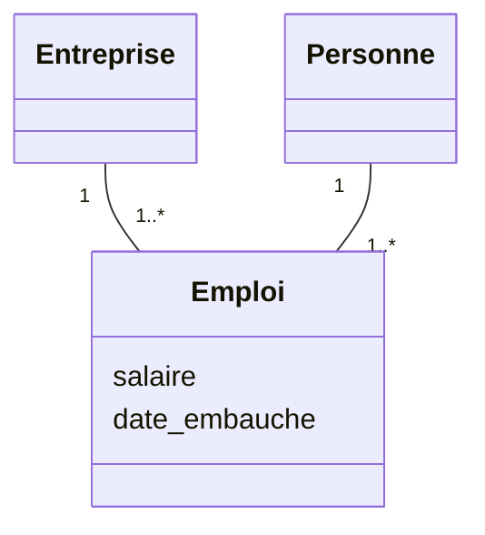

L'association entre Personne et Entreprise a été **réifiée** (introduction de la classe intermédiaire **Emploi**) pour exprimer concrètement qu'une personne peut occuper plusieurs emplois dans la même entreprise.