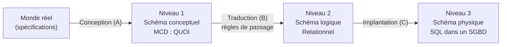

> [!note]
> **R1.05 – Introduction aux Bases de Données et SQL (partie Conception)**
> IUT de Bayonne et du Pays Basque – BUT Informatique – 2026-2027 – A. Gastambide et C. Marquesuzaà
> 
> Objectif : savoir modéliser une base de données du **conceptuel** (MCD Merise ou diagramme de classes UML) au **logique** (schéma relationnel) puis au **physique** (SQL), avec dictionnaire des données, commentaires, et l'outil **Looping**.

## Plan du cours

Une sous-page par chapitre, chacune avec une **version simple** d'abord, puis la **version détaillée**.

1. Introduction : BD, SGBD, SQL, les 3 niveaux de modélisation
2. Le modèle E/A de Merise : concepts de base
3. Exemple : la gestion d'une bibliothèque
4. Construire un Modèle Conceptuel de Données
5. Le diagramme de classes UML : concepts de base
6. Modélisation logique des données (MLD) : du conceptuel au relationnel
7. Extensions du modèle E/A de Merise et d'UML

## Les 3 niveaux en un coup d'œil

## Conventions de notation utilisées dans ces notes

| Élément | Notation |
| --- | --- |
| Clé primaire (schéma relationnel) | soulignée |
| Clé étrangère | précédée de `#` |
| Nom de relation / table | MAJUSCULES |
| Identifiant (MCD) | souligné |

> Les schémas Merise ci-dessous sont redessinés en diagrammes simplifiés (rectangle = entité, rond = association, étiquette = cardinalité `min,max`).

[[1 – Introduction]]

[[2 – Le modèle E-A de Merise  concepts de base]]

[[3 – Exemple gestion d'une bibliothèque]]

[[4 – Construire un Modèle Conceptuel de Données]]

[[5 – Le diagramme de classes UML  concepts de base]]

[[6 – Modélisation logique des données (MLD)]]

[[7 – Extensions du modèle E-A de Merise et d'UML]]