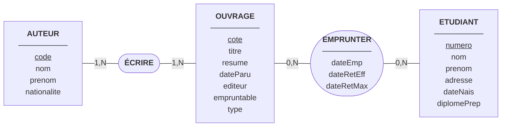
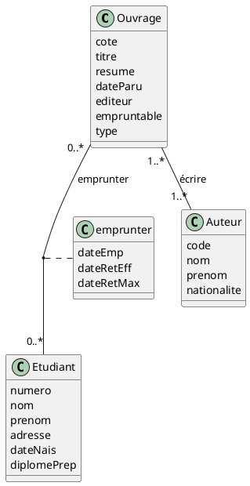

## Hypothèses et choix de modélisation

- Un ouvrage possède une **cote**, un titre, un résumé, une date de parution et un nom d'éditeur.
- Un ouvrage a **un ou plusieurs auteurs** ; un auteur a écrit **au moins un ouvrage** (sinon il n'existe pas dans la base).
- On ne gère **pas la multi-nationalité** : un auteur a une seule nationalité.
- Pour les ouvrages dont l'auteur n'est pas connu, on crée **deux auteurs artificiels** : « Anonyme » et « Inconnu ».
- On ne considère qu'**un seul exemplaire** par ouvrage.
- Un étudiant peut emprunter plusieurs ouvrages, et un ouvrage peut être emprunté par plusieurs étudiants **au fil du temps**.
- Les règles « 3 livres maximum en même temps », « pas de nouvel emprunt si un livre n'est pas rendu » et « certains livres réservés à la lecture sur place » sont des **règles de gestion** vérifiées par l'application, pas par les cardinalités.

### Synchronique ou diachronique ?

- **Synchronique** = une photo : on observe la situation à un instant précis.
- **Diachronique** = un film : on observe les évènements au cours du temps.

Avec un point de vue synchronique, un livre ne serait emprunté que par un seul étudiant à la fois (0,1) et un étudiant aurait au plus 3 livres (0,3).
On passe ici à une **vision diachronique** : on garde l'historique de tous les emprunts, donc les cardinalités d'EMPRUNTER deviennent **0,N des deux côtés**. Les limites (3 livres, un seul emprunteur à la fois) restent des règles de gestion.

---

## Question 1 – Modèles conceptuels

### 1.1 Modèle Entité-Association (MCD de MERISE)

Lecture des cardinalités :

| Association | Côté     | Cardinalité | Signification                                                                |
| ----------- | -------- | ----------- | ---------------------------------------------------------------------------- |
| ÉCRIRE      | AUTEUR   | 1,N         | Un auteur a écrit au moins un ouvrage                                        |
| ÉCRIRE      | OUVRAGE  | 1,N         | Un ouvrage a au moins un auteur                                              |
| EMPRUNTER   | OUVRAGE  | 0,N         | Un ouvrage peut n'avoir jamais été emprunté, ou l'avoir été plusieurs fois   |
| EMPRUNTER   | ETUDIANT | 0,N         | Un étudiant peut n'avoir rien emprunté, ou avoir emprunté plusieurs ouvrages |

### 1.2 Modèle des classes simplifié (UML)

- **ÉCRIRE** est une association plusieurs-à-plusieurs : un ouvrage peut avoir plusieurs auteurs et un auteur plusieurs ouvrages.
- **EMPRUNTER** est aussi plusieurs-à-plusieurs (vision diachronique) et porte des données propres : la date d'emprunt, la date de retour effective et la date de retour maximale. En UML, ces données sont dans une **classe d'association**.
- La date de retour effective reste vide tant que l'ouvrage n'est pas rendu.

---

## Question 2 – Dictionnaire des données

| Libellé           | Signification                                                                                  | Domaine conceptuel | Domaine logique      | Domaine physique | Taille | Contrainte                                                                                         | Exemple                                                  |
| ----------------- | ---------------------------------------------------------------------------------------------- | ------------------ | -------------------- | ---------------- | ------ | -------------------------------------------------------------------------------------------------- | -------------------------------------------------------- |
| cote              | Identifiant unique d'un ouvrage dans la B.U.                                                   | Alphanumérique     | Chaîne de caractères |                  | 20     | Identifiant (clé primaire), unique, non nul. Clé étrangère `#coteOuvrage` dans ÉCRIRE et EMPRUNTER | LIT-001                                                  |
| titre             | Titre de l'ouvrage                                                                             | Alphanumérique     | Chaîne de caractères |                  | 150    | Non nul                                                                                            | Germinal                                                 |
| resume            | Résumé de l'ouvrage                                                                            | Alphanumérique     | Chaîne de caractères |                  | 1000   | Facultatif                                                                                         | Roman sur une grève de mineurs dans le Nord de la France |
| dateParu          | Date de parution de l'ouvrage                                                                  | Date               | Date                 |                  | –      | Non nulle, antérieure ou égale à la date du jour                                                   | 01/03/1885                                               |
| editeur           | Nom de l'éditeur de l'ouvrage                                                                  | Alphanumérique     | Chaîne de caractères |                  | 100    | Non nul                                                                                            | Gallimard                                                |
| empruntable       | Indique si l'ouvrage peut être emprunté (Oui) ou s'il est réservé à la lecture sur place (Non) | Booléen            | Booléen              |                  | –      | Non nul                                                                                            | Oui                                                      |
| type              | Catégorie de l'ouvrage (revue, roman, etc.)                                                    | Alphanumérique     | Chaîne de caractères |                  | 30     | Non nul                                                                                            | roman                                                    |
| code              | Identifiant unique d'un auteur                                                                 | Numérique          | Entier               |                  | –      | Identifiant (clé primaire), unique, non nul. Clé étrangère `#codeAuteur` dans ÉCRIRE               | 3                                                        |
| nom (auteur)      | Nom de famille de l'auteur (« Anonyme » ou « Inconnu » pour les auteurs artificiels)           | Alphanumérique     | Chaîne de caractères |                  | 50     | Non nul                                                                                            | Zola                                                     |
| prenom (auteur)   | Prénom(s) de l'auteur                                                                          | Alphanumérique     | Chaîne de caractères |                  | 80     | Facultatif (vide pour les auteurs artificiels)                                                     | Émile                                                    |
| nationalite       | Nationalité unique de l'auteur (pas de multi-nationalité)                                      | Alphanumérique     | Chaîne de caractères |                  | 40     | Une seule valeur                                                                                   | Française                                                |
| numero            | Numéro d'étudiant, identifiant unique d'un étudiant                                            | Numérique          | Entier               |                  | –      | Identifiant (clé primaire), unique, non nul. Clé étrangère `#numEtudiant` dans EMPRUNTER           | 21001                                                    |
| nom (étudiant)    | Nom de famille de l'étudiant                                                                   | Alphanumérique     | Chaîne de caractères |                  | 50     | Non nul                                                                                            | Dupont                                                   |
| prenom (étudiant) | Prénom(s) de l'étudiant                                                                        | Alphanumérique     | Chaîne de caractères |                  | 80     | Non nul                                                                                            | Marie                                                    |
| adresse           | Adresse postale de l'étudiant                                                                  | Alphanumérique     | Chaîne de caractères |                  | 200    | Non nulle                                                                                          | 12 rue des Arceaux, 64100 Bayonne                        |
| dateNais          | Date de naissance de l'étudiant                                                                | Date               | Date                 |                  | –      | Non nulle, antérieure à la date du jour                                                            | 14/05/2005                                               |
| diplomePrep       | Diplôme préparé par l'étudiant (licence, master ou doctorat)                                   | Alphanumérique     | Chaîne de caractères |                  | 20     | Non nul, valeurs : licence, master, doctorat                                                       | licence                                                  |
| dateEmp           | Date à laquelle l'étudiant a emprunté l'ouvrage                                                | Date               | Date                 |                  | –      | Non nulle, antérieure ou égale à la date du jour. Fait partie de la clé primaire d'EMPRUNTER       | 07/09/2026                                               |
| dateRetEff        | Date à laquelle l'ouvrage a réellement été rendu                                               | Date               | Date                 |                  | –      | Vide tant que l'ouvrage n'est pas rendu, sinon postérieure ou égale à dateEmp                      | 20/09/2026                                               |
| dateRetMax        | Date limite de retour de l'ouvrage                                                             | Date               | Date                 |                  | –      | Non nulle, postérieure à dateEmp                                                                   | 21/09/2026                                               |

---

## Question 3 – Tables d'occurrences

### OUVRAGE

| cote | titre | resume | dateParu | editeur | empruntable | type |
|---|---|---|---|---|---|---|
| LIT-001 | Germinal | Roman sur une grève de mineurs | 01/03/1885 | Charpentier | Oui | roman |
| LIT-002 | Les Misérables | Roman sur la destinée de Jean Valjean | 03/04/1862 | Lacroix | Oui | roman |
| LIT-003 | La Chanson de Roland | Poème épique médiéval | 01/01/1100 | Gallimard | Oui | poème |
| BD-001 | Astérix le Gaulois | Premier album des aventures d'Astérix | 01/10/1961 | Dargaud | Oui | bande dessinée |
| MED-001 | Bestiaire médiéval | Recueil illustré d'animaux réels et fantastiques | 01/01/1250 | Bibliothèque nationale | Non | manuscrit |

### AUTEUR

| code | nom | prenom | nationalite |
|---|---|---|---|
| 1 | Anonyme | | Inconnue |
| 2 | Inconnu | | Inconnue |
| 3 | Zola | Émile | Française |
| 4 | Hugo | Victor | Française |
| 5 | Goscinny | René | Française |
| 6 | Uderzo | Albert | Française |

### ETUDIANT

| numero | nom | prenom | adresse | dateNais | diplomePrep |
|---|---|---|---|---|---|
| 21001 | Dupont | Marie | 12 rue des Arceaux, 64100 Bayonne | 14/05/2005 | licence |
| 21002 | Etcheverry | Peio | 3 avenue de l'Adour, 64600 Anglet | 02/11/2002 | master |
| 21003 | Martin | Lucas | 8 allée des Pins, 64200 Biarritz | 23/07/1999 | doctorat |

### ECRIRE

| coteOuvrage | codeAuteur |
|---|---|
| LIT-001 | 3 |
| LIT-002 | 4 |
| LIT-003 | 1 |
| BD-001 | 5 |
| BD-001 | 6 |
| MED-001 | 2 |

### EMPRUNTER

| numEtudiant | coteOuvrage | dateEmp | dateRetEff | dateRetMax |
|---|---|---|---|---|
| 21001 | LIT-001 | 07/09/2026 | 20/09/2026 | 21/09/2026 |
| 21001 | BD-001 | 05/10/2026 | | 19/10/2026 |
| 21002 | LIT-002 | 12/10/2026 | | 02/11/2026 |
| 21003 | LIT-001 | 01/10/2026 | 10/10/2026 | 29/10/2026 |
| 21003 | LIT-003 | 14/10/2026 | | 11/11/2026 |

---

## Question 4 – Schéma relationnel

Légende : <u>clés primaires soulignées</u> ; clés étrangères précédées de #.

- **OUVRAGE**(<u>cote</u>, titre, resume, dateParu, editeur, empruntable, type)
- **AUTEUR**(<u>code</u>, nom, prenom, nationalite)
- **ETUDIANT**(<u>numero</u>, nom, prenom, adresse, dateNais, diplomePrep)
- **ECRIRE**(<u>#coteOuvrage, #codeAuteur</u>)
- **EMPRUNTER**(<u>#numEtudiant, #coteOuvrage, dateEmp</u>, dateRetEff, dateRetMax)

Justification :

- Les associations plusieurs-à-plusieurs (ÉCRIRE, EMPRUNTER) deviennent des **tables de liaison** dont la clé primaire est composée des clés étrangères.
- **dateEmp** fait partie de la clé d'EMPRUNTER : un même étudiant peut emprunter plusieurs fois le même ouvrage à des dates différentes (vision diachronique).
