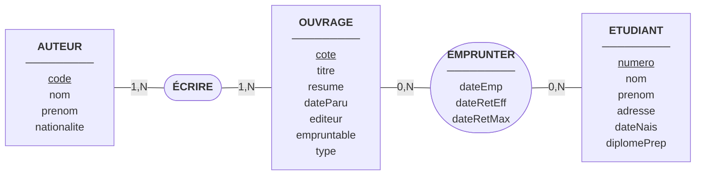
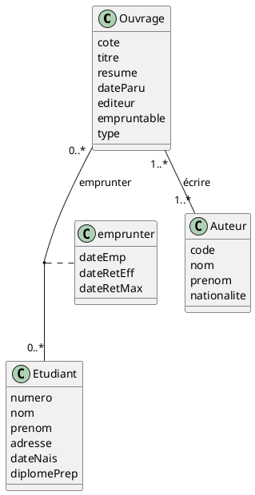
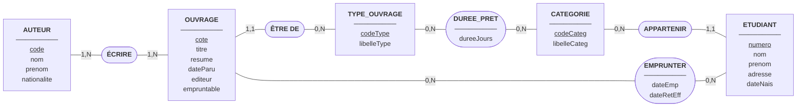
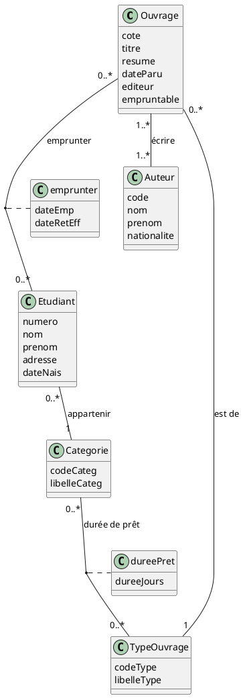
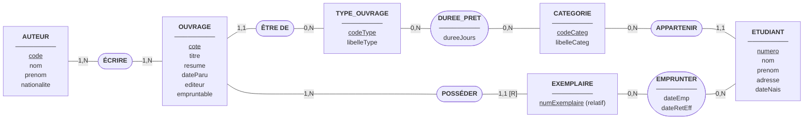
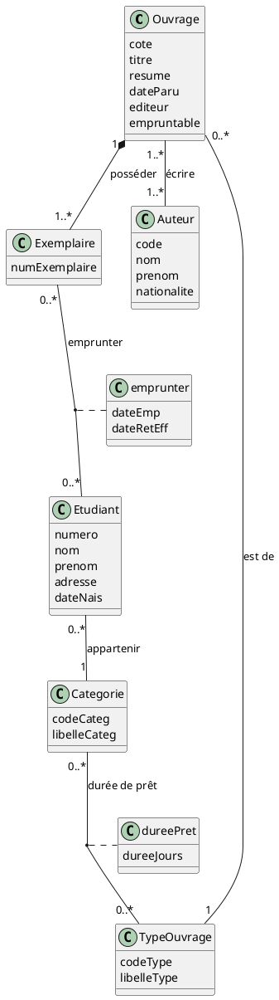
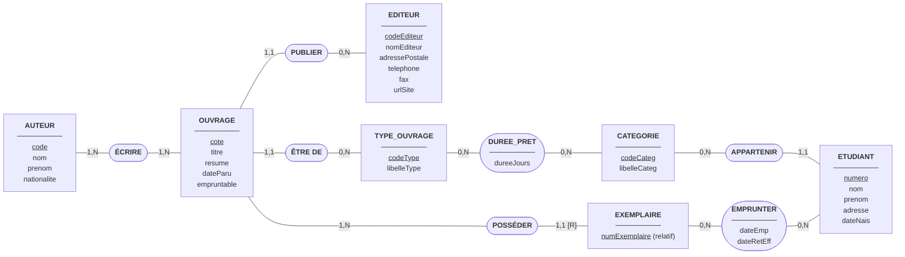
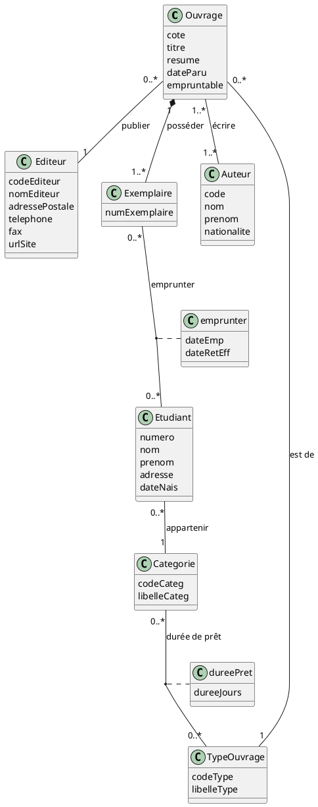

## Hypothèses et choix de modélisation

- Un ouvrage possède une **cote**, un titre, un résumé, une date de parution et un nom d'éditeur.
- Un ouvrage a **un ou plusieurs auteurs** ; un auteur a écrit **au moins un ouvrage** (sinon il n'existe pas dans la base).
- On ne gère **pas la multi-nationalité** : un auteur a une seule nationalité.
- Pour les ouvrages dont l'auteur n'est pas connu, on crée **deux auteurs artificiels** : « Anonyme » et « Inconnu ».
- On ne considère qu'**un seul exemplaire** par ouvrage.
- Un étudiant peut emprunter plusieurs ouvrages, et un ouvrage peut être emprunté par plusieurs étudiants **au fil du temps**.
- Les règles « 3 livres maximum en même temps », « pas de nouvel emprunt si un livre n'est pas rendu » et « certains livres réservés à la lecture sur place » sont des **règles de gestion** vérifiées par l'application, pas par les cardinalités.
- Il en va de même pour les **participations obligatoires (1,N)** — « un auteur a écrit au moins un ouvrage », « un ouvrage a au moins un auteur » (et, à partir de la Q7, « un ouvrage a au moins un exemplaire ») : elles ne sont **pas transposables en relationnel**, aucune contrainte de clé ne peut les garantir → elles sont **aussi** vérifiées par l'application. À l'inverse, les participations **(1,1)** (un seul type, une seule catégorie, un seul éditeur) sont assurées naturellement par les clés étrangères non nulles.

### Synchronique ou diachronique ?

- **Synchronique** = une photo : on observe la situation à un instant précis.
- **Diachronique** = un film : on observe les évènements au cours du temps.

Avec un point de vue synchronique, un livre ne serait emprunté que par un seul étudiant à la fois (0,1) et un étudiant aurait au plus 3 livres (0,3). On passe ici à une **vision diachronique** : on garde l'historique de tous les emprunts, donc les cardinalités d'EMPRUNTER deviennent **0,N des deux côtés**. Les limites (3 livres, un seul emprunteur à la fois) restent des règles de gestion.

---

## Question 1 – Modèles conceptuels

### 1.1 Modèle Entité-Association (MCD de MERISE)

> Mermaid n'a pas de notation Merise native : les entités sont des rectangles, les associations des ovales, et les cardinalités sont notées sur les liens. Les identifiants sont soulignés.

Lecture des cardinalités :

|Association|Côté|Cardinalité|Signification|
|---|---|---|---|
|ÉCRIRE|AUTEUR|1,N|Un auteur a écrit au moins un ouvrage|
|ÉCRIRE|OUVRAGE|1,N|Un ouvrage a au moins un auteur|
|EMPRUNTER|OUVRAGE|0,N|Un ouvrage peut n'avoir jamais été emprunté, ou l'avoir été plusieurs fois|
|EMPRUNTER|ETUDIANT|0,N|Un étudiant peut n'avoir rien emprunté, ou avoir emprunté plusieurs ouvrages|

### 1.2 Modèle des classes simplifié (UML)

- **ÉCRIRE** est une association plusieurs-à-plusieurs : un ouvrage peut avoir plusieurs auteurs et un auteur plusieurs ouvrages.
- **EMPRUNTER** est aussi plusieurs-à-plusieurs (vision diachronique) et porte des données propres : la date d'emprunt, la date de retour effective et la date de retour maximale. En UML, ces données sont dans une **classe d'association**.
- La date de retour effective reste vide tant que l'ouvrage n'est pas rendu.

---

## Question 2 – Dictionnaire des données

|Libellé|Signification|Domaine conceptuel|Domaine logique|Domaine physique|Taille|Contrainte|Exemple|
|---|---|---|---|---|---|---|---|
|cote|Identifiant unique d'un ouvrage dans la B.U. ; le préfixe indique le rayon (LIT = littérature, BD = bande dessinée, MED = fonds médiéval)|Alphanumérique|Chaîne de caractères|VARCHAR(20)|20|Identifiant (clé primaire), unique, non nul. Clé étrangère `#coteOuvrage` dans ÉCRIRE et EMPRUNTER|LIT-001|
|titre|Titre de l'ouvrage|Alphanumérique|Chaîne de caractères|VARCHAR(150)|150|Non nul|Germinal|
|resume|Résumé de l'ouvrage|Alphanumérique|Chaîne de caractères|VARCHAR(1000)|1000|Facultatif|Roman sur une grève de mineurs dans le Nord de la France|
|dateParu|Date de parution de l'ouvrage|Date|Date|DATE|–|Non nulle, antérieure ou égale à la date du jour|01/03/1885|
|editeur|Nom de l'éditeur de l'ouvrage|Alphanumérique|Chaîne de caractères|VARCHAR(100)|100|Non nul|Gallimard|
|empruntable|Indique si l'ouvrage peut être emprunté (Vrai) ou s'il est réservé à la lecture sur place (Faux)|Booléen|Booléen|BOOLEAN|–|Non nul|Vrai|
|type|Catégorie de l'ouvrage (revue, roman, etc.)|Alphanumérique|Chaîne de caractères|VARCHAR(30)|30|Non nul|roman|
|code|Identifiant unique d'un auteur|Numérique|Entier|INT|–|Identifiant (clé primaire), unique, non nul. Clé étrangère `#codeAuteur` dans ÉCRIRE|3|
|nom (auteur)|Nom de famille de l'auteur (« Anonyme » ou « Inconnu » pour les auteurs artificiels)|Alphanumérique|Chaîne de caractères|VARCHAR(50)|50|Non nul|Zola|
|prenom (auteur)|Prénom(s) de l'auteur|Alphanumérique|Chaîne de caractères|VARCHAR(80)|80|Facultatif (vide pour les auteurs artificiels)|Émile|
|nationalite|Nationalité unique de l'auteur (pas de multi-nationalité)|Alphanumérique|Chaîne de caractères|VARCHAR(40)|40|Non nulle|Française|
|numero|Numéro d'étudiant, identifiant unique d'un étudiant|Numérique|Entier|INT|–|Identifiant (clé primaire), unique, non nul. Clé étrangère `#numEtudiant` dans EMPRUNTER|21001|
|nom (étudiant)|Nom de famille de l'étudiant|Alphanumérique|Chaîne de caractères|VARCHAR(50)|50|Non nul|Dupont|
|prenom (étudiant)|Prénom(s) de l'étudiant|Alphanumérique|Chaîne de caractères|VARCHAR(80)|80|Non nul|Marie|
|adresse|Adresse postale de l'étudiant|Alphanumérique|Chaîne de caractères|VARCHAR(200)|200|Non nulle|12 rue des Arceaux, 64100 Bayonne|
|dateNais|Date de naissance de l'étudiant|Date|Date|DATE|–|Non nulle, antérieure à la date du jour|14/05/2005|
|diplomePrep|Diplôme préparé par l'étudiant (licence, master ou doctorat)|Alphanumérique|Chaîne de caractères|VARCHAR(20)|20|Non nul, valeurs : licence, master, doctorat|licence|
|dateEmp|Date à laquelle l'étudiant a emprunté l'ouvrage|Date|Date|DATE|–|Non nulle, antérieure ou égale à la date du jour. Fait partie de la clé primaire d'EMPRUNTER|07/09/2026|
|dateRetEff|Date à laquelle l'ouvrage a réellement été rendu|Date|Date|DATE|–|Vide tant que l'ouvrage n'est pas rendu, sinon postérieure ou égale à dateEmp|20/09/2026|
|dateRetMax|Date limite de retour de l'ouvrage|Date|Date|DATE|–|Non nulle, postérieure à dateEmp|21/09/2026|

---

## Question 3 – Tables d'occurrences

> Données fictives, pour illustrer le modèle.

### OUVRAGE

|cote|titre|resume|dateParu|editeur|empruntable|type|
|---|---|---|---|---|---|---|
|LIT-001|Germinal|Roman sur une grève de mineurs|01/03/1885|Charpentier|Vrai|roman|
|LIT-002|Les Misérables|Roman sur la destinée de Jean Valjean|03/04/1862|Lacroix|Vrai|roman|
|LIT-003|La Chanson de Roland|Poème épique médiéval|01/01/1100|Gallimard|Vrai|poème|
|BD-001|Astérix le Gaulois|Premier album des aventures d'Astérix|01/10/1961|Dargaud|Vrai|bande dessinée|
|MED-001|Bestiaire médiéval|Recueil illustré d'animaux réels et fantastiques|01/01/1250|Bibliothèque nationale|Faux|manuscrit|

### AUTEUR

|code|nom|prenom|nationalite|
|---|---|---|---|
|1|Anonyme||Inconnue|
|2|Inconnu||Inconnue|
|3|Zola|Émile|Française|
|4|Hugo|Victor|Française|
|5|Goscinny|René|Française|
|6|Uderzo|Albert|Française|

### ETUDIANT

|numero|nom|prenom|adresse|dateNais|diplomePrep|
|---|---|---|---|---|---|
|21001|Dupont|Marie|12 rue des Arceaux, 64100 Bayonne|14/05/2005|licence|
|21002|Etcheverry|Peio|3 avenue de l'Adour, 64600 Anglet|02/11/2002|master|
|21003|Martin|Lucas|8 allée des Pins, 64200 Biarritz|23/07/1999|doctorat|

### ECRIRE

|coteOuvrage|codeAuteur|
|---|---|
|LIT-001|3|
|LIT-002|4|
|LIT-003|1|
|BD-001|5|
|BD-001|6|
|MED-001|2|

### EMPRUNTER

|numEtudiant|coteOuvrage|dateEmp|dateRetEff|dateRetMax|
|---|---|---|---|---|
|21001|LIT-001|07/09/2026|20/09/2026|21/09/2026|
|21001|BD-001|05/10/2026||12/10/2026|
|21002|LIT-002|12/10/2026||02/11/2026|
|21003|LIT-001|01/10/2026|10/10/2026|29/10/2026|
|21003|LIT-003|14/10/2026||11/11/2026|

---

## Question 4 – Schéma relationnel

Légende : <u>clés primaires soulignées</u> ; clés étrangères précédées de #.

- **OUVRAGE**(<u>cote</u>, titre, resume, dateParu, editeur, empruntable, type)
- **AUTEUR**(<u>code</u>, nom, prenom, nationalite)
- **ETUDIANT**(<u>numero</u>, nom, prenom, adresse, dateNais, diplomePrep)
- **ECRIRE**(<u>#coteOuvrage, #codeAuteur</u>)
- **EMPRUNTER**(<u>#numEtudiant, #coteOuvrage, dateEmp</u>, dateRetEff, dateRetMax)

Justification :

- Les associations plusieurs-à-plusieurs (ÉCRIRE, EMPRUNTER) deviennent des **tables de liaison** dont la clé primaire est composée des clés étrangères.
- **dateEmp** fait partie de la clé d'EMPRUNTER : un même étudiant peut emprunter plusieurs fois le même ouvrage à des dates différentes (vision diachronique).

---

## Question 5 – Durée de prêt selon la catégorie de l'étudiant et le type de l'ouvrage

### Analyse

La date de retour dépend de deux informations : la **catégorie de l'étudiant** (licence, master, doctorat) et le **type de l'ouvrage** (revue, roman, etc.). Une durée de prêt est donc attachée à un **couple (catégorie, type)**, et non à un étudiant ou à un ouvrage précis.

Choix de modélisation :

- `diplomePrep` et `type` deviennent des **entités** : **CATEGORIE** et **TYPE_OUVRAGE**.
- Une association **DUREE_PRET** relie CATEGORIE et TYPE_OUVRAGE et porte l'attribut **dureeJours**.
- `dateRetMax` est **supprimée** d'EMPRUNTER : elle se calcule (`dateEmp + dureeJours`). Stockée telle quelle, ce serait une donnée dérivée, avec un risque d'incohérence.
- **Limite de ce choix** : le recalcul n'est correct que si la catégorie de l'étudiant et les durées de prêt restent **stables**. Sinon, un changement de catégorie ou de politique de prêt décalerait rétroactivement la date butoir des prêts en cours ou déjà rendus, et fausserait la liste des emprunteurs en retard. Alternative : mémoriser `dateRetMax` au moment de l'emprunt comme **instantané** — ce n'est alors plus une redondance, mais un fait historique. Dans ce TD, on conserve le calcul, en assumant des entrées stables.
- Un étudiant appartient à **une seule** catégorie ; un ouvrage est d'**un seul** type.

Exemple (fictif) de durées de prêt, en jours :

|Catégorie \ Type|roman|revue|bande dessinée|poème|manuscrit|
|---|---|---|---|---|---|
|licence|14|7|7|14|7|
|master|21|14|14|21|7|
|doctorat|28|21|21|28|7|

### 5.1 Modèle Entité-Association (MCD de MERISE)

Nouvelles cardinalités :

|Association|Côté|Cardinalité|Signification|
|---|---|---|---|
|ÊTRE DE|OUVRAGE|1,1|Un ouvrage est d'un seul type|
|ÊTRE DE|TYPE_OUVRAGE|0,N|Un type peut regrouper plusieurs ouvrages|
|APPARTENIR|ETUDIANT|1,1|Un étudiant appartient à une seule catégorie|
|APPARTENIR|CATEGORIE|0,N|Une catégorie regroupe plusieurs étudiants|
|DUREE_PRET|CATEGORIE|0,N|Une catégorie a une durée pour chaque type d'ouvrage|
|DUREE_PRET|TYPE_OUVRAGE|0,N|Un type d'ouvrage a une durée pour chaque catégorie|

> Le fait que **chaque couple (catégorie, type) ait une durée** n'est pas exprimable par une cardinalité : c'est la **contrainte de complétude**. Elle est satisfaite ici par la matrice, qui couvre **tous** les types de `TYPE_OUVRAGE` (roman, revue, bande dessinée, poème, manuscrit).

### 5.2 Modèle des classes simplifié (UML)

---

## Question 6 – Schéma relationnel et dictionnaire (après Q5)

### Schéma relationnel

Légende : <u>clés primaires soulignées</u> ; clés étrangères précédées de #.

- **TYPE_OUVRAGE**(<u>codeType</u>, libelleType)
- **CATEGORIE**(<u>codeCateg</u>, libelleCateg)
- **DUREE_PRET**(<u>#codeCateg, #codeType</u>, dureeJours)
- **OUVRAGE**(<u>cote</u>, titre, resume, dateParu, editeur, empruntable, #codeType)
- **AUTEUR**(<u>code</u>, nom, prenom, nationalite)
- **ETUDIANT**(<u>numero</u>, nom, prenom, adresse, dateNais, #codeCateg)
- **ECRIRE**(<u>#coteOuvrage, #codeAuteur</u>)
- **EMPRUNTER**(<u>#numEtudiant, #coteOuvrage, dateEmp</u>, dateRetEff)

Ce qui change par rapport à la Q4 :

- Les associations « un-à-plusieurs » (ÊTRE DE, APPARTENIR) deviennent des **clés étrangères** dans OUVRAGE (`#codeType`) et ETUDIANT (`#codeCateg`).
- DUREE_PRET, association plusieurs-à-plusieurs, devient une **table de liaison** à clé composée.
- `diplomePrep`, `type` et `dateRetMax` n'existent plus comme colonnes.

### Extension du dictionnaire des données

**Éléments ajoutés :**

|Libellé|Signification|Domaine conceptuel|Domaine logique|Domaine physique|Taille|Contrainte|Exemple|
|---|---|---|---|---|---|---|---|
|codeType|Identifiant unique d'un type d'ouvrage|Numérique|Entier|INT|–|Identifiant (clé primaire), unique, non nul. Clé étrangère `#codeType` dans OUVRAGE et DUREE_PRET|1|
|libelleType|Libellé du type d'ouvrage (revue, roman, etc.)|Alphanumérique|Chaîne de caractères|VARCHAR(30)|30|Non nul, unique, valeurs : roman, revue, bande dessinée, poème, manuscrit|roman|
|codeCateg|Identifiant unique d'une catégorie d'étudiants|Numérique|Entier|INT|–|Identifiant (clé primaire), unique, non nul. Clé étrangère `#codeCateg` dans ETUDIANT et DUREE_PRET|1|
|libelleCateg|Libellé de la catégorie d'étudiants (licence, master ou doctorat)|Alphanumérique|Chaîne de caractères|VARCHAR(20)|20|Non nul, unique, valeurs : licence, master, doctorat|licence|
|dureeJours|Durée de prêt, en jours, pour une catégorie d'étudiants et un type d'ouvrage donnés|Numérique|Entier|INT|–|Non nulle, strictement positive. Contrainte de complétude : un couple (catégorie, type) doit exister pour chaque type et chaque catégorie|14|

**Éléments supprimés ou remplacés :**

- `type` (OUVRAGE) est remplacé par `codeType` (clé étrangère) et `libelleType`.
- `diplomePrep` (ETUDIANT) est remplacé par `codeCateg` (clé étrangère) et `libelleCateg`.
- `dateRetMax` (EMPRUNTER) est supprimée : elle se calcule avec `dateEmp + dureeJours`.

---

## Question 7 – Plusieurs exemplaires par ouvrage

### Analyse

Jusqu'ici, un emprunt portait sur un **ouvrage**. Avec plusieurs copies, il faut distinguer :

- l'**ouvrage** : le titre, avec son résumé, ses auteurs, son éditeur, etc. ;
- l'**exemplaire** : la copie physique, que l'on emprunte réellement.

Choix de modélisation :

- Une entité **EXEMPLAIRE** est créée en **identification relative** : son numéro (1, 2, 3…) n'a de sens qu'au sein d'un ouvrage. Son identifiant est donc `cote` (de l'ouvrage) + `numExemplaire`. En MERISE, on le note **(1,1) [R]**.
- Un ouvrage a **au moins un exemplaire** (1,N) ; un exemplaire appartient à **un seul** ouvrage (1,1).
- **EMPRUNTER** ne relie plus OUVRAGE et ETUDIANT, mais **EXEMPLAIRE et ETUDIANT**.
- L'attribut `empruntable` reste sur l'ouvrage : on considère qu'un livre réservé à la lecture sur place l'est pour toutes ses copies.

### 7.1 Modèle Entité-Association (MCD de MERISE)

Nouvelles cardinalités :

|Association|Côté|Cardinalité|Signification|
|---|---|---|---|
|POSSÉDER|OUVRAGE|1,N|Un ouvrage a au moins un exemplaire|
|POSSÉDER|EXEMPLAIRE|1,1 [R]|Un exemplaire appartient à un seul ouvrage, qui participe à son identifiant|
|EMPRUNTER|EXEMPLAIRE|0,N|Un exemplaire peut n'avoir jamais été emprunté, ou l'avoir été plusieurs fois|
|EMPRUNTER|ETUDIANT|0,N|Inchangé|

### 7.2 Modèle des classes simplifié (UML)

> Le losange plein (composition) sur Ouvrage traduit que l'exemplaire n'existe pas sans son ouvrage, ce qui correspond à l'identification relative de MERISE.

---

## Question 8 – Schéma relationnel et dictionnaire (après Q7)

### Schéma relationnel

Légende : <u>clés primaires soulignées</u> ; clés étrangères précédées de #.

- **TYPE_OUVRAGE**(<u>codeType</u>, libelleType)
- **CATEGORIE**(<u>codeCateg</u>, libelleCateg)
- **DUREE_PRET**(<u>#codeCateg, #codeType</u>, dureeJours)
- **OUVRAGE**(<u>cote</u>, titre, resume, dateParu, editeur, empruntable, #codeType)
- **EXEMPLAIRE**(<u>#coteOuvrage, numExemplaire</u>)
- **AUTEUR**(<u>code</u>, nom, prenom, nationalite)
- **ETUDIANT**(<u>numero</u>, nom, prenom, adresse, dateNais, #codeCateg)
- **ECRIRE**(<u>#coteOuvrage, #codeAuteur</u>)
- **EMPRUNTER**(<u>#numEtudiant, #coteOuvrage, #numExemplaire, dateEmp</u>, dateRetEff)

Ce qui change par rapport à la Q6 :

- **EXEMPLAIRE** est une nouvelle table. Sa clé primaire est composée de la clé de l'ouvrage (`#coteOuvrage`, qui est aussi une clé étrangère) et de `numExemplaire`.
- Dans **EMPRUNTER**, `#coteOuvrage` et `#numExemplaire` forment ensemble **une seule clé étrangère composée** vers EXEMPLAIRE.

### Extension du dictionnaire des données

**Élément ajouté :**

|Libellé|Signification|Domaine conceptuel|Domaine logique|Domaine physique|Taille|Contrainte|Exemple|
|---|---|---|---|---|---|---|---|
|numExemplaire|Numéro de l'exemplaire au sein d'un ouvrage (identifiant relatif à l'ouvrage)|Numérique|Entier|INT|–|Identifiant relatif (clé primaire avec `#coteOuvrage`), non nul. Clé étrangère composée `#coteOuvrage, #numExemplaire` dans EMPRUNTER|1|

**Élément modifié :**

- `dateEmp` et `dateRetEff` portent désormais sur un **exemplaire** et non plus sur un ouvrage.
- La contrainte de `cote` précise que `#coteOuvrage` est clé étrangère dans ÉCRIRE et EXEMPLAIRE (et plus directement dans EMPRUNTER).

---

## Question 9 – Détails sur les éditeurs

### Analyse

Un éditeur a maintenant ses propres informations : **adresse postale, téléphone, fax et URL du site web**. Les garder dans OUVRAGE les répéterait pour chaque livre du même éditeur. L'attribut `editeur` devient donc une **entité EDITEUR**, avec un identifiant.

Choix de modélisation :

- L'association **PUBLIER** relie OUVRAGE et EDITEUR : un ouvrage a **un seul** éditeur (1,1), un éditeur publie **plusieurs** ouvrages (0,N).
- Le téléphone, le fax et l'URL sont **facultatifs** (pas tous les éditeurs en ont un).
- L'adresse postale reste un seul attribut. On pourrait la décomposer (rue, code postal, ville) si on voulait faire des recherches par ville.

### 9.1 Modèle Entité-Association (MCD de MERISE)

Nouvelles cardinalités :

|Association|Côté|Cardinalité|Signification|
|---|---|---|---|
|PUBLIER|OUVRAGE|1,1|Un ouvrage a un seul éditeur|
|PUBLIER|EDITEUR|0,N|Un éditeur peut publier plusieurs ouvrages (ou aucun pour l'instant)|

### 9.2 Modèle des classes simplifié (UML)

---

## Question 10 – Schéma relationnel et dictionnaire (version finale)

### Schéma relationnel

Légende : <u>clés primaires soulignées</u> ; clés étrangères précédées de #.

- **EDITEUR**(<u>codeEditeur</u>, nomEditeur, adressePostale, telephone, fax, urlSite)
- **TYPE_OUVRAGE**(<u>codeType</u>, libelleType)
- **CATEGORIE**(<u>codeCateg</u>, libelleCateg)
- **DUREE_PRET**(<u>#codeCateg, #codeType</u>, dureeJours)
- **OUVRAGE**(<u>cote</u>, titre, resume, dateParu, empruntable, #codeType, #codeEditeur)
- **EXEMPLAIRE**(<u>#coteOuvrage, numExemplaire</u>)
- **AUTEUR**(<u>code</u>, nom, prenom, nationalite)
- **ETUDIANT**(<u>numero</u>, nom, prenom, adresse, dateNais, #codeCateg)
- **ECRIRE**(<u>#coteOuvrage, #codeAuteur</u>)
- **EMPRUNTER**(<u>#numEtudiant, #coteOuvrage, #numExemplaire, dateEmp</u>, dateRetEff)

Ce qui change par rapport à la Q8 :

- **EDITEUR** est une nouvelle table.
- Dans **OUVRAGE**, la colonne `editeur` est remplacée par la clé étrangère `#codeEditeur`.

### Extension du dictionnaire des données

**Éléments ajoutés :**

|Libellé|Signification|Domaine conceptuel|Domaine logique|Domaine physique|Taille|Contrainte|Exemple|
|---|---|---|---|---|---|---|---|
|codeEditeur|Identifiant unique d'un éditeur|Numérique|Entier|INT|–|Identifiant (clé primaire), unique, non nul. Clé étrangère `#codeEditeur` dans OUVRAGE|1|
|nomEditeur|Nom de l'éditeur|Alphanumérique|Chaîne de caractères|VARCHAR(100)|100|Non nul|Gallimard|
|adressePostale|Adresse postale de l'éditeur|Alphanumérique|Chaîne de caractères|VARCHAR(200)|200|Non nulle|5 rue Gaston-Gallimard, 75007 Paris|
|telephone|Numéro de téléphone de l'éditeur (stocké en chaîne pour conserver le 0 initial)|Alphanumérique|Chaîne de caractères|VARCHAR(20)|20|Facultatif|01 23 45 67 89|
|fax|Numéro de fax de l'éditeur|Alphanumérique|Chaîne de caractères|VARCHAR(20)|20|Facultatif|01 23 45 67 90|
|urlSite|Adresse URL du site web de l'éditeur|Alphanumérique|Chaîne de caractères|VARCHAR(200)|200|Facultative, commence par http:// ou https://|https://www.gallimard.fr|

**Élément supprimé ou remplacé :**

- `editeur` (OUVRAGE) est remplacé par `codeEditeur` (clé étrangère) ; le nom de l'éditeur est maintenant `nomEditeur`.

### Dictionnaire des données complet (récapitulatif final)

|Libellé|Signification|Domaine conceptuel|Domaine logique|Domaine physique|Taille|Contrainte|Exemple|
|---|---|---|---|---|---|---|---|
|cote|Identifiant unique d'un ouvrage dans la B.U. ; le préfixe indique le rayon (LIT = littérature, BD = bande dessinée, MED = fonds médiéval)|Alphanumérique|Chaîne de caractères|VARCHAR(20)|20|Identifiant (clé primaire), unique, non nul. Clé étrangère `#coteOuvrage` dans ÉCRIRE et EXEMPLAIRE|LIT-001|
|titre|Titre de l'ouvrage|Alphanumérique|Chaîne de caractères|VARCHAR(150)|150|Non nul|Germinal|
|resume|Résumé de l'ouvrage|Alphanumérique|Chaîne de caractères|VARCHAR(1000)|1000|Facultatif|Roman sur une grève de mineurs dans le Nord de la France|
|dateParu|Date de parution de l'ouvrage|Date|Date|DATE|–|Non nulle, antérieure ou égale à la date du jour|01/03/1885|
|empruntable|Indique si l'ouvrage peut être emprunté (Vrai) ou s'il est réservé à la lecture sur place (Faux)|Booléen|Booléen|BOOLEAN|–|Non nul|Vrai|
|numExemplaire|Numéro de l'exemplaire au sein d'un ouvrage (identifiant relatif à l'ouvrage)|Numérique|Entier|INT|–|Identifiant relatif (clé primaire avec `#coteOuvrage`), non nul. Clé étrangère composée `#coteOuvrage, #numExemplaire` dans EMPRUNTER|1|
|codeType|Identifiant unique d'un type d'ouvrage|Numérique|Entier|INT|–|Identifiant (clé primaire), unique, non nul. Clé étrangère `#codeType` dans OUVRAGE et DUREE_PRET|1|
|libelleType|Libellé du type d'ouvrage (revue, roman, etc.)|Alphanumérique|Chaîne de caractères|VARCHAR(30)|30|Non nul, unique, valeurs : roman, revue, bande dessinée, poème, manuscrit|roman|
|codeEditeur|Identifiant unique d'un éditeur|Numérique|Entier|INT|–|Identifiant (clé primaire), unique, non nul. Clé étrangère `#codeEditeur` dans OUVRAGE|1|
|nomEditeur|Nom de l'éditeur|Alphanumérique|Chaîne de caractères|VARCHAR(100)|100|Non nul|Gallimard|
|adressePostale|Adresse postale de l'éditeur|Alphanumérique|Chaîne de caractères|VARCHAR(200)|200|Non nulle|5 rue Gaston-Gallimard, 75007 Paris|
|telephone|Numéro de téléphone de l'éditeur (stocké en chaîne pour conserver le 0 initial)|Alphanumérique|Chaîne de caractères|VARCHAR(20)|20|Facultatif|01 23 45 67 89|
|fax|Numéro de fax de l'éditeur|Alphanumérique|Chaîne de caractères|VARCHAR(20)|20|Facultatif|01 23 45 67 90|
|urlSite|Adresse URL du site web de l'éditeur|Alphanumérique|Chaîne de caractères|VARCHAR(200)|200|Facultative, commence par http:// ou https://|https://www.gallimard.fr|
|code|Identifiant unique d'un auteur|Numérique|Entier|INT|–|Identifiant (clé primaire), unique, non nul. Clé étrangère `#codeAuteur` dans ÉCRIRE|3|
|nom (auteur)|Nom de famille de l'auteur (« Anonyme » ou « Inconnu » pour les auteurs artificiels)|Alphanumérique|Chaîne de caractères|VARCHAR(50)|50|Non nul|Zola|
|prenom (auteur)|Prénom(s) de l'auteur|Alphanumérique|Chaîne de caractères|VARCHAR(80)|80|Facultatif (vide pour les auteurs artificiels)|Émile|
|nationalite|Nationalité unique de l'auteur (pas de multi-nationalité)|Alphanumérique|Chaîne de caractères|VARCHAR(40)|40|Non nulle|Française|
|numero|Numéro d'étudiant, identifiant unique d'un étudiant|Numérique|Entier|INT|–|Identifiant (clé primaire), unique, non nul. Clé étrangère `#numEtudiant` dans EMPRUNTER|21001|
|nom (étudiant)|Nom de famille de l'étudiant|Alphanumérique|Chaîne de caractères|VARCHAR(50)|50|Non nul|Dupont|
|prenom (étudiant)|Prénom(s) de l'étudiant|Alphanumérique|Chaîne de caractères|VARCHAR(80)|80|Non nul|Marie|
|adresse|Adresse postale de l'étudiant|Alphanumérique|Chaîne de caractères|VARCHAR(200)|200|Non nulle|12 rue des Arceaux, 64100 Bayonne|
|dateNais|Date de naissance de l'étudiant|Date|Date|DATE|–|Non nulle, antérieure à la date du jour|14/05/2005|
|codeCateg|Identifiant unique d'une catégorie d'étudiants|Numérique|Entier|INT|–|Identifiant (clé primaire), unique, non nul. Clé étrangère `#codeCateg` dans ETUDIANT et DUREE_PRET|1|
|libelleCateg|Libellé de la catégorie d'étudiants (licence, master ou doctorat)|Alphanumérique|Chaîne de caractères|VARCHAR(20)|20|Non nul, unique, valeurs : licence, master, doctorat|licence|
|dureeJours|Durée de prêt, en jours, pour une catégorie d'étudiants et un type d'ouvrage donnés|Numérique|Entier|INT|–|Non nulle, strictement positive. Contrainte de complétude : un couple (catégorie, type) doit exister pour chaque type et chaque catégorie|14|
|dateEmp|Date à laquelle l'étudiant a emprunté l'exemplaire|Date|Date|DATE|–|Non nulle, antérieure ou égale à la date du jour. Fait partie de la clé primaire d'EMPRUNTER|07/09/2026|
|dateRetEff|Date à laquelle l'exemplaire a réellement été rendu|Date|Date|DATE|–|Vide tant que l'exemplaire n'est pas rendu, sinon postérieure ou égale à dateEmp|20/09/2026|