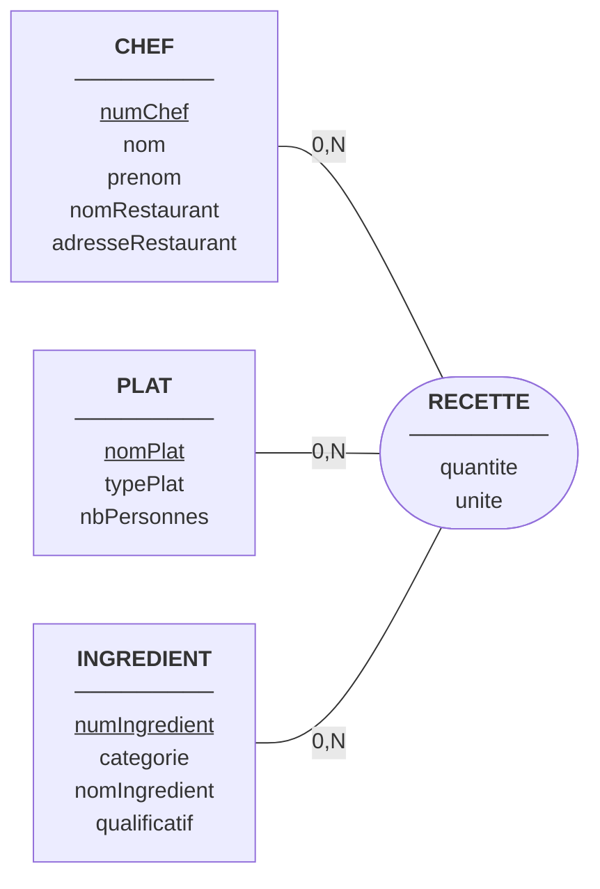
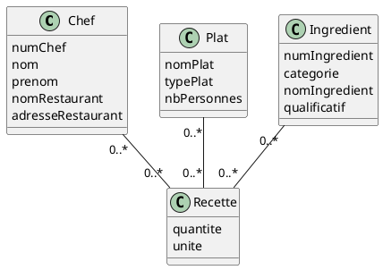

# Fiche de correction : TD 5, Les recettes du chef (R1.05)

## Hypothèses et choix de modélisation

- Un **plat** est identifié par sa **désignation** (ex. « le gigot d'agneau à l'estouffade »). Chaque plat a un **type** (entrée, viandes, poissons, pâtisserie…).
- Un plat est cuisiné **pour un nombre de personnes** : c'est une propriété du plat, et toutes les quantités de ses recettes s'entendent pour ce nombre. Une recette pour une personne est « ridicule », donc on impose **nbPersonnes ≥ 2**.
- Un **chef** n'est pas identifiable de façon fiable par son seul nom : on ajoute un identifiant artificiel **numChef**. Le nom, le prénom, et le nom et l'adresse du restaurant restent des attributs.
- Un **ingrédient** est reconnu par sa catégorie générale, son nom et son qualificatif. On lui ajoute un identifiant artificiel **numIngredient**.
- **Tous les chefs ne font pas tous les plats** : les cardinalités sont donc **0,N** des deux côtés.
- La quantité dépend du **chef, du plat et de l'ingrédient** à la fois (Pierre Lucullus met 200 g de chocolat noir et 6 œufs, Raymond Livius met 5 œufs et du rhum). D'où une **association ternaire** RECETTE.

---

## Question 1 : Modèle Entité-Association (MCD MERISE)

| Association | Entité     | Cardinalité | Signification                                                        |
| ----------- | ---------- | ----------- | -------------------------------------------------------------------- |
| RECETTE     | CHEF       | 0,N         | Un chef peut ne préparer aucune recette, ou en préparer plusieurs    |
| RECETTE     | PLAT       | 0,N         | Un plat peut n'être préparé par aucun chef, ou par plusieurs        |
| RECETTE     | INGREDIENT | 0,N         | Un ingrédient peut entrer dans plusieurs recettes, ou dans aucune    |

Un même triplet (chef, plat, ingrédient) n'apparaît qu'une fois : c'est la clé de l'association.

---

## Question 2 : Diagramme de classes simplifié (UML)

**Remarque :** UML représente en principe une association ternaire par un losange relié aux trois classes. La classe d'association Recette porte ici quantité et unité.

---

## Question 3 : Dictionnaire des données

| Libellé           | Signification                                              | Domaine conceptuel | Domaine logique      | Taille | Contrainte                                                             | Exemple                            |
| ----------------- | ---------------------------------------------------------- | ------------------ | -------------------- | ------ | ---------------------------------------------------------------------- | ---------------------------------- |
| numChef           | Identifiant unique d'un chef cuisinier                     | Numérique          | Entier               | –      | Clé primaire, unique, non nulle                                        | 1                                  |
| nom (chef)        | Nom de famille du chef                                     | Alphanumérique     | Chaîne de caractères | 50     | Non nul                                                                | Lucullus                           |
| prenom (chef)     | Prénom du chef                                             | Alphanumérique     | Chaîne de caractères | 50     | Non nul                                                                | Pierre                             |
| nomRestaurant     | Nom du restaurant où travaille le chef                     | Alphanumérique     | Chaîne de caractères | 100    | Non nul                                                                | Le Gourmet                         |
| adresseRestaurant | Adresse du restaurant                                      | Alphanumérique     | Chaîne de caractères | 200    | Non nulle                                                              | 2 place des Arceaux, 64100 Bayonne |
| nomPlat           | Désignation du plat, sert d'identifiant                    | Alphanumérique     | Chaîne de caractères | 200    | Clé primaire, unique, non nulle                                        | mousse au chocolat                 |
| typePlat          | Type de plat (entrée, viandes, poissons, pâtisserie…)      | Alphanumérique     | Chaîne de caractères | 30     | Non nul                                                                | pâtisserie                         |
| nbPersonnes       | Nombre de personnes pour lequel le plat est cuisiné        | Numérique          | Entier               | –      | Non nul, supérieur ou égal à 2                                         | 6                                  |
| numIngredient     | Identifiant unique d'un ingrédient                         | Numérique          | Entier               | –      | Clé primaire, unique, non nulle                                        | 12                                 |
| categorie         | Catégorie générale de l'ingrédient                         | Alphanumérique     | Chaîne de caractères | 50     | Non nulle (viande, poisson, légumes, crudités, farines, laitages…)     | laitages                           |
| nomIngredient     | Nom de l'ingrédient                                        | Alphanumérique     | Chaîne de caractères | 100    | Non nul                                                                | chocolat                           |
| qualificatif      | Qualificatif de l'ingrédient                               | Alphanumérique     | Chaîne de caractères | 50     | Facultatif                                                             | noir                               |
| quantite          | Quantité d'un ingrédient utilisée par un chef pour un plat | Numérique          | Réel                 | –      | Non nulle, strictement positive                                        | 200                                |
| unite             | Unité de la quantité                                       | Alphanumérique     | Chaîne de caractères | 15     | Non nulle (g, cl, cuillerée, œuf…)                                     | g                                  |

---

## Question 4 : Schéma relationnel

Légende : clés primaires soulignées ; clés étrangères précédées de #.

- **CHEF**(<u>numChef</u>, nom, prenom, nomRestaurant, adresseRestaurant)
- **PLAT**(<u>nomPlat</u>, typePlat, nbPersonnes)
- **INGREDIENT**(<u>numIngredient</u>, categorie, nomIngredient, qualificatif)
- **RECETTE**(<u>#numChef, #nomPlat, #numIngredient</u>, quantite, unite)

Justification :

- L'association ternaire RECETTE devient une **table de liaison** dont la clé primaire est composée des trois clés étrangères.
- **quantite** et **unite** dépendent de l'ensemble du triplet (chef, plat, ingrédient), donc ils sont placés dans RECETTE.
- **nbPersonnes** ne dépend que du plat : il reste dans PLAT et n'est pas dupliqué dans chaque ligne de recette.

---

## Question 5 : Extension du dictionnaire des données

| Libellé           | Domaine physique (SQL) | Contrainte d'intégrité                                                       | Justification                                  |
| ----------------- | ---------------------- | ---------------------------------------------------------------------------- | ---------------------------------------------- |
| numChef           | INT                    | PRIMARY KEY, AUTO_INCREMENT                                                  | Identifiant artificiel                         |
| nom (chef)        | VARCHAR(50)            | NOT NULL                                                                     |                                                |
| prenom (chef)     | VARCHAR(50)            | NOT NULL                                                                     |                                                |
| nomRestaurant     | VARCHAR(100)           | NOT NULL                                                                     |                                                |
| adresseRestaurant | VARCHAR(200)           | NOT NULL                                                                     |                                                |
| nomPlat           | VARCHAR(200)           | PRIMARY KEY, NOT NULL                                                        | Désignation longue                             |
| typePlat          | VARCHAR(30)            | NOT NULL, CHECK (typePlat IN ('entrée','viandes','poissons','pâtisserie'…))  | Types connus                                   |
| nbPersonnes       | INT                    | NOT NULL, CHECK (nbPersonnes >= 2)                                           | « Une recette pour une personne est ridicule » |
| numIngredient     | INT                    | PRIMARY KEY, AUTO_INCREMENT                                                  | Identifiant artificiel                         |
| categorie         | VARCHAR(50)            | NOT NULL                                                                     |                                                |
| nomIngredient     | VARCHAR(100)           | NOT NULL                                                                     |                                                |
| qualificatif      | VARCHAR(50)            | NULL autorisé                                                                | Facultatif                                     |
| quantite          | DECIMAL(8,2)           | NOT NULL, CHECK (quantite > 0)                                               |                                                |
| unite             | VARCHAR(15)            | NOT NULL                                                                     |                                                |

**Clés étrangères de RECETTE :** `numChef` référence CHEF(numChef), `nomPlat` référence PLAT(nomPlat), `numIngredient` référence INGREDIENT(numIngredient), avec `ON DELETE CASCADE`.
