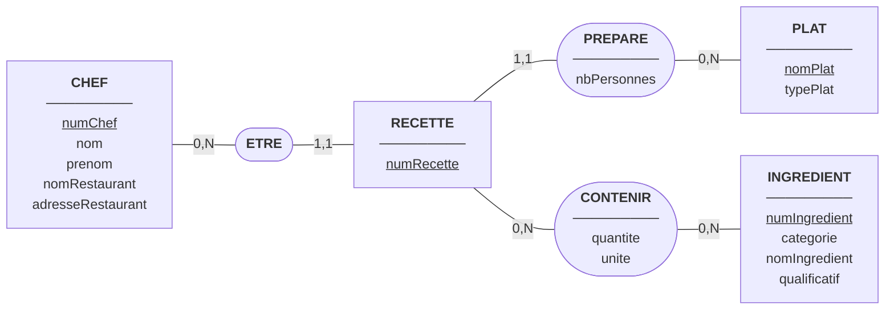
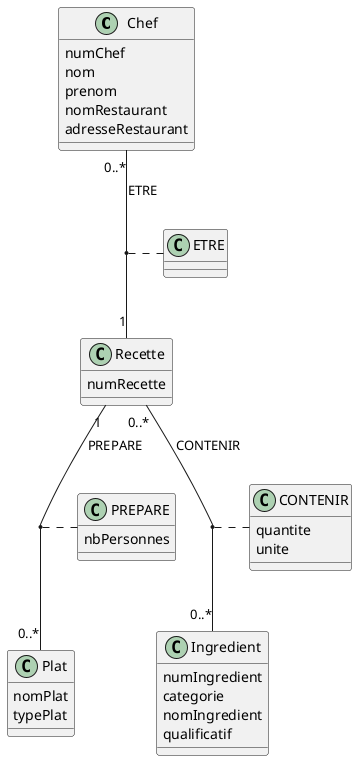

# Fiche de correction : TD 5, Les recettes du chef (R1.05), version 2

## Lecture de la modélisation

- **Classes** : CHEF, PLAT, INGREDIENT, RECETTE.
- **Classes d'association** :
  - **ETRE** relie un chef à la recette qu'il a écrite (une recette a un seul auteur).
  - **PREPARE** relie une recette au plat qu'elle permet de cuisiner ; il porte **nbPersonnes**.
  - **CONTENIR** relie une recette aux ingrédients qu'elle utilise ; il porte **quantite** et **unite**.

La recette est le centre du modèle : c'est elle qui porte la quantité, puisque Pierre Lucullus et Raymond Livius ont des recettes différentes pour la même mousse au chocolat.

Hypothèses complémentaires :

- Un chef a **0 à N** recettes, chaque recette a **un seul** chef.
- Une recette prépare **un seul** plat ; un plat peut être prépar par **0 à N** recettes.
- Une recette contient **0 à N** ingrédients ; un ingrédient entre dans **0 à N** recettes.
- Un couple (chef, plat) n'a qu'une recette : contrainte d'unicité sur la recette.
- Un plat est cuisiné pour un nombre de personnes **≥ 2**.

---

## Question 1 : Modèle Entité-Association (MCD MERISE)

| Association | Entité     | Cardinalité | Signification                                                       |
| ----------- | ---------- | ----------- | ------------------------------------------------------------------- |
| ETRE        | CHEF       | 0,N         | Un chef a écrit zéro, une ou plusieurs recettes                     |
| ETRE        | RECETTE    | 1,1         | Une recette est écrite par un seul chef                             |
| PREPARE     | RECETTE    | 1,1         | Une recette permet de cuisiner un seul plat                         |
| PREPARE     | PLAT       | 0,N         | Un plat peut être préparé par plusieurs recettes, ou aucune         |
| CONTENIR    | RECETTE    | 0,N         | Une recette contient zéro, un ou plusieurs ingrédients              |
| CONTENIR    | INGREDIENT | 0,N         | Un ingrédient entre dans zéro, une ou plusieurs recettes            |

---

## Question 2 : Diagramme de classes simplifié (UML)

---

## Question 3 : Dictionnaire des données

| Libellé           | Signification                                          | Domaine conceptuel | Domaine logique      | Contrainte                                                                 |
| ----------------- | ------------------------------------------------------ | ------------------ | -------------------- | -------------------------------------------------------------------------- |
| numChef           | Identifiant unique d'un chef                           | Numérique          | Entier               | Clé primaire, unique, non nulle                                            |
| nom (chef)        | Nom de famille du chef                                 | Alphanumérique     | Chaîne de caractères | Non nul                                                                    |
| prenom (chef)     | Prénom du chef                                         | Alphanumérique     | Chaîne de caractères | Non nul                                                                    |
| nomRestaurant     | Nom du restaurant où travaille le chef                 | Alphanumérique     | Chaîne de caractères | Non nul                                                                    |
| adresseRestaurant | Adresse du restaurant                                  | Alphanumérique     | Chaîne de caractères | Non nulle                                                                  |
| numRecette        | Identifiant unique d'une recette                       | Numérique          | Entier               | Clé primaire, unique, non nulle                                            |
| nomPlat           | Désignation du plat                                    | Alphanumérique     | Chaîne de caractères | Clé primaire, unique, non nulle                                            |
| typePlat          | Type du plat (entrée, viandes, poissons, pâtisserie…)  | Alphanumérique     | Chaîne de caractères | Non nul                                                                    |
| nbPersonnes       | Nombre de personnes pour lequel la recette est faite   | Numérique          | Entier               | Non nul, supérieur ou égal à 2                                             |
| numIngredient     | Identifiant unique d'un ingrédient                     | Numérique          | Entier               | Clé primaire, unique, non nulle                                            |
| categorie         | Catégorie générale de l'ingrédient                     | Alphanumérique     | Chaîne de caractères | Non nulle                                                                  |
| nomIngredient     | Nom de l'ingrédient                                    | Alphanumérique     | Chaîne de caractères | Non nul                                                                    |
| qualificatif      | Qualificatif de l'ingrédient                           | Alphanumérique     | Chaîne de caractères | Facultatif                                                                 |
| quantite          | Quantité d'un ingrédient dans une recette              | Numérique          | Réel                 | Non nulle, strictement positive                                            |
| unite             | Unité de la quantité                                   | Alphanumérique     | Chaîne de caractères | Non nulle                                                                  |

---

## Question 4 : Schéma relationnel

Légende : clés primaires soulignées ; clés étrangères précédées de #.

- **CHEF**(<u>numChef</u>, nom, prenom, nomRestaurant, adresseRestaurant)
- **PLAT**(<u>nomPlat</u>, typePlat)
- **INGREDIENT**(<u>numIngredient</u>, categorie, nomIngredient, qualificatif)
- **RECETTE**(<u>numRecette</u>, #numChef, #nomPlat, nbPersonnes)
- **CONTENIR**(<u>#numRecette, #numIngredient</u>, quantite, unite)

Justification :

- **ETRE** (1,1 côté RECETTE) devient une clé étrangère **#numChef** dans RECETTE.
- **PREPARE** (1,1 côté RECETTE) devient une clé étrangère **#nomPlat** dans RECETTE. L'attribut **nbPersonnes** de PREPARE est placé dans RECETTE pour la même raison.
- **CONTENIR** (0,N des deux côtés) devient une **table de liaison** dont la clé est composée de #numRecette et #numIngredient.
- Contrainte d'unicité : **UNIQUE (numChef, nomPlat)** dans RECETTE, pour qu'un chef n'ait qu'une recette par plat.

---

## Question 5 : Extension du dictionnaire des données

| Libellé       | Domaine physique (SQL) | Contrainte d'intégrité                                  |
| ------------- | ---------------------- | ------------------------------------------------------- |
| numChef       | INT                    | PRIMARY KEY, AUTO_INCREMENT                             |
| nom (chef)    | VARCHAR(50)            | NOT NULL                                                |
| prenom (chef) | VARCHAR(50)            | NOT NULL                                                |
| nomRestaurant | VARCHAR(100)           | NOT NULL                                                |
| adresseRestaurant | VARCHAR(200)       | NOT NULL                                                |
| numRecette    | INT                    | PRIMARY KEY, AUTO_INCREMENT                             |
| nomPlat       | VARCHAR(200)           | PRIMARY KEY, NOT NULL                                   |
| typePlat      | VARCHAR(30)            | NOT NULL, CHECK (typePlat IN ('entrée','viandes','poissons','pâtisserie'…)) |
| nbPersonnes   | INT                    | NOT NULL, CHECK (nbPersonnes >= 2)                      |
| numIngredient | INT                    | PRIMARY KEY, AUTO_INCREMENT                             |
| categorie     | VARCHAR(50)            | NOT NULL                                                |
| nomIngredient | VARCHAR(100)           | NOT NULL                                                |
| qualificatif  | VARCHAR(50)            | NULL autorisé                                           |
| quantite      | DECIMAL(8,2)           | NOT NULL, CHECK (quantite > 0)                          |
| unite         | VARCHAR(15)            | NOT NULL                                                |

**Clés étrangères :** RECETTE.numChef référence CHEF(numChef) ; RECETTE.nomPlat référence PLAT(nomPlat) ; CONTENIR.numRecette référence RECETTE(numRecette) ; CONTENIR.numIngredient référence INGREDIENT(numIngredient).
