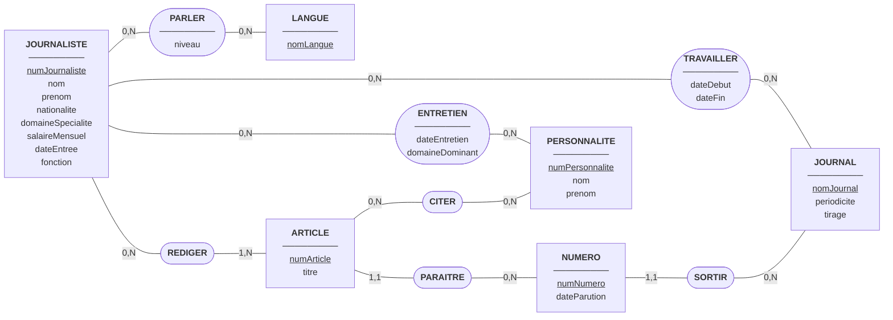
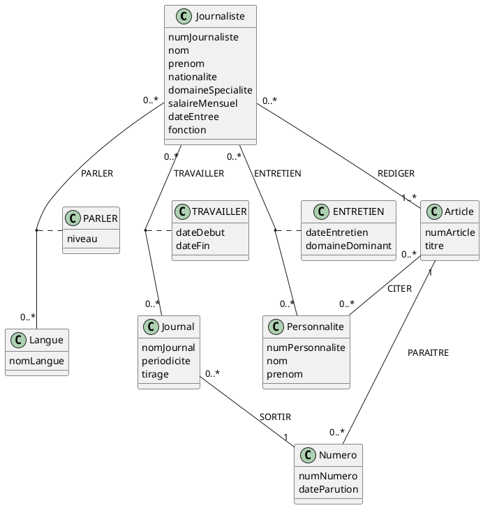
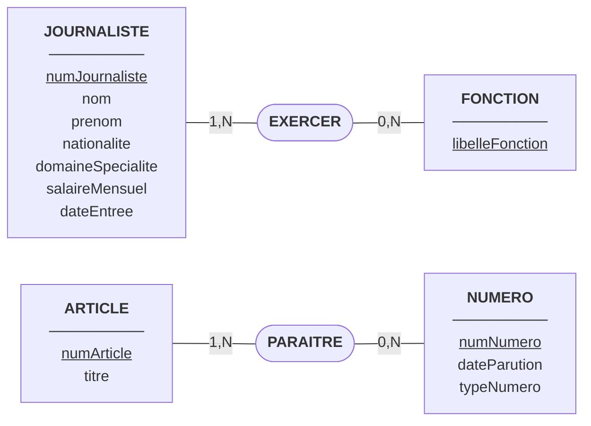

# Fiche de correction : TD 6, Suivi de l'activité du journal « Le Canard Embroché » (R1.05)

## Hypothèses et choix de modélisation

- Un **journaliste** est identifié par un **numéro** artificiel (le nom seul n'est pas fiable, on ne connaît que « Jeanjean L. »). Il a une nationalité unique, un domaine de spécialité, un salaire mensuel et une date d'entrée dans le journal.
- Un journaliste **parle plusieurs langues**, chacune avec un **niveau**. Les langues sont donc une entité LANGUE reliée au journaliste par l'association PARLER, qui porte le niveau. Aucun attribut « langue1, langue2, langue3 » n'est prévu.
- Un journaliste a travaillé pour **plusieurs journaux**, dont le sien. L'association TRAVAILLER porte la date de début et la date de fin. La date de fin est vide tant que le journaliste est en poste.
- Un **journal** a une périodicité et un tirage. « Le Canard Embroché » est une occurrence de JOURNAL, comme « IUT News » et « Le journal des nuls ».
- Un **numéro** appartient à un seul journal et a une date de parution.
- Une **personnalité** peut être interviewée plusieurs fois par le même journaliste. L'association ENTRETIEN porte donc la date de l'entretien dans sa clé, et le domaine dominant sous lequel la personnalité a été rencontrée.
- Un **article** est rédigé par **un ou plusieurs** journalistes (1,N côté ARTICLE). Il paraît dans **un seul** numéro (1,1 côté ARTICLE). Une personnalité peut être citée dans plusieurs articles et un article peut citer plusieurs personnalités.
- Le salaire « 1,5 KF » est lu comme 1 500 francs.

---

## Question 1 : Modèle Entité-Association (MCD MERISE)

Lecture des cardinalités :

| Association | Entité        | Cardinalité | Signification                                                       |
| ----------- | ------------- | ----------- | ------------------------------------------------------------------- |
| PARLER      | JOURNALISTE   | 0,N         | Un journaliste parle zéro, une ou plusieurs langues                 |
| PARLER      | LANGUE        | 0,N         | Une langue est parlée par zéro, un ou plusieurs journalistes        |
| TRAVAILLER  | JOURNALISTE   | 0,N         | Un journaliste a travaillé pour zéro, un ou plusieurs journaux       |
| TRAVAILLER  | JOURNAL       | 0,N         | Un journal emploie ou a employé zéro, un ou plusieurs journalistes  |
| ENTRETIEN   | JOURNALISTE   | 0,N         | Un journaliste réalise zéro, un ou plusieurs entretiens             |
| ENTRETIEN   | PERSONNALITE  | 0,N         | Une personnalité est interviewée zéro, une ou plusieurs fois        |
| REDIGER     | JOURNALISTE   | 0,N         | Un journaliste rédige zéro, un ou plusieurs articles                |
| REDIGER     | ARTICLE       | 1,N         | Un article est rédigé par un ou plusieurs journalistes              |
| CITER       | ARTICLE       | 0,N         | Un article cite zéro, une ou plusieurs personnalités                |
| CITER       | PERSONNALITE  | 0,N         | Une personnalité est citée dans zéro, un ou plusieurs articles      |
| PARAITRE    | ARTICLE       | 1,1         | Un article paraît dans un seul numéro                               |
| PARAITRE    | NUMERO        | 0,N         | Un numéro contient zéro, un ou plusieurs articles                   |
| SORTIR      | NUMERO        | 1,1         | Un numéro appartient à un seul journal                              |
| SORTIR      | JOURNAL       | 0,N         | Un journal a zéro, un ou plusieurs numéros                          |

---

## Question 2 : Diagramme de classes simplifié (UML)

---

## Question 3 : Dictionnaire des données

| Libellé           | Signification                                           | Domaine conceptuel | Domaine logique      | Contrainte                                                    | Exemple                           |
| ----------------- | ------------------------------------------------------- | ------------------ | -------------------- | ------------------------------------------------------------- | --------------------------------- |
| numJournaliste    | Identifiant unique d'un journaliste                     | Numérique          | Entier               | Clé primaire, unique, non nulle                               | 1                                 |
| nom (journaliste) | Nom de famille du journaliste                           | Alphanumérique     | Chaîne de caractères | Non nul                                                       | Jeanjean                          |
| prenom (journaliste) | Initiale ou prénom du journaliste                    | Alphanumérique     | Chaîne de caractères | Non nul                                                       | L.                                |
| nationalite       | Nationalité unique du journaliste                       | Alphanumérique     | Chaîne de caractères | Une seule valeur                                              | Serbe                             |
| domaineSpecialite | Domaine de spécialité du journaliste                    | Alphanumérique     | Chaîne de caractères | Non nul                                                       | économie                          |
| salaireMensuel    | Salaire mensuel brut en francs                          | Numérique          | Réel                 | Non nul, positif                                              | 1500                              |
| dateEntree        | Date d'entrée du journaliste dans le journal            | Date               | Date                 | Non nulle, antérieure ou égale à la date du jour              | 01/09/2018                        |
| fonction          | Fonction exercée (base : une seule)                     | Alphanumérique     | Chaîne de caractères | Non nulle                                                     | grand reporter                    |
| nomLangue         | Nom de la langue                                        | Alphanumérique     | Chaîne de caractères | Clé primaire, unique, non nulle                               | serbo-croate                      |
| niveau            | Niveau de maîtrise d'une langue                         | Alphanumérique     | Chaîne de caractères | Non nul (maîtrise complète, bon niveau, oral…)                | bon niveau                        |
| nomJournal        | Nom du journal                                          | Alphanumérique     | Chaîne de caractères | Clé primaire, unique, non nul                                 | Le Canard Embroché                |
| periodicite       | Fréquence de parution du journal                        | Alphanumérique     | Chaîne de caractères | Non nulle                                                     | quotidienne                       |
| tirage            | Nombre d'exemplaires imprimés                           | Numérique          | Entier               | Non nul, strictement positif                                  | 30                                |
| dateDebut         | Date de début de l'emploi du journaliste dans un journal | Date              | Date                 | Non nulle, clé de TRAVAILLER                                  | 09/1980                           |
| dateFin           | Date de fin de l'emploi                                 | Date               | Date                 | Vide tant que le journaliste est en poste, sinon postérieure à dateDebut | 11/1983                  |
| numPersonnalite   | Identifiant unique d'une personnalité                   | Numérique          | Entier               | Clé primaire, unique, non nulle                               | 7                                 |
| nom (personnalite) | Nom de famille de la personnalité                      | Alphanumérique     | Chaîne de caractères | Non nul                                                       | Le Mambo                          |
| prenom (personnalite) | Prénom de la personnalité                           | Alphanumérique     | Chaîne de caractères | Non nul                                                       | Jo                                |
| dateEntretien     | Date de l'entretien                                     | Date               | Date                 | Non nulle, clé de ENTRETIEN                                   | 12/03/1996                        |
| domaineDominant   | Domaine sous lequel la personnalité est rencontrée      | Alphanumérique     | Chaîne de caractères | Non nul                                                       | économie                          |
| numNumero         | Identifiant unique d'un numéro                          | Numérique          | Entier               | Clé primaire, unique, non nulle                               | 42                                |
| dateParution      | Date de parution du numéro                              | Date               | Date                 | Non nulle                                                     | 15/01/1995                        |
| numArticle        | Identifiant unique d'un article                         | Numérique          | Entier               | Clé primaire, unique, non nulle                               | 3                                 |
| titre (article)   | Titre de l'article                                      | Alphanumérique     | Chaîne de caractères | Non nul                                                       | …                                 |

---

## Question 4 : Schéma relationnel et extension du dictionnaire

Légende : clés primaires soulignées ; clés étrangères précédées de #.

- **JOURNALISTE**(<u>numJournaliste</u>, nom, prenom, nationalite, domaineSpecialite, salaireMensuel, dateEntree, fonction)
- **LANGUE**(<u>nomLangue</u>)
- **PARLER**(<u>#numJournaliste, #nomLangue</u>, niveau)
- **JOURNAL**(<u>nomJournal</u>, periodicite, tirage)
- **TRAVAILLER**(<u>#numJournaliste, #nomJournal, dateDebut</u>, dateFin)
- **PERSONNALITE**(<u>numPersonnalite</u>, nom, prenom)
- **ENTRETIEN**(<u>#numJournaliste, #numPersonnalite, dateEntretien</u>, domaineDominant)
- **NUMERO**(<u>numNumero</u>, dateParution, #nomJournal)
- **ARTICLE**(<u>numArticle</u>, titre, #numNumero)
- **REDIGER**(<u>#numJournaliste, #numArticle</u>)
- **CITER**(<u>#numArticle, #numPersonnalite</u>)

Justification :

- **PARLER**, **TRAVAILLER**, **ENTRETIEN**, **REDIGER** et **CITER** sont des associations N:N, donc des tables de liaison dont la clé est composée des clés étrangères.
- **dateEntretien** fait partie de la clé d'ENTRETIEN, parce qu'une même personnalité peut être interviewée plusieurs fois par le même journaliste.
- **PARAITRE** (1,1 côté ARTICLE) devient la clé étrangère **#numNumero** dans ARTICLE.
- **SORTIR** (1,1 côté NUMERO) devient la clé étrangère **#nomJournal** dans NUMERO.

Extension du dictionnaire (domaines physiques) :

| Libellé           | Domaine physique (SQL)          | Contrainte d'intégrité                              |
| ----------------- | ------------------------------- | --------------------------------------------------- |
| numJournaliste    | INT                             | PRIMARY KEY, AUTO_INCREMENT                         |
| nom, prenom       | VARCHAR(50)                     | NOT NULL                                            |
| nationalite       | VARCHAR(40)                     | NOT NULL                                            |
| domaineSpecialite | VARCHAR(50)                     | NOT NULL                                            |
| salaireMensuel    | DECIMAL(10,2)                   | NOT NULL, CHECK (salaireMensuel > 0)                |
| dateEntree        | DATE                            | NOT NULL                                            |
| fonction          | VARCHAR(50)                     | NOT NULL                                            |
| nomLangue         | VARCHAR(50)                     | PRIMARY KEY                                         |
| niveau            | VARCHAR(30)                     | NOT NULL                                            |
| nomJournal        | VARCHAR(100)                    | PRIMARY KEY, NOT NULL                               |
| periodicite       | VARCHAR(30)                     | NOT NULL                                            |
| tirage            | INT                             | NOT NULL, CHECK (tirage > 0)                        |
| dateDebut, dateFin | DATE                           | dateFin NULL autorisé, CHECK (dateFin >= dateDebut) |
| numPersonnalite   | INT                             | PRIMARY KEY, AUTO_INCREMENT                         |
| dateEntretien     | DATE                            | NOT NULL                                            |
| domaineDominant   | VARCHAR(50)                     | NOT NULL                                            |
| numNumero         | INT                             | PRIMARY KEY, AUTO_INCREMENT                         |
| dateParution      | DATE                            | NOT NULL                                            |
| numArticle        | INT                             | PRIMARY KEY, AUTO_INCREMENT                         |
| titre             | VARCHAR(200)                    | NOT NULL                                            |

---

## Question 5 : Évolution du modèle conceptuel

Les changements demandés sont examinés un par un.

1. **Tirage passé à 100 000 exemplaires.** C'est une simple mise à jour de la valeur de l'attribut *tirage* de l'occurrence « Le Canard Embroché ». Le modèle ne change pas. Il faut seulement que *tirage* soit un entier capable de stocker 100 000, donc pas un SMALLINT.

2. **Doublement du nombre de journalistes.** C'est une question de volume de données, pas de structure. Aucun changement sur le MCD.

3. **Journalistes parlant plus de trois langues.** Le modèle ne change pas. Les langues sont déjà gérées par l'association N:N PARLER, sans nombre limité. Il n'y a pas d'attribut « langue1, langue2, langue3 » à remplacer.

4. **Numéro spécial comportant les meilleurs articles.** Un article peut maintenant paraître dans **plusieurs numéros** : le numéro régulier et le numéro spécial. La cardinalité de PARAITRE passe donc de 1,1 à **1,N** côté ARTICLE, et PARAITRE devient une association N:N. On ajoute un attribut **typeNumero** à NUMERO (régulier ou spécial) pour distinguer les deux. La sélection des articles par le PDG n'a pas besoin d'association supplémentaire : être présent dans le numéro spécial suffit.

5. **Journalistes cumulant plusieurs fonctions.** L'attribut *fonction* de JOURNALISTE devient insuffisant. On crée une entité **FONCTION** (libelleFonction) reliée aux journalistes par l'association **EXERCER**, N:N. Côté JOURNALISTE, la cardinalité est 1,N : un journaliste a au moins une fonction. Côté FONCTION, elle est 0,N.

6. **Cravate.** Cette information ne correspond à aucune donnée à mémoriser. Elle n'a donc pas d'impact sur le modèle.

### MCD modifié

Les autres associations (PARLER, TRAVAILLER, ENTRETIEN, REDIGER, CITER, SORTIR) restent inchangées.

---

## Question 6 : Schéma relationnel modifié

- **JOURNALISTE**(<u>numJournaliste</u>, nom, prenom, nationalite, domaineSpecialite, salaireMensuel, dateEntree)
- **FONCTION**(<u>libelleFonction</u>)
- **EXERCER**(<u>#numJournaliste, #libelleFonction</u>)
- **LANGUE**(<u>nomLangue</u>)
- **PARLER**(<u>#numJournaliste, #nomLangue</u>, niveau)
- **JOURNAL**(<u>nomJournal</u>, periodicite, tirage)
- **TRAVAILLER**(<u>#numJournaliste, #nomJournal, dateDebut</u>, dateFin)
- **PERSONNALITE**(<u>numPersonnalite</u>, nom, prenom)
- **ENTRETIEN**(<u>#numJournaliste, #numPersonnalite, dateEntretien</u>, domaineDominant)
- **NUMERO**(<u>numNumero</u>, dateParution, typeNumero, #nomJournal)
- **ARTICLE**(<u>numArticle</u>, titre)
- **PARAITRE**(<u>#numArticle, #numNumero</u>)
- **REDIGER**(<u>#numJournaliste, #numArticle</u>)
- **CITER**(<u>#numArticle, #numPersonnalite</u>)

Extension du dictionnaire (ajouts et modifications) :

| Libellé       | Domaine physique (SQL)             | Contrainte d'intégrité                                  | Changement                       |
| ------------- | ---------------------------------- | ------------------------------------------------------- | -------------------------------- |
| libelleFonction | VARCHAR(50)                      | PRIMARY KEY, NOT NULL                                   | Nouvelle entité                  |
| tirage        | INT                                | NOT NULL, CHECK (tirage > 0)                            | Doit contenir 100 000            |
| typeNumero    | VARCHAR(20)                        | NOT NULL, CHECK (typeNumero IN ('régulier','spécial'))  | Nouvel attribut                  |
| fonction      | (supprimé de JOURNALISTE)          | –                                                       | Remplacé par EXERCER             |

**Clés étrangères :** EXERCER.numJournaliste référence JOURNALISTE(numJournaliste) ; EXERCER.libelleFonction référence FONCTION(libelleFonction) ; PARAITRE.numArticle référence ARTICLE(numArticle) ; PARAITRE.numNumero référence NUMERO(numNumero) ; NUMERO.nomJournal référence JOURNAL(nomJournal) ; PARLER, TRAVAILLER, ENTRETIEN, REDIGER et CITER référencent leurs entités respectives.
