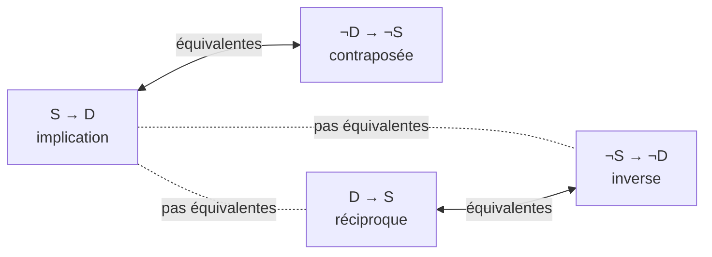
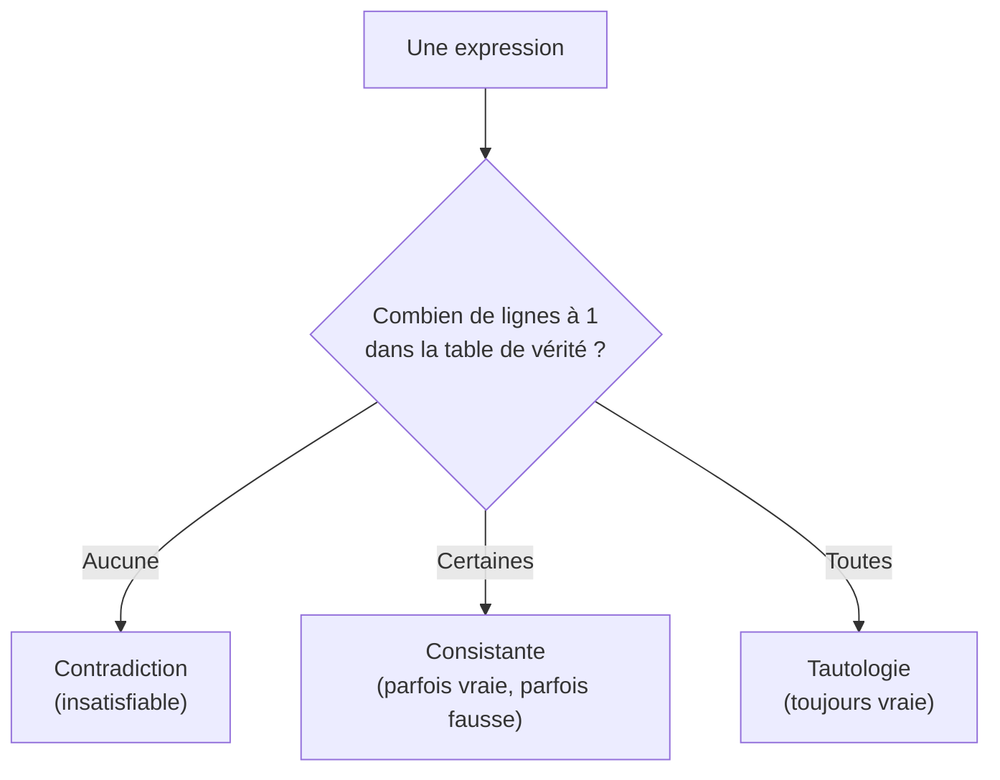

> [!note]
> **Version simple – l'essentiel en 3 minutes**
> La logique sert à **écrire des phrases sans ambiguïté** et à **calculer si elles sont vraies ou fausses**, un peu comme on calcule avec des nombres.
> 
> - Une **proposition** = une phrase qui est soit **vraie**, soit **fausse** (jamais les deux). « Il pleut » en est une. « Ferme la porte ! » n'en est pas une.
> - On les assemble avec des **connecteurs** : ∧ (**et**), ∨ (**ou**), ¬ (**non**), → (**si… alors**), ↔ (**si et seulement si**).
> - Une **table de vérité** liste tous les cas possibles (0 = faux, 1 = vrai) et donne le résultat pour chacun.
> - **Le piège n°1 : l'implication.** « A → B » n'est fausse que dans **un seul cas** : A vrai et B faux. Si A est faux, l'implication est vraie « par défaut ».
> - **Lois de Morgan** : « pas (A et B) » = « pas A ou pas B » ; « pas (A ou B) » = « pas A et pas B ».
> - **Contraposée** : « A → B » est équivalente à « non B → non A ». Par contre la **réciproque** « B → A » n'est **pas** équivalente.

> [!warning]
> **Les 3 erreurs classiques**
> - Croire que « si A est faux, alors A → B est fausse ». **Non** : elle est vraie.
> - Confondre **réciproque** (B → A) et **contraposée** (¬B → ¬A). Seule la contraposée est équivalente.
> - Mal appliquer Morgan : $\neg(A \land B) \equiv \neg A \lor \neg B$ (le **et** devient **ou** quand on nie, et inversement).

---

## 1. Pourquoi s'intéresser à la logique ?

| Raison | Idée |
| --- | --- |
| Lever l'ambiguïté du langage naturel | « Je regarde Paul avec des jumelles » peut avoir deux sens (c'est moi qui ai les jumelles, ou c'est Paul). La logique impose un sens unique. |
| Chercher la certitude | Les mathématiciens grecs (Pythagore, Euclide) exigent des **preuves** et pas seulement de l'intuition. Aristote formalise le **syllogisme** : « Tous les hommes sont mortels, Socrate est un homme, donc Socrate est mortel ». |
| Mécaniser le raisonnement (XIXᵉ et XXᵉ siècles) | Boole, Frege, Russell donnent à la logique une forme mathématique. Le projet de Russell se heurte à des paradoxes (celui du barbier), puis aux **théorèmes d'incomplétude de Gödel** (1931) : certains énoncés ne sont ni prouvables ni réfutables dans un système formel donné. |
| Naissance de l'informatique | Gödel et Turing (années 1930) formalisent la **calculabilité** : quelles opérations une procédure mécanique peut-elle réaliser ? Les **machines de Turing** sont un modèle abstrait du calcul. |
| Fonctionnement des ordinateurs | Les **portes logiques** (AND, OR, NOT…) réalisent des opérations sur des bits ; combinées, elles forment des circuits (logique booléenne). |
| Programmation | `if`, `while`, `for` reposent sur des **conditions booléennes**. La logique permet aussi de **vérifier** des programmes (propriétés, erreurs, contraintes). |
| Intelligence artificielle | **IA symbolique** (années 1950 : règles logiques, Prolog, systèmes experts) : rigoureuse et explicable, mais rigide. **IA connexionniste** (réseaux de neurones, deep learning, LLM) : apprend à partir de données, mais décisions souvent opaques. L'**IA neuro-symbolique** et l'**IA explicable (XAI)** cherchent à combiner les deux. |

**Plan du mini-cours de logique** : (1) logique des **propositions**, (2) logique des **prédicats** (extension avec paramètres, voir page 6), (3) **automatisation** du raisonnement (simplification de formes clausales).

## 2. Proposition

> [!note]
> **Définition.** Une **proposition** est un énoncé qui peut être déclaré **vrai ou faux sans ambiguïté** (une seule valeur de vérité). C'est le **principe de non-contradiction** : une proposition ne peut pas être vraie et fausse en même temps.

**Ce qui n'est pas une proposition** : « Ferme la porte ! » (ordre), « Quelle heure est-il ? » (question), « Je mens » et « cette phrase est fausse » (paradoxes).

**Le temps n'existe pas.** La logique propositionnelle est **statique** :

- « Il pleut » est une proposition (vraie ou fausse à l'instant où on la dit) ;
- « Il pleuvra demain » ou « il a cessé de pleuvoir » **ne sont pas** des propositions.

Une **proposition élémentaire** (ou **atome**, ou **variable propositionnelle**) est une proposition qu'on ne peut pas décomposer. Exemples : « Il pleut », « Paul mange », « 2+4=7 » (fausse), « 2+4=6 » (vraie).

## 3. Connecteurs logiques

À partir d'atomes, on construit des propositions plus complexes avec des **connecteurs**.

| Symbole | Nom | Se lit | Exemple (P : il pleut, S : il y a du soleil, A : il y a un arc-en-ciel) |
| --- | --- | --- | --- |
| $\land$ | conjonction | et | Il pleut et il y a du soleil : $P \land S$ |
| $\lor$ | disjonction | ou (inclusif) | Il pleut ou il y a du soleil : $P \lor S$ |
| $\neg$ | négation | non | Il ne pleut pas : $\neg P$ |
| $\to$ | implication | si… alors | S'il y a un arc-en-ciel, alors il pleut : $A \to P$ |
| $\leftrightarrow$ | équivalence | si et seulement si | Il pleut si et seulement s'il y a du soleil : $P \leftrightarrow S$ |

Exemple composé : « S'il pleut **et** s'il y a du soleil alors il y a un arc-en-ciel » s'écrit $(P \land S) \to A$.

**Deux signes à ne pas confondre :**

- $\leftrightarrow$ s'utilise **à l'intérieur** d'une expression ;
- $\equiv$ (comme un « = ») dit que **deux expressions** ont les mêmes tables de vérité.

## 4. Expression bien formée (ebf)

Une expression est **bien formée** si on peut l'obtenir avec ces règles (définition **récursive**) :

1. Les **atomes** sont des ebf.
2. Si A est une ebf, alors $\neg A$ est une ebf.
3. Si A et B sont des ebf, alors $(A \land B)$, $(A \lor B)$, $(A \Rightarrow B)$, $(A \Leftrightarrow B)$ sont des ebf.

Exemple : $(((A \lor B) \land \neg(A \Leftrightarrow \neg B)) \Rightarrow B)$ est bien formée.

Dans la suite du cours, on utilise des expressions « **presque bien formées** » : on enlève les parenthèses inutiles (notamment les extérieures).

**Exercice type : traduire du français en logique** (M : Paul fait des maths, G : de la gestion, A : de l'anglais)

| Phrase | Traduction |
| --- | --- |
| E1 : Paul fait des maths et de l'anglais mais pas de gestion | $M \land A \land \neg G$ |
| E2 : Paul fait des maths et de la gestion, mais pas à la fois de la gestion et de l'anglais | $M \land G \land \neg(G \land A)$ (équivalent à $M \land G \land \neg A$) |
| E3 : Il est faux que Paul fasse de l'anglais sans faire de maths | $\neg(A \land \neg M)$ (équivalent à $A \to M$) |
| E4 : Paul ne fait ni anglais, ni gestion, mais il fait des maths | $\neg A \land \neg G \land M$ |
| E5 : Il est faux que Pierre fasse de l'anglais ou de la gestion sans faire de maths | $\neg((A \lor G) \land \neg M)$ (équivalent à $(A \lor G) \to M$) ; la phrase est ambiguë, c'est l'interprétation la plus naturelle |

**Astuce de traduction** : « ni A, ni B » = $\neg A \land \neg B$ ; « A mais B » = $A \land B$ ; « A sans B » = $A \land \neg B$.

## 5. Interprétation et tables de vérité

**Interpréter** une expression, c'est lui donner une **valeur de vérité** (1 = vrai, 0 = faux) en fixant d'abord la valeur de chaque atome. Exemple : avec A=1, B=1, C=0, l'expression $A \to (C \land B)$ est **fausse** (car $C \land B = 0$ et A=1).

Une **table de vérité** liste toutes les interprétations (une ligne chacune) :

- nombre de **lignes** : $2^n$ où n est le nombre d'atomes ;
- nombre de **colonnes** : atomes + étapes intermédiaires + résultat.

### 5.1 Tables des connecteurs

| A | B | $\neg A$ | $A \land B$ | $A \lor B$ | $A \to B$ | $A \leftrightarrow B$ |
| --- | --- | --- | --- | --- | --- | --- |
| 0 | 0 | 1 | 0 | 0 | 1 | 1 |
| 0 | 1 | 1 | 0 | 1 | 1 | 0 |
| 1 | 0 | 0 | 0 | 1 | 0 | 0 |
| 1 | 1 | 0 | 1 | 1 | 1 | 1 |

**À retenir** : « et » = vrai seulement si **les deux** sont vrais ; « ou » = faux seulement si **les deux** sont faux ; « → » = faux seulement pour (1, 0) ; « ↔ » = vrai si A et B ont la **même** valeur.

### 5.2 Exemple complet : table de $(\neg A \lor B) \land (A \land C)$

| A | B | C | $\neg A$ | $\neg A \lor B$ | $A \land C$ | **Résultat** |
| --- | --- | --- | --- | --- | --- | --- |
| 1 | 1 | 1 | 0 | 1 | 1 | **1** |
| 1 | 1 | 0 | 0 | 1 | 0 | 0 |
| 1 | 0 | 1 | 0 | 0 | 1 | 0 |
| 1 | 0 | 0 | 0 | 0 | 0 | 0 |
| 0 | 1 | 1 | 1 | 1 | 0 | 0 |
| 0 | 1 | 0 | 1 | 1 | 0 | 0 |
| 0 | 0 | 1 | 1 | 1 | 0 | 0 |
| 0 | 0 | 0 | 1 | 1 | 0 | 0 |

L'expression n'est vraie que pour A=B=C=1 : elle est donc équivalente à $A \land B \land C$.

### 5.3 Propriétés des connecteurs

$\equiv$ signifie « **mêmes tables de vérité** ». Toutes ces propriétés se **démontrent avec des tables de vérité**.

| Propriété | Formules |
| --- | --- |
| Commutativité | $A \lor B \equiv B \lor A$ ; $A \land B \equiv B \land A$ |
| Associativité | $(A \lor B) \lor C \equiv A \lor (B \lor C)$ ; $(A \land B) \land C \equiv A \land (B \land C)$ |
| Distributivité | $A \lor (B \land C) \equiv (A \lor B) \land (A \lor C)$ ; $A \land (B \lor C) \equiv (A \land B) \lor (A \land C)$ |
| Idempotence | $A \lor A \equiv A$ ; $A \land A \equiv A$ |
| Double négation | $\neg\neg A \equiv A$ |
| **Lois de Morgan (très important)** | $\neg(A \land B) \equiv \neg A \lor \neg B$ ; $\neg(A \lor B) \equiv \neg A \land \neg B$ |

> [!tip]
> **Morgan avec un exemple.** Si je **ne suis pas** inscrit à la fois en anglais et en chinois ($\neg(A \land C)$), c'est qu'il y a **au moins un** des deux cours que je ne suis pas : $\neg A \lor \neg C$.
> Si je ne suis inscrit **ni** en anglais **ni** en chinois ($\neg A \land \neg C$), c'est que je ne suis inscrit dans **aucun des deux** : $\neg(A \lor C)$.

## 6. L'implication (et l'équivalence)

### 6.1 Deux « implications » différentes

- L'**implication mathématique** $\Rightarrow$ exprime une **conséquence** dans un raisonnement : on suppose A vraie et on **démontre** B. Exemple : pour tout entier n, « n pair ⇒ n² pair » (si n = 2k, alors n² = 4k² = 2×(2k²), donc pair).
- Le **connecteur** $\to$ est plus général : il ne décrit pas forcément une démonstration ni un lien de cause. Il relie seulement les **valeurs de vérité** de A et de B. Intuitivement : **si A est vraie, alors B doit être vraie**.

### 6.2 Quand A → B est-elle vraie ou fausse ?

| Cas | Exemple | A → B |
| --- | --- | --- |
| A vrai, B vrai | « Si 2 est pair, alors 4 est pair » (avec lien) ; « Si 2 est pair, alors 5×5 = 25 » (sans aucun lien) | **Vraie** |
| A vrai, B faux | « Si 2 est pair, alors 3 est pair » | **Fausse** (le seul contre-exemple) |
| A faux, B vrai | « Si 2 est impair, alors 4 est pair » | **Vraie** « par défaut » |
| A faux, B faux | « Si 2 est impair, alors 4 est impair » | **Vraie** « par défaut » |

**Bilan** : A est l'**antécédent**, B le **conséquent**. $A \to B$ n'est **fausse que si A est vraie et B fausse**. Si A est fausse, on « n'affirme rien », donc on ne peut pas la contredire : elle est vraie.

**Formules à connaître :**

- $A \to B \equiv \neg A \lor B$
- $\neg(A \to B) \equiv A \land \neg B$
- $A \leftrightarrow B \equiv (A \to B) \land (B \to A)$ (A et B ont **les mêmes valeurs de vérité**)

## 7. Contraposée et réciproque

Un parent dit (et ne ment pas) : « **si tu manges ta soupe (S), alors tu as du dessert (D)** » : $S \to D$.

- Ça ne veut **pas** dire « s'il ne mange pas sa soupe, il n'a pas de dessert » : $S \to D$ n'implique pas $\neg S \to \neg D$. Si l'enfant ne mange pas sa soupe, il peut avoir du dessert sans que le parent ait menti.
- Ça ne veut **pas** dire non plus « s'il a du dessert, il a mangé sa soupe » : $D \to S$ est la **réciproque**, elle n'est **pas équivalente** à $S \to D$.
- Par contre, « **s'il n'a pas de dessert, c'est sûr qu'il n'a pas mangé sa soupe** » : $\neg D \to \neg S$ est la **contraposée**, **équivalente** à $S \to D$.

**Justification** : $S \to D \equiv \neg S \lor D \equiv D \lor \neg S \equiv \neg(\neg D) \lor \neg S \equiv \neg D \to \neg S$.

**À retenir** : l'implication et sa contraposée disent la même chose ; la réciproque et l'inverse disent la même chose entre elles, mais autre chose que l'implication de départ.

## 8. Vocabulaire : consistance, contradiction, tautologie

| Terme | Définition | Exemple |
| --- | --- | --- |
| **Modèle** | Une interprétation pour laquelle l'expression est **vraie** | A=0, B=1, C=0 est un modèle de $A \to (C \land B)$ |
| **Consistante** (satisfiable) | Elle a **au moins un modèle** | $A \to (C \land B)$ |
| **Inconsistante** (insatisfiable, contradiction) | **Aucun modèle** : toujours fausse | $A \land \neg A$ |
| **Tautologie** (valide), notée $\models A$ | **Toujours vraie** | $A \lor \neg A$ ; $A \to A$ ; $A \equiv \neg\neg A$ |

Une tautologie est aussi consistante (elle a des modèles : tous !).

## 9. Exercices corrigés

### 9.1 Paul reste à la maison ou va au parc (M : maison, P : parc)

Le sujet parle de « A → ¬B » : on prend A = M et B = P, soit $M \to \neg P$.

| Proposition | Traduction | Remarque |
| --- | --- | --- |
| a. maison et parc | $M \land P$ |   |
| b. si pas parc, alors pas maison | $\neg P \to \neg M$ | ≡ $M \to P$ |
| c. ni maison ni parc | $\neg M \land \neg P$ |   |
| d. maison ou parc | $M \lor P$ | ≡ **réciproque** de $M \to \neg P$ (c'est $\neg P \to M$) |
| e. si parc, alors pas maison | $P \to \neg M$ | ≡ **l'implication** $M \to \neg P$ (c'est sa contraposée) |
| f. maison et pas parc | $M \land \neg P$ |   |
| g. si pas maison, alors pas parc | $\neg M \to \neg P$ | ≡ $P \to M$ |
| h. maison ou pas parc | $M \lor \neg P$ | ≡ $P \to M$ |

**Réponse** : équivalente à l'implication : **e** ; équivalente à sa réciproque : **d**.

### 9.2 Paul fait ses devoirs (D) ou scrolle sur son téléphone (S)

| Expression | Formule | En français |
| --- | --- | --- |
| a. $S \to \neg D$ | $S \to \neg D$ | Si Paul scrolle, il ne fait pas ses devoirs. |
| b. contraposée de a | $D \to \neg S$ | Si Paul fait ses devoirs, il ne scrolle pas. |
| c. négation de a | $S \land D$ | Paul scrolle et fait ses devoirs. |
| d. négation de la réciproque de a | $\neg D \land \neg S$ (réciproque : $\neg D \to S$) | Paul ne fait pas ses devoirs et ne scrolle pas. |
| e. contraposée de la réciproque de a | $\neg S \to D$ (≡ $S \lor D$) | Si Paul ne scrolle pas, il fait ses devoirs. |

**Équivalences** : seules **a et b** sont équivalentes entre elles.

### 9.3 Si A et B sont vraies (A = B = 1)

| Expression | Calcul | Valeur |
| --- | --- | --- |
| $(\neg A \land B) \to \neg(A \lor B)$ | antécédent = 0∧1 = 0 | **Vraie** |
| $(A \lor B) \to (\neg A \land B)$ | 1 → 0 | **Fausse** |
| $\neg(A \lor B) \to (\neg A \land B)$ | antécédent = 0 | **Vraie** |
| $(\neg A \lor B) \to \neg(A \lor B)$ | 1 → 0 | **Fausse** |

### 9.4 Paul prend des notes (N) ou s'endort en cours (D)

**1.** La négation de $D \to \neg N$ est $D \land N$ : seule la proposition **« Paul prend des notes et s'endort »** convient.

**2.** Traductions :

- a. contraposée de la réciproque de $D \to \neg N$ : $\neg D \to N$ : « Si Paul ne s'endort pas, il prend des notes. »
- b. réciproque de $D \to \neg N$ : $\neg N \to D$ : « Si Paul ne prend pas de notes, il s'endort. »
- c. $D \to \neg N$ : « Si Paul s'endort, il ne prend pas de notes. »
- d. négation de la réciproque de $N \to \neg D$ : $\neg D \land \neg N$ : « Paul ne s'endort pas et ne prend pas de notes. »
- e. négation de $D \to \neg N$ : $D \land N$ : « Paul s'endort et prend des notes. »
- f. contraposée de $D \to \neg N$ : $N \to \neg D$ : « Si Paul prend des notes, il ne s'endort pas. »

### 9.5 Jules (J : jeux vidéo, T : travaille, S : sort avec ses amis)

| Phrase | Formule |
| --- | --- |
| P1 : Si Jules travaille, il ne joue pas | $T \to \neg J$ |
| P2 : Jules ne travaille pas et il sort | $\neg T \land S$ |
| P3 : Si Jules ne sort pas, alors il travaille ou joue | $\neg S \to (T \lor J)$ |
| P4 : Jules travaille uniquement s'il ne joue pas | $T \to \neg J$ (« uniquement si » = condition nécessaire) |
| P5 : Jules travaille et ne sort pas, ou bien il joue | $(T \land \neg S) \lor J$ |
| P6 : négation de P3 | $\neg S \land \neg T \land \neg J$ : Jules ne sort pas, ne travaille pas et ne joue pas. |
| P7 : réciproque de P4 | $\neg J \to T$ : si Jules ne joue pas, alors il travaille. |
| P8 : contraposée de P4 | $J \to \neg T$ : si Jules joue, alors il ne travaille pas. |

**Équivalences** : **P1 ≡ P4 ≡ P8**. Les autres sont deux à deux non équivalentes (par exemple P3 ≡ $S \lor T \lor J$ alors que P7 ≡ $J \lor T$).

### 9.6 Vrai, faux ou cela dépend ?

| Expression | Nature | Justification |
| --- | --- | --- |
| $A \lor \neg A$ | Tautologie | un des deux est toujours vrai |
| $A \land \neg A$ | Contradiction | A et non A ne sont jamais vrais ensemble |
| $A \to A$ | Tautologie | $\neg A \lor A$ |
| $A \to B$ | Consistante | vraie pour (0,0), fausse pour (1,0) |
| $(A \to B) \land A \land \neg B$ | Contradiction | A et $A \to B$ donnent B, mais on a aussi $\neg B$ |
| $(A \to B) \lor (\neg A \land B)$ | Consistante | $\neg A \land B$ implique $\neg A \lor B$, donc ≡ $A \to B$ ; fausse pour A=1, B=0 |
| $(A \lor B) \land (\neg A \land \neg B)$ | Contradiction | $\neg A \land \neg B \equiv \neg(A \lor B)$ (Morgan) |
| $(A \to B) \leftrightarrow (\neg B \to \neg A)$ | Tautologie | une implication est toujours équivalente à sa contraposée |

**Méthode** : construire la table de vérité ; **que des 1** → tautologie ; **que des 0** → contradiction ; **un mélange** → consistante.

Test d'entraînement : « Logique des propositions » (QR code du document 5, sur elearn).