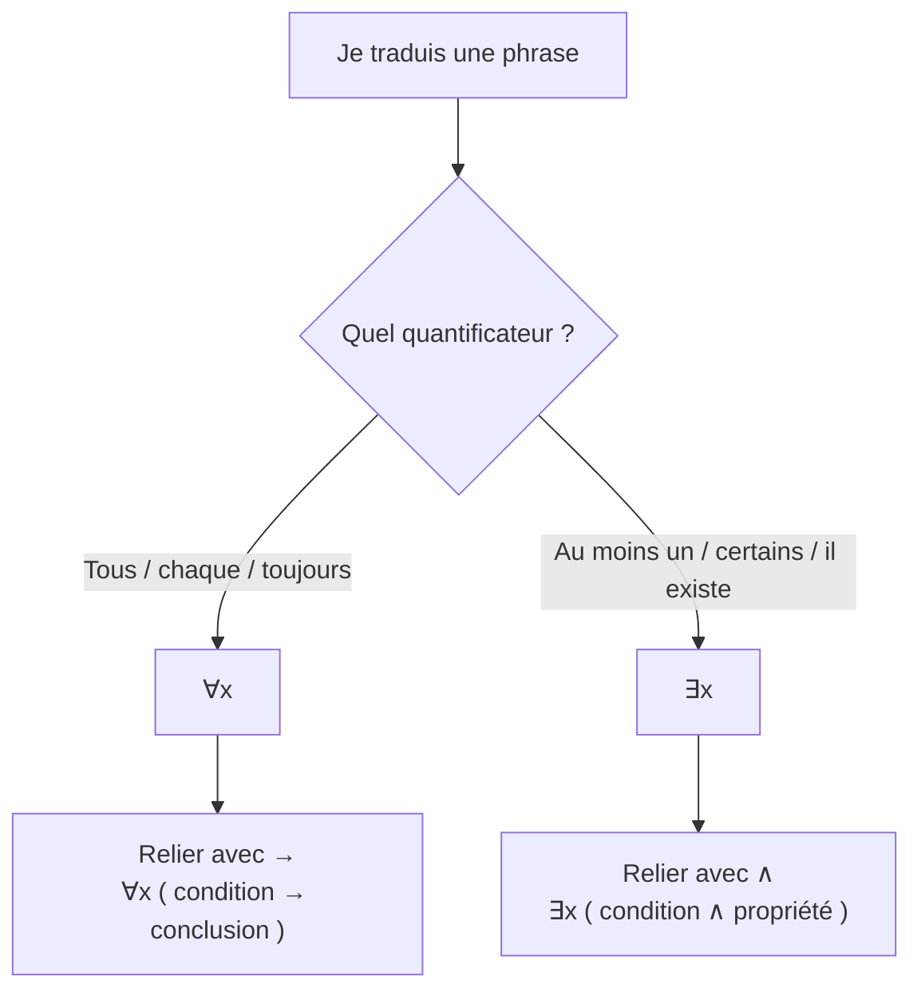

> [!note]
> **Version simple – l'essentiel en 3 minutes**
> La logique des propositions ne sait parler que de **faits précis** (« Paul est inscrit »). La logique des **prédicats** permet de parler de **tout le monde** ou de **quelqu'un**.
> 
> - Un **prédicat** est une **phrase à trous** : $E(x)$ = « x est un étudiant ». Selon la valeur qu'on met à la place de x, c'est vrai ou faux.
> - $\forall x$ = **« pour tout x »** (tout le monde, chaque, tous).
> - $\exists x$ = **« il existe un x »** (quelqu'un, au moins un, certains).
> - **Règle d'or de la traduction** :
>     - avec **∀**, on utilise **→** : « Tous les étudiants sont inscrits » = $\forall x\ E(x) \to I(x)$ ;
>     - avec **∃**, on utilise **∧** : « Un étudiant est présent » = $\exists x\ E(x) \land P(x)$.
> - **Nier une phrase avec quantificateur** : on **change le quantificateur** (∀ devient ∃, ∃ devient ∀) puis on **nie ce qui suit**.
>     - « Tout le monde est présent » → nier → « **Il existe quelqu'un d'absent** ».
> - **Ordre des quantificateurs** : « tout le monde aime quelqu'un » n'est **pas** « quelqu'un est aimé de tous ».

> [!warning]
> **Pièges à éviter**
> - ∀ avec ∧ (« tous les étudiants **et** inscrits » veut dire que **tout le monde** est étudiant : faux) et ∃ avec → (trop facile à rendre vrai : il suffit d'un non-étudiant).
> - Inverser l'ordre de ∀ et ∃ : $\forall x \exists y\ P(x,y) \not\equiv \exists y \forall x\ P(x,y)$.
> - Distribuer ∀ sur « ou » ou ∃ sur « et » : ça **ne marche pas**.

---

## 1. Prédicat

> [!note]
> **Définition.** Un **prédicat** est un énoncé dont la **valeur de vérité dépend d'un ou plusieurs paramètres**.

- **Proposition** : « Paul est inscrit en math » (vraie ou fausse, point).
- **Prédicat** : $I(x, y)$ : « x est inscrit en y ». En remplaçant x et y, on obtient une proposition : $I(Paul, Math)$.

Autres prédicats : $E(x)$ : x est un étudiant ; $P(x)$ : x est présent.

**La logique des prédicats (ou du premier ordre)** est une extension de la logique des propositions : on garde les connecteurs ($\land, \lor, \neg, \to, \leftrightarrow$) et on ajoute les prédicats et les quantificateurs.

## 2. Quantificateurs

| Symbole | Nom | Se lit | Vrai si… |
| --- | --- | --- | --- |
| $\forall x\ P(x)$ | universel | pour tout x, P(x) | **toute** valeur de x rend P(x) vrai |
| $\exists x\ P(x)$ | existentiel | il existe x tel que P(x) | **au moins une** valeur de x rend P(x) vrai |

Un ∀ est donc comme un **« et » géant** sur tous les éléments, un ∃ comme un **« ou » géant**.

## 3. Traduire du français en prédicats

Avec $I(x,y)$ : x est inscrit en y ; $E(x)$ : x est étudiant ; $P(x)$ : x est présent.

### 3.1 Sans quantificateur (sur Paul)

| Phrase | Formule |
| --- | --- |
| Paul est un étudiant inscrit en math | $E(Paul) \land I(Paul, Math)$ |
| Si Paul est présent alors il est inscrit en math | $P(Paul) \to I(Paul, Math)$ |
| Paul n'est pas étudiant mais il est inscrit en math | $\neg E(Paul) \land I(Paul, Math)$ |

### 3.2 Avec quantificateurs : attention au mot « un »

| Phrase | Formule | Pourquoi |
| --- | --- | --- |
| Jean est inscrit à au moins un cours | $\exists x\ I(Jean, x)$ | « un cours » = ∃ |
| Il y a au moins un inscrit en math | $\exists x\ I(x, math)$ |   |
| Il y a au moins un étudiant inscrit en math | $\exists x\ E(x) \land I(x, math)$ | ∃ → ∧ |
| Un étudiant est présent | $\exists x\ E(x) \land P(x)$ | ∃ → ∧ |
| Tous sont inscrits en math | $\forall x\ I(x, math)$ |   |
| Tous les étudiants sont inscrits en math | $\forall x\ E(x) \to I(x, math)$ | ∀ → → |
| Un étudiant est toujours inscrit à au moins un cours | $\forall x\ E(x) \to \exists y\ I(x,y)$ | ici « un étudiant » veut dire « tout étudiant » |
| Un étudiant inscrit en informatique est aussi inscrit en math | $\forall x\ (E(x) \land I(x, info)) \to I(x, math)$ | idem : « un » = « tout » |

**Le mot « un » est piégeux** : tantôt « il existe » (« un étudiant est présent »), tantôt « tout » (« un étudiant est toujours inscrit… »). Pour trancher, se demander : *parle-t-on d'un cas particulier, ou d'une règle générale ?*

## 4. Propriétés des quantificateurs

### 4.1 Ordre des quantificateurs

> [!warning]
> $\forall x\, \exists y\ P(x,y) \not\equiv \exists y\, \forall x\ P(x,y)$

Avec $A(x,y)$ : « x aime y » :

- $\forall x\, \exists y\ A(x,y)$ : **« Tout le monde aime quelqu'un »** (chacun a quelqu'un, pas forcément le même) ;
- $\exists y\, \forall x\ A(x,y)$ : **« Il existe quelqu'un que tout le monde aime »** (la même personne pour tous).

La deuxième est **plus forte** : elle entraîne la première, pas l'inverse. Deux quantificateurs **de même nature** peuvent par contre être échangés ($\forall x \forall y \equiv \forall y \forall x$).

### 4.2 Quantificateurs et négation

$\neg(\forall x\ P(x)) \equiv \exists x\ \neg P(x)$

$\neg(\exists x\ P(x)) \equiv \forall x\ \neg P(x)$

Exemple : P(x) : « x est présent ». La négation de « tout le monde est présent » est « il existe (au moins) un absent ».

**Recette pour nier une formule** :

1. Remplacer chaque ∀ par ∃ et chaque ∃ par ∀ ;
2. Nier le prédicat final (en utilisant Morgan et $\neg(A \to B) \equiv A \land \neg B$).

| Formule | Négation |
| --- | --- |
| $\forall x\ E(x) \to I(x, math)$ | $\exists x\ E(x) \land \neg I(x, math)$ : il existe un étudiant non inscrit en math |
| $\exists x\ E(x) \land P(x)$ | $\forall x\ E(x) \to \neg P(x)$ : aucun étudiant n'est présent |
| $\forall x\, \exists y\ A(x,y)$ | $\exists x\, \forall y\ \neg A(x,y)$ : quelqu'un n'aime personne |

### 4.3 Quantificateurs et connecteurs

**Ce qui marche :**

- $\exists x\ (P(x) \lor Q(x)) \equiv \exists x\ P(x) \lor \exists x\ Q(x)$
- $\forall x\ (P(x) \land Q(x)) \equiv \forall x\ P(x) \land \forall x\ Q(x)$

**Ce qui ne marche pas (attention) :**

- $\forall x\ (P(x) \lor Q(x)) \not\equiv \forall x\ P(x) \lor \forall x\ Q(x)$
- $\exists x\ (P(x) \land Q(x)) \not\equiv \exists x\ P(x) \land \exists x\ Q(x)$

**Contre-exemple avec les lettres** (x est une lettre, P(x) : consonne, Q(x) : voyelle) :

| Formule | En français | Valeur |
| --- | --- | --- |
| $\forall x\ (P(x) \lor Q(x))$ | Toute lettre est une consonne ou une voyelle | **Vraie** |
| $\forall x\ P(x) \lor \forall x\ Q(x)$ | Toute lettre est une consonne, ou toute lettre est une voyelle | **Fausse** (deux fausses) |
| $\exists x\ (P(x) \land Q(x))$ | Il existe une lettre à la fois consonne et voyelle | **Fausse** |
| $\exists x\ P(x) \land \exists x\ Q(x)$ | Il existe une consonne et il existe une voyelle | **Vraie** |

Donc les formules ne sont pas équivalentes.

## 5. Exercices corrigés

### 5.1 Journée des anciens (A : ancien de l'IUT, D : développeur, J : participe à la journée des anciens)

| Proposition | Prédicats | Négation (prédicats) | Négation (français) |
| --- | --- | --- | --- |
| P1 : Paul est un ancien qui participe | $A(Paul) \land J(Paul)$ | $\neg A(Paul) \lor \neg J(Paul)$ | Paul n'est pas un ancien, ou ne participe pas |
| P2 : Tous les anciens sont développeurs | $\forall x\ A(x) \to D(x)$ | $\exists x\ A(x) \land \neg D(x)$ | Il existe un ancien qui n'est pas développeur |
| P3 : Au moins un participant n'est pas un ancien | $\exists x\ J(x) \land \neg A(x)$ | $\forall x\ J(x) \to A(x)$ | Tous les participants sont des anciens |
| P4 : Si un ancien participe, alors il est développeur | $\forall x\ (A(x) \land J(x)) \to D(x)$ | $\exists x\ A(x) \land J(x) \land \neg D(x)$ | Il existe un ancien qui participe sans être développeur |
| P5 : Si tous les anciens participent, alors au moins un développeur participe | $(\forall x\ A(x) \to J(x)) \to \exists x\ D(x) \land J(x)$ | $(\forall x\ A(x) \to J(x)) \land \forall x\ D(x) \to \neg J(x)$ | Tous les anciens participent et aucun développeur ne participe |

### 5.2 Filles, chats, vélos (F : fille, C : a un chat, V : a un vélo, M : mange, L : lit)

**Situation** : Jeanne et Lucie sont des filles ; Paul et Marc des garçons ; Jeanne et Paul ont un chat ; Marc et Lucie ont un vélo ; Jeanne lit ; Paul, Marc et Lucie mangent. **Ce qui n'est pas dit est faux** (Jeanne ne mange pas, par exemple).

| Proposition | Prédicats | Valeur | Négation (prédicats) | Négation (français) |
| --- | --- | --- | --- | --- |
| P1 : Jeanne mange ou lit | $M(Jeanne) \lor L(Jeanne)$ | **Vrai** (elle lit) | $\neg M(Jeanne) \land \neg L(Jeanne)$ | Jeanne ne mange pas et ne lit pas |
| P2 : Si Paul et Marc mangent, alors Lucie ne lit pas | $(M(Paul) \land M(Marc)) \to \neg L(Lucie)$ | **Vrai** | $M(Paul) \land M(Marc) \land L(Lucie)$ | Paul et Marc mangent et Lucie lit |
| P3 : Si quelqu'un lit, tout le monde mange | $(\exists x\ L(x)) \to \forall y\ M(y)$ | **Faux** (Jeanne lit mais ne mange pas) | $(\exists x\ L(x)) \land \exists y\ \neg M(y)$ | Quelqu'un lit et quelqu'un ne mange pas |
| P4 : Tous les garçons mangent | $\forall x\ \neg F(x) \to M(x)$ | **Vrai** | $\exists x\ \neg F(x) \land \neg M(x)$ | Il existe un garçon qui ne mange pas |
| P5 : Aucune fille n'a de vélo | $\forall x\ F(x) \to \neg V(x)$ | **Faux** (Lucie) | $\exists x\ F(x) \land V(x)$ | Au moins une fille a un vélo |
| P6 : Certains garçons ne lisent pas | $\exists x\ \neg F(x) \land \neg L(x)$ | **Vrai** (Paul) | $\forall x\ \neg F(x) \to L(x)$ | Tous les garçons lisent |
| P7 : Si une fille lit, alors une fille mange | $(\exists x\ F(x) \land L(x)) \to \exists y\ F(y) \land M(y)$ | **Vrai** (Jeanne lit, Lucie mange) | $(\exists x\ F(x) \land L(x)) \land \forall y\ F(y) \to \neg M(y)$ | Une fille lit et aucune fille ne mange |
| P8 : Si une fille lit, alors elle mange | $\forall x\ (F(x) \land L(x)) \to M(x)$ | **Faux** (Jeanne) | $\exists x\ F(x) \land L(x) \land \neg M(x)$ | Il existe une fille qui lit et ne mange pas |
| P9 : Tous ceux qui ont un chat lisent ou mangent | $\forall x\ C(x) \to (L(x) \lor M(x))$ | **Vrai** (Jeanne lit, Paul mange) | $\exists x\ C(x) \land \neg L(x) \land \neg M(x)$ | Quelqu'un a un chat sans lire ni manger |
| P10 : Si toutes les filles ont un vélo ou mangent, alors tous les garçons ont un vélo ou lisent | $(\forall x\ F(x) \to (V(x) \lor M(x))) \to \forall y\ \neg F(y) \to (V(y) \lor L(y))$ | **Vrai** (antécédent faux : Jeanne n'a pas de vélo et ne mange pas) | $(\forall x\ F(x) \to (V(x) \lor M(x))) \land \exists y\ \neg F(y) \land \neg V(y) \land \neg L(y)$ | Toutes les filles ont un vélo ou mangent, et il existe un garçon sans vélo qui ne lit pas |

**Lecture des négations avec ∀ ou ∃ dans une implication** : la portée d'un quantificateur va jusqu'à la fin de la parenthèse ou du bloc ; en cas de doute, ajouter des parenthèses.

### 5.3 Tournoi d'échecs (F : fille, T : participe, C : content(e), G(x,i) : x gagne la ronde i, D : chaussettes dépareillées)

Maria et Paula sont les seules filles ; Maria a des chaussettes dépareillées, Paula non.

| Proposition | Prédicats | Négation (prédicats) | Négation (français) |
| --- | --- | --- | --- |
| P1 : Maria participe | $T(Maria)$ |   |   |
| P2 : Tous les participants ont des chaussettes dépareillées | $\forall x\ T(x) \to D(x)$ | $\exists x\ T(x) \land \neg D(x)$ | Un participant a des chaussettes assorties (Paula, par exemple) |
| P3 : Paula ne peut être contente que si Maria gagne toutes ses rondes | $C(Paula) \to \forall i\ G(Maria, i)$ | $C(Paula) \land \exists i\ \neg G(Maria, i)$ | Paula est contente et Maria n'a pas gagné au moins une ronde |
| P4 : Un participant est toujours content quand il gagne une ronde | $\forall x\ \forall i\ (T(x) \land G(x,i)) \to C(x)$ | $\exists x\ \exists i\ T(x) \land G(x,i) \land \neg C(x)$ | Un participant a gagné une ronde et n'est pas content |
| P5 : Chaque fois qu'un participant aux chaussettes dépareillées gagne la première ronde, tout le monde est content | $\forall x\ (T(x) \land D(x) \land G(x,1)) \to \forall y\ (T(y) \to C(y))$ | non demandée |   |

Le document ne donne pas de proposition P6 (le sujet en demande pourtant une) : pense à vérifier ton énoncé si tu l'as.

### 5.4 Fonctions $f : \mathbb{R} \to \mathbb{R}$ : négations

| Proposition | Négation (prédicats) | Négation (français) |
| --- | --- | --- |
| $\forall x \in \mathbb{R},\ f(x) \neq 0$ | $\exists x \in \mathbb{R},\ f(x) = 0$ | f s'annule au moins une fois |
| $\forall x>0,\ \forall x'>0,\ x \neq x' \Rightarrow f(x) \neq f(x')$ | $\exists x>0,\ \exists x'>0,\ x \neq x' \land f(x) = f(x')$ | Deux réels strictement positifs distincts ont la même image |
| $\forall x>0,\ \exists y>0,\ x \neq f(y)$ | $\exists x>0,\ \forall y>0,\ x = f(y)$ | Il existe un x>0 tel que tous les y>0 ont pour image x (f est constante sur les réels strictement positifs, égale à x) |
| $\forall x \in \mathbb{R},\ (f(x) > 0 \Rightarrow x \leq 0)$ | $\exists x \in \mathbb{R},\ f(x) > 0 \land x > 0$ | Il existe un réel strictement positif dont l'image est strictement positive |

Test d'entraînement : voir les tests de logique sur elearn.