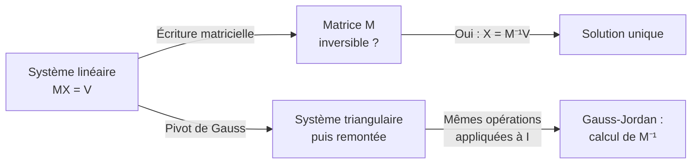

> [!note]
> **R1.07 – Outils mathématiques fondamentaux (partie Algèbre)**
> IUT de Bayonne et du Pays Basque – BUT Informatique – 2026-2027
>
> Objectif : savoir **résoudre un système linéaire** et **inverser une matrice** avec des méthodes systématiques (donc programmables) : le **pivot de Gauss** puis **Gauss-Jordan**.

## Plan du cours

Une sous-page par chapitre, chacune avec une **version simple** d'abord, puis la **version détaillée**.

1. Systèmes linéaires : vocabulaire, écriture matricielle, opérations sur les lignes
2. Matrices : vocabulaire, opérations, produit, puissances, transposée, inverse et déterminant (ordre 2)
3. Méthode du pivot de Gauss : triangulariser puis remonter, systèmes paramétriques
4. Méthode de Gauss-Jordan : inverser une matrice par opérations sur les lignes

## L'idée du chapitre en un schéma

> [!tip]
> **Le fil rouge** : chaque opération sur les lignes d'un système correspond à une **multiplication à gauche par une matrice**. C'est ce qui permet de passer de « résoudre un système » à « inverser une matrice ».

[[1 – Systèmes linéaires]]

[[2 – Matrices]]

[[3 – Méthode du pivot de Gauss]]

[[4 – Méthode de Gauss-Jordan]]
