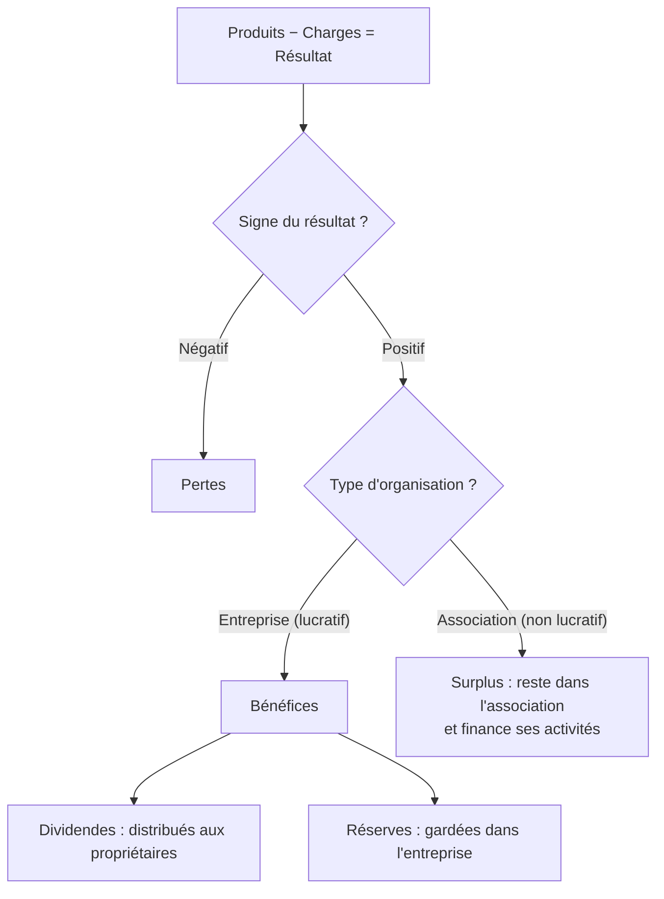
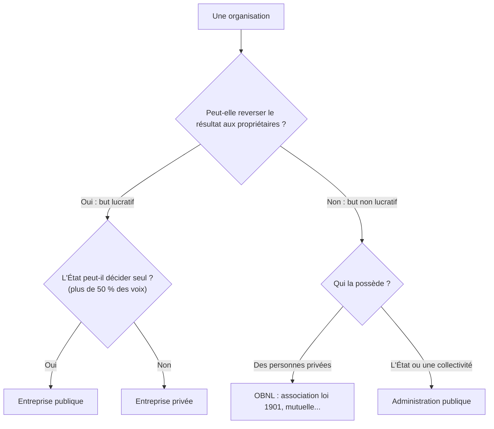

> [!note]
> **L'essentiel en simple**
> - Une **organisation** = des personnes qui travaillent **ensemble, durablement, vers un but commun**.
> - Chacun a une tâche différente (**division du travail**), donc il faut **se coordonner** : il existe **5 façons** de le faire.
> - Pour classer une organisation on se pose **2 questions** : *peut-on se partager le résultat ?* (lucratif / non lucratif) et *qui décide ?* (privé / public). Ça donne **4 cases**.
> - Une organisation a besoin de **3 types de ressources** et subit **4 types de contraintes**.

---

## 1. Définir une organisation

📍 *Diapos 3 à 7*

> **Définition** : un groupe de personnes réunies de façon **stable et durable**, qui **coordonne ses efforts** pour atteindre des **objectifs communs**.

Les **5 critères** à vérifier (ils doivent tous être présents) :

| Critère | Question à se poser | Exemple Grandé Italia (diapo 5) |
| --- | --- | --- |
| **Groupe** | Y a-t-il plusieurs personnes ? | Paolo et Romano |
| **Objectif commun** | Visent-elles le même but ? | s'enrichir |
| **Division du travail** | Chacune a-t-elle une tâche différente ? | Paolo prend les commandes et encaisse, Romano prépare les pizzas |
| **Coordination** | Les tâches sont-elles articulées entre elles ? | Paolo et Romano se transmettent les commandes et les pizzas prêtes |
| **Stabilité** | Est-ce fait pour durer ? | entreprise déclarée, censée durer |

> [!tip]
> **Réflexe d'examen** : pour dire qu'une situation est (ou n'est pas) une organisation, passe les 5 critères un par un. Cas du TD : 4 étudiants qui révisent un weekend et se répartissent les chapitres → 4 critères sur 5, il manque la **stabilité** (un weekend ne suffit pas). Ce n'est donc **pas** une organisation au sens strict.

---

## 2. Division du travail et coordination

📍 *Diapos 8 à 11*

**Division du travail** (chacun se spécialise dans une tâche) → **besoin de coordination** (il faut articuler les tâches pour atteindre l'objectif commun) → **mécanismes de coordination** (5 retenus sur les 6 identifiés par Mintzberg).

| # | Mécanisme | Principe | Exemples des diapos | Comment le reconnaître |
| --- | --- | --- | --- | --- |
| 1 | **Ajustement mutuel** | communication informelle entre les membres | match de foot entre amis | on se parle, **personne ne commande** |
| 2 | **Supervision directe** | une personne donne les ordres et instructions à plusieurs | entraîneur de basket, chef de cuisine et ses cuisiniers | **un chef** dit quoi faire |
| 3 | **Standardisation des procédés** | la façon de travailler est imposée à tous | recette identique dans tous les McDonald's | le **comment** est imposé |
| 4 | **Standardisation des résultats** | objectif fixé, méthode libre | livreur : 30 colis par jour, vendeur : 10 voitures par mois | le **combien** est imposé, pas la méthode |
| 5 | **Standardisation des qualifications** | uniformisation par le savoir et le diplôme | cabinet comptable : le rôle de chacun dépend de son diplôme | le **qui sait faire** (diplôme) |

> [!tip]
> La **6e** (standardisation des normes) n'est **pas au programme**. Moyen mnémotechnique : procédés = *comment*, résultats = *combien*, qualifications = *qui*.

---

## 3. Les 4 types d'organisations

📍 *Diapos 12 à 20*

Deux axes de classement : **but lucratif / non lucratif** et **privée / publique**.

### A. But lucratif ou non lucratif

📍 *Diapos 13 et 14*

Le critère : **l'organisation peut-elle reverser une partie du résultat à ses propriétaires ou membres ?**

|   | But lucratif | But non lucratif |
| --- | --- | --- |
| Peut distribuer le résultat ? | **Oui** | **Non**, le surplus doit rester dans l'organisation |
| Résultat positif = | **bénéfices** | **surplus** |
| Résultat négatif = | **pertes** | **pertes** |
| Que devient le résultat positif ? | **dividendes** (distribués aux propriétaires) et/ou **réserves** (gardées dans l'entreprise) | finance les activités de l'association |
| Exemples (diapos) | pizzeria, SAS, boutique | MSF, club sportif, mutuelle |

### B. Publique ou privée : qui décide ?

📍 *Diapos 15 à 19*

La chaîne à retenir :

1. **Apports** : les créateurs apportent de l'argent ou des biens pour démarrer. Leur somme = le **capital**.
2. **Titres** : chaque apporteur reçoit des **actions** ou **parts sociales**. **1 titre = 1 voix** en assemblée générale.
3. **Contrôle** : celui qui détient **plus de 50 % des voix exprimées** décide seul. Si c'est l'**État** (ou une collectivité) → entreprise **publique**, sinon **privée**.

**Formules** : Nb de titres = Apport ÷ Valeur nominale d'un titre, puis % des voix = titres du propriétaire ÷ total des titres.

**Exemple (diapo 16)** : valeur nominale 100 €.

| Créateur | Apports | Nb de titres | % des voix |
| --- | --- | --- | --- |
| Monsieur A | 60 000 € | 600 | 66,7 % |
| Madame B | 20 000 € | 200 | 22,2 % |
| État | 10 000 € | 100 | 11,1 % |
| **Total** | **90 000 €** | **900** | **100 %** |

M. A est actionnaire majoritaire et ce n'est pas l'État → entreprise **privée**.

**Cas particulier (diapo 17) : certains actionnaires ne votent pas.** On peut contrôler une entreprise avec moins de 50 % du capital si une partie des titres appartient à des particuliers qui n'exercent pas leur droit de vote.

- M. A : 30 %, M. B : 10 %, le reste (60 %) appartient à des particuliers qui ne votent pas.
- Seuls 30 % + 10 % = 40 % des titres votent. M. A pèse 30 ÷ 40 = **75 % des voix exprimées** → il décide seul avec seulement 30 % du capital.

**Méthode en 4 étapes** :

4. Calculer le nombre de titres de chacun (apport ÷ valeur nominale).
5. Calculer le % de chacun.
6. Si certains titres ne votent pas, les retirer du total avant de recalculer.
7. Chercher qui dépasse 50 % : si c'est l'État → **publique**, sinon → **privée**.

> [!warning]
> **Piège (diapo 19)** : l'État peut être présent au capital et rester minoritaire (20 % par exemple). Pour être publique, il faut qu'il détienne **plus de 50 %** des voix exprimées. Et exactement 50 % ne suffit pas non plus.

### C. Tableau récapitulatif

📍 *Diapo 20*

|   | Lucratif | Non lucratif |
| --- | --- | --- |
| Privée | **Entreprise privée** (SARL, SAS, SA...) | **OBNL** (associations loi 1901, mutuelles...) |
| Publique | **Entreprise publique** (ex : La Poste) | **État, collectivités territoriales** et leurs administrations |

---

## 4. Les ressources

📍 *Diapos 21 et 22*

| Type | C'est quoi ? | Exemples (diapo 22) |
| --- | --- | --- |
| **Humaines** | les personnes qui travaillent pour l'organisation | salariés, membres d'une association, fonctionnaires, bénévoles |
| **Financières** | les moyens de trouver de l'argent | capital, emprunts, impôts, dons, cotisations |
| **Matérielles** | tout ce que possède l'organisation | machines, ordinateurs, bâtiments, brevets, marques |

> [!tip]
> Attention : les **brevets** et les **marques** sont rangés dans les ressources **matérielles** (ce que l'organisation possède), pas dans les financières.

---

## 5. Les contraintes

📍 *Diapos 23 et 24*

Les organisations ne peuvent pas faire tout ce qu'elles veulent.

| Contrainte | Idée | Exemple (diapo 24) |
| --- | --- | --- |
| **Juridiques** | lois et règles à respecter | RGPD : amende infligée à Free Mobile par la CNIL (janvier 2026) |
| **De ressources** | moyens limités (argent, personnes, matériel) | MSF n'a ni assez d'argent ni assez de médecins pour soigner tout le monde |
| **De temps** | des délais à respecter | une association veut commencer rapidement |
| **De résultat** | le but doit être atteint, sinon plus de raison d'exister | entreprise en pertes permanentes → fermeture |

---

## ✅ Objectifs à maîtriser (Synthèse n°1, diapo 25)

- [ ] Définir une organisation et ses 5 caractéristiques
- [ ] Expliquer pourquoi une situation correspond à la définition
- [ ] Distinguer but lucratif et non lucratif
- [ ] Différencier bénéfices / surplus et dividendes / réserves
- [ ] Calculer qui contrôle une entreprise
- [ ] Positionner une organisation dans le tableau des 4 types
- [ ] Identifier un mécanisme de coordination dans un exemple
- [ ] Classer les ressources et les contraintes d'une organisation