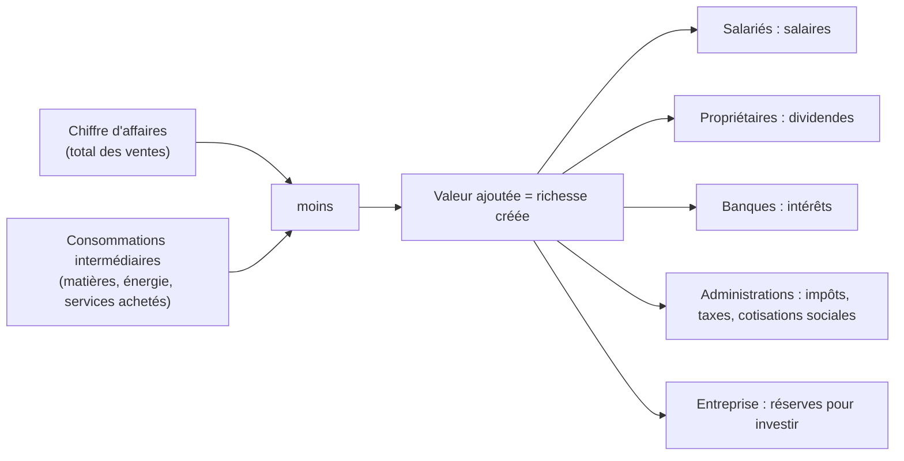

> [!note]
> **L'essentiel en simple**
> - Une entreprise vend des biens ou des services pour **faire du profit** et le partager entre ses propriétaires.
> - Elle a **3 noms** possibles (officiel, commercial, enseigne) et **3 finalités** : économique (toujours), sociale et sociétale (en option).
> - Elle crée de la **valeur ajoutée** (ventes − achats consommés) qui est partagée entre **5 acteurs**.
> - On la décrit avec : ce qu'elle fait (**activité, type, secteur**), sa **taille**, son **pays** (siège social), ses **ressources**, et l'endroit où elle vend (**champ d'action**).
> - Sa forme juridique est traitée dans la page suivante (Ch2.2).

---

## Rappel

📍 *Diapo 2*

- Sauf si l'entrepreneur est seul, l'entreprise est une **forme d'organisation**, avec un **but lucratif**.
- Elle est **publique** si l'État possède assez de titres pour décider seul. En pratique, la très grande majorité des entreprises sont **privées**.

---

## 1. Le nom

📍 *Diapo 5*

> Le nom est un mot ou un ensemble de mots qui permet de distinguer les entreprises les unes des autres.

| Type de nom | C'est… | Pour s'en souvenir |
| --- | --- | --- |
| **Dénomination sociale** (ou raison sociale) | le **nom officiel** | celui des papiers officiels |
| **Nom commercial** | le nom utilisé **auprès des clients** (ex : pub, site web) | celui que voit le client |
| **Enseigne** | le **signe apposé sur l'établissement** pour l'identifier | celui de la façade |

---

## 2. Les finalités

📍 *Diapo 7*

La **finalité** est la raison pour laquelle l'entreprise a été créée. Plusieurs finalités peuvent coexister.

| Finalité | Contenu | Exemple |
| --- | --- | --- |
| **Économique** (présente dans **toutes** les entreprises) | s'enrichir. Pour cela : satisfaire des **besoins solvables** (clients capables de payer), **créer** de la richesse, la **répartir** | toute entreprise |
| **Sociale** (optionnelle) | améliorer la situation des **salariés** | recruter exclusivement des personnes en situation de handicap |
| **Sociétale** (optionnelle) | améliorer la situation de la **société** dans son ensemble | Ecosia reverse ses revenus à des programmes de reforestation |

---

## 3. Création et répartition de la richesse

📍 *Diapos 8 à 10*

> **Valeur ajoutée = Chiffre d'affaires − Consommations intermédiaires**

- **Chiffre d'affaires (CA)** : total des ventes.
- **Consommations intermédiaires (CI)** : biens et services achetés puis transformés ou consommés dans la production (matières premières, énergie...).

| Acteur | Reçoit | En contrepartie de |
| --- | --- | --- |
| Salariés | salaires | leur travail |
| Propriétaires | dividendes | le capital apporté |
| Banques | intérêts | les prêts accordés |
| Administrations publiques | impôts, taxes, cotisations sociales | les services publics fournis |
| L'entreprise elle-même | réserves | financer ses futurs investissements |

> [!warning]
> **Piège (diapo 10)** : les **salaires**, les **impôts** et les **immobilisations** (biens gardés plusieurs années, comme un four) **ne sont pas** des consommations intermédiaires. Seuls les achats de matières, d'énergie... en sont. La répartition de la valeur ajoutée est souvent source de conflit : chaque acteur veut la plus grosse part.

---

## 4. L'activité et le type d'activité

📍 *Diapos 11 et 12*

L'**activité** décrit ce que fait l'entreprise (ex : Intersport commercialise des articles de sport). Le **type d'activité** est une classification en 5 catégories. Une même entreprise peut avoir **plusieurs activités**.

| Type | Définition | Exemples (diapo 12) |
| --- | --- | --- |
| **Artisanale** | le chef d'entreprise participe **personnellement à un travail manuel** et l'entreprise a **moins de 10 salariés** | plombier, menuisier, cordonnier |
| **Commerciale de biens** | achète des marchandises pour les **revendre sans les transformer** | Leclerc, Leaderprice, Zara |
| **Commerciale de services** | vend des **biens immatériels** | restaurants, Epic Games, Free, banques, assurances |
| **Industrielle** | **fabrique** des biens pour les vendre | Yoplait, Peugeot, Airbus |
| **Agricole** | agriculture, élevage ou pêche | éleveur laitier, pêcheur, exploitation forestière |

**Méthode pour classer** : elle fabrique ? → industrielle. Elle achète pour revendre tel quel ? → commerciale de biens. Elle vend de l'immatériel ? → commerciale de services. Elle produit de la matière naturelle ? → agricole. Le patron fait lui-même le travail manuel avec moins de 10 salariés ? → artisanale.

---

## 5. Le secteur d'activité

📍 *Diapo 13*

Autre classification selon l'activité. Les économistes utilisent aussi une autre terminologie.

| Secteur | Terme d'économiste | Contenu | Exemples |
| --- | --- | --- | --- |
| **Primaire** | agriculture | produit des **matières premières non transformées** à partir de ressources naturelles (agriculture, pêche, mines, forêts) | agriculteur laitier |
| **Secondaire** | industrie | **transforme** les matières premières en produits finis (industrie, construction) | Airbus, Yoplait |
| **Tertiaire** | services | tout ce qui n'est pas dans les deux autres, essentiellement des **services** | banques, enseignement, commerce |

- Une entreprise de type **agricole** appartient au secteur **primaire**.

> [!warning]
> **Incohérence dans les supports** : la diapo 13 range la « construction » dans le secondaire, mais la correction du TD classe le **plombier** (artisanale) en **tertiaire**. Retiens la correction du prof pour le plombier, ou justifie clairement ton choix.

---

## 6. La taille

📍 *Diapo 17*

Classification par **3 critères** : nombre de salariés, **total du bilan** (valeur de tout ce que possède l'entreprise) et **chiffre d'affaires**.

| Catégorie | Salariés | Total du bilan | Chiffre d'affaires |
| --- | --- | --- | --- |
| **Micro-entreprise** | moins de 10 | moins de 2 M€ | moins de 2 M€ |
| **PME** | moins de 250 | moins de 43 M€ | moins de 50 M€ |
| **ETI** (taille intermédiaire) | moins de 5 000 | moins de 2 Md€ | moins de 1,5 Md€ |
| **Grande entreprise** | 5 000 et plus | plus de 2 Md€ | plus de 1,5 Md€ |

> [!tip]
> **Règle** : pour entrer dans une catégorie, l'entreprise doit respecter **au moins 2 critères sur 3**. Pratique : teste les catégories de la plus petite à la plus grande et garde la première où au moins 2 des 3 chiffres rentrent.

---

## 7. Nationalité, ressources, champ d'action

📍 *Diapo 18*

| Caractéristique | Contenu |
| --- | --- |
| **Nationalité** | pays auquel l'entreprise est rattachée, déterminé par l'adresse du **siège social** (et **pas** par la nationalité des propriétaires) |
| **Ressources humaines** | les personnes qui travaillent pour elle |
| **Ressources financières** | résultats non distribués, capital apporté par les propriétaires, emprunts |
| **Ressources matérielles** | locaux, machines, brevets... |
| **Champ d'action** | partie du monde où ont lieu les **ventes** : communal → départemental → régional → national → international |

---

## ✅ Objectifs à maîtriser (Synthèse n°2, diapo 27)

- [ ] Distinguer dénomination sociale, nom commercial et enseigne
- [ ] Définir et distinguer les 3 types de finalités
- [ ] Calculer la valeur ajoutée et citer les 5 acteurs qui se la partagent
- [ ] Classer une entreprise dans le bon type d'activité (5 types)
- [ ] Classer une entreprise dans le bon secteur (primaire, secondaire, tertiaire)
- [ ] Classer une entreprise par taille à partir du tableau des 4 catégories
- [ ] Citer les 6 formes juridiques et leurs caractéristiques (page Ch2.2)
- [ ] Déterminer si les biens personnels d'un propriétaire peuvent être saisis (page Ch2.2)