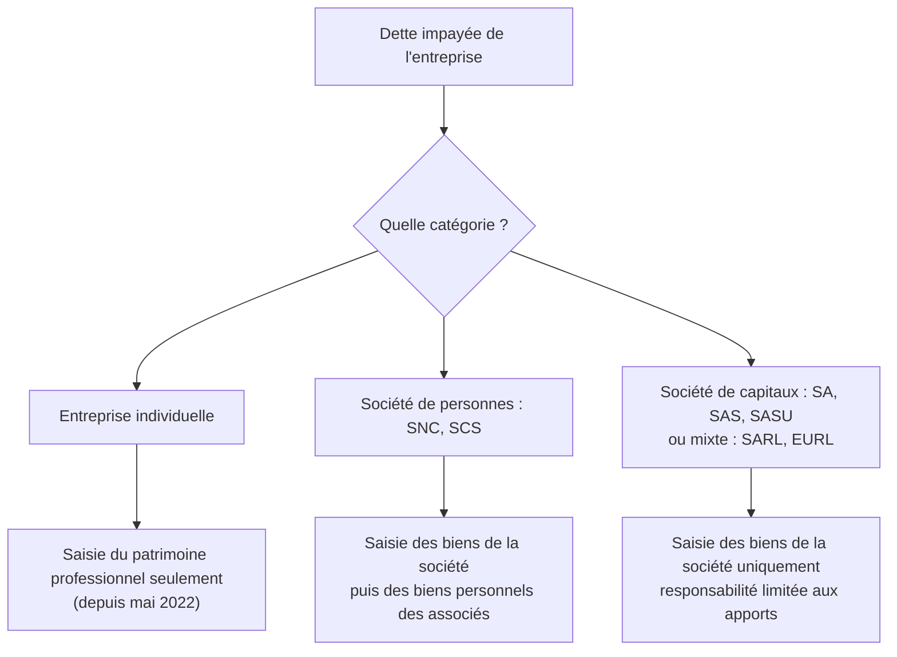

> [!note]
> **L'essentiel en simple**
> - La **forme juridique** = le statut légal de l'entreprise. Chaque forme a ses propres règles.
> - 6 formes à connaître : **EI, SARL, EURL, SA, SAS, SASU**.
> - La grande question : *si l'entreprise ne peut pas payer ses dettes, mes biens personnels sont-ils en danger ?* La réponse dépend de la **catégorie** (limitée ou illimitée).
> - Une société est une **personne distincte** de ses propriétaires : on ne pioche pas dans la caisse pour ses courses perso.

---

## 1. Les 6 formes juridiques

📍 *Diapo 20*

| Forme | Nom complet | Propriétaires | Titres | Direction |
| --- | --- | --- | --- | --- |
| **EI** | Entreprise individuelle | entrepreneur individuel (un seul) | aucun | l'entrepreneur lui-même |
| **SARL** | Société à responsabilité limitée | associés | parts sociales | gérant (choisi par les associés) |
| **EURL** | Entreprise unipersonnelle à responsabilité limitée | associé unique | parts sociales | gérant |
| **SA** | Société anonyme | actionnaires | actions | président + conseil d'administration, ou directoire + conseil de surveillance |
| **SAS** | Société par actions simplifiée | actionnaires | actions | défini par les statuts |
| **SASU** | Société par actions simplifiée unipersonnelle | actionnaire unique | actions | défini par les statuts |

> [!tip]
> **Repères** : *unipersonnelle* = un seul propriétaire (EURL = SARL à 1 associé, SASU = SAS à 1 actionnaire). **Associés + parts sociales** pour SARL/EURL, **actionnaires + actions** pour SA/SAS/SASU. L'EI peut quand même embaucher : « individuelle » désigne le propriétaire, pas les salariés.

---

## 2. Les 4 grandes catégories

📍 *Diapo 21*

| Catégorie | Formes | Personnalité juridique | Responsabilité des propriétaires | Cession des titres |
| --- | --- | --- | --- | --- |
| **Entreprise individuelle** | EI | **non** : patrimoine pro et personnel ne font qu'un | un créancier professionnel ne peut saisir que le **patrimoine professionnel** (depuis mai 2022) | sans objet |
| **Sociétés de personnes** | SNC, SCS | oui | **solidaire et illimitée** : les biens personnels des associés peuvent être saisis | encadrée (accord des autres associés) |
| **Sociétés de capitaux** | SA, SAS (et SASU) | oui | **limitée aux apports** | libre |
| **Sociétés mixtes** | SARL, EURL | oui | **limitée aux apports** | encadrée |

**Personnalité juridique** : une société est une **personne morale** différente de ses associés. L'entreprise individuelle, elle, n'en a pas : l'entreprise et l'entrepreneur sont une seule personne juridique.

---

## 3. Responsabilité limitée ou illimitée

📍 *Diapo 22*

|   | Responsabilité LIMITÉE | Responsabilité ILLIMITÉE |
| --- | --- | --- |
| Formes | SA, SAS, SASU, SARL, EURL (capitaux + mixtes) | sociétés de personnes (SNC, SCS) et EI (voir nuance) |
| Les propriétaires répondent… | seulement à hauteur de leurs **apports** | **personnellement et solidairement** |
| Si l'entreprise ne peut pas payer | saisie des biens **de l'entreprise** uniquement | saisie des biens de l'entreprise **puis** des biens personnels des associés (un seul ou tous) |

**Nuance EI depuis 2022** : seul le patrimoine **professionnel** peut être saisi.

**Exemple type (TD)** : la SAS code+ doit 15 000 € à un client mais n'a que 3 000 € de trésorerie. Société de capitaux → responsabilité limitée → le client ne peut **pas** saisir les biens personnels de M. X. Les 12 000 € restants restent à la charge de la société. En SNC, il pourrait saisir les biens personnels des associés. En EI, seulement le patrimoine professionnel.

---

## 4. Personnalité juridique et abus de biens sociaux

📍 *Diapos 25 et 26*

Cas : un client paie 500 € en liquide, M. X prend 300 € dans la caisse pour ses courses personnelles.

- **SAS ou SASU** : problème. La société a la personnalité juridique, son patrimoine est **distinct** de celui de ses propriétaires, et M. X n'a pas le droit d'utiliser les biens de la société pour son usage personnel (**abus de biens sociaux**).
- **Entreprise individuelle** : pas de problème. Sans personnalité juridique, l'entreprise fait partie du patrimoine de l'entrepreneur (sauf en cas de saisie par des créanciers).

---

## ✅ Objectifs à maîtriser

- [ ] Citer les 6 formes juridiques, le nom des propriétaires, des titres et de l'organe de direction
- [ ] Distinguer SARL/EURL et SA/SAS/SASU sur le nombre de propriétaires
- [ ] Distinguer entreprise individuelle, société de personnes, société de capitaux et société mixte
- [ ] Expliquer limitée / illimitée / solidaire et l'effet sur le patrimoine personnel
- [ ] Déterminer à partir d'un cas si les biens personnels peuvent être saisis