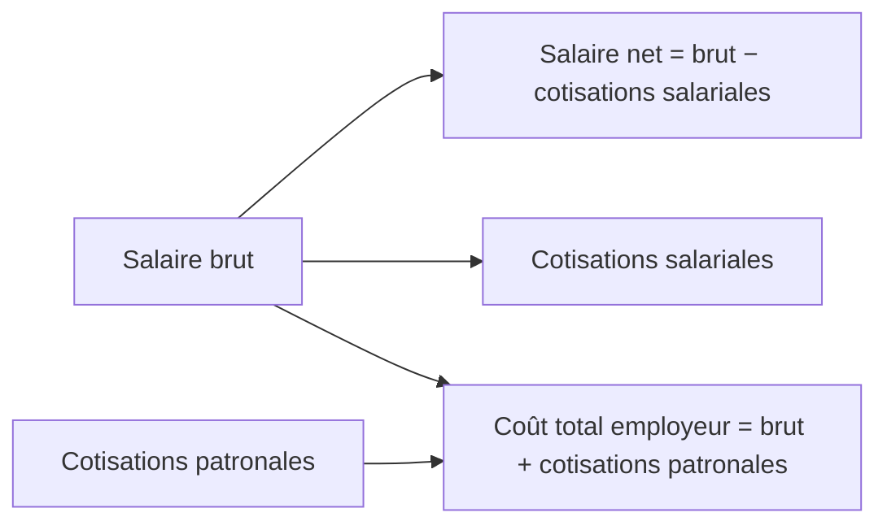

> [!note]
> **L'essentiel en simple**
> - **Collectivités territoriales** = régions, départements, communes. Elles font comme l'État (service public + domaine public) mais **sur leur territoire seulement**, avec des conseils élus.
> - **Sécurité sociale** = assurance maladie, retraite, allocations familiales : elle **redistribue** de l'argent pour la collectivité, financée par les **cotisations** (et CSG, CRDS).
> - Clé de calcul : **net = brut − cotisations salariales** et **coût employeur = brut + cotisations patronales**.

---

## Vue d'ensemble des 3 types

|   | Centrales | Collectivités territoriales | Sécurité sociale |
| --- | --- | --- | --- |
| Finalité | service public + domaine public | service public + domaine public (local) | redistribution des revenus |
| Champ d'action | national | le territoire géré | national |
| Ressources financières | impôts d'État (IR, IS, TVA) | impôts locaux directs et indirects + dotations de l'État | cotisations sociales + CSG + CRDS |
| Ressources humaines | fonctionnaires d'État + contractuels | fonctionnaires territoriaux (FPT) + contractuels | fonctionnaires d'État + territoriaux + salariés de droit privé |
| Direction | gouvernement et ministères | conseil régional, départemental ou municipal | conseil d'administration |

---

## I. Les collectivités territoriales

📍 *Diapos 24 à 29*

Aussi appelées **administrations publiques locales** : régions, départements, communes, et les établissements qui en dépendent (lycées, collèges, écoles, piscines, parcs).

|   | Région | Département | Commune |
| --- | --- | --- | --- |
| Territoire (exemples diapo 26) | Nouvelle-Aquitaine, Occitanie | Pyrénées-Atlantiques, Gironde | Bayonne, Anglet, Biarritz |
| Exemples de services (diapo 25) | gestion des **lycées** | gestion des **collèges** | voirie, bibliothèques, transports en commun locaux |
| Organe de direction (diapo 29) | **conseil régional** | **conseil départemental** | **conseil municipal** |
| Qui dirige ? | un **président** élu par le conseil | un **président** élu par le conseil | le **maire** élu par le conseil |

Les 3 conseils sont **élus par les citoyens pour 6 ans**.

- **Finalité** (diapo 25) : identique aux administrations centrales, mais pour la collectivité locale. Domaine public local : routes départementales et communales, parcs et jardins, équipements sportifs, bâtiments scolaires.
- **Champ d'action** (diapo 26) : seulement le **territoire géré** (contrairement au champ national des centrales).
- **Ressources financières** (diapo 27) : **impôts locaux directs** (taxe foncière, payée par les propriétaires), **impôts locaux indirects** (taxes incorporées aux factures d'eau, de déchets) et **dotations de l'État** (transferts financiers de l'État vers les collectivités).
- **Ressources humaines** (diapo 28) : **fonctionnaires territoriaux** (Fonction Publique Territoriale, mêmes principes que l'État : concours, emploi à vie, droit administratif, mais statut adapté) et **agents contractuels** de plus en plus fréquents pour des compétences spécifiques.
- **Ressources matérielles** : tous les biens que l'administration possède.

---

## II. Les administrations de sécurité sociale

📍 *Diapos 30 à 37*

- **Finalité** (diapo 31) : assurance maladie, assurance vieillesse, prestations familiales... Elles effectuent, pour le compte de la collectivité, des **opérations de redistribution des revenus**.
- **Champ d'action** (diapo 32) : **national**.

### Ressources financières (diapo 33)

**Cotisations sociales** :

- **Salariales** : prélevées sur le salaire brut. **Salaire net = salaire brut − cotisations salariales**.
- **Patronales** : versées par l'employeur **en plus** du brut. **Coût total = salaire brut + cotisations patronales**.

**Impôts sociaux** : **CSG** (Contribution Sociale Généralisée) et **CRDS** (Contribution au Remboursement de la Dette Sociale). Plus larges que les cotisations : ils touchent **tous les revenus**, pas seulement les salaires.

**Exemple de la diapo 35** : brut 2 500 €, cotisations salariales 20 %, patronales 25 %. Salariales = 500 €, **net = 2 000 €**, patronales = 625 €, **coût total = 3 125 €**.

**Exemple de la synthèse PDF** : brut 2 000 €, salariales 400 €, patronales 500 € → net 1 600 €, coût total 2 500 €.

> [!tip]
> **Pourquoi baisser les cotisations pose problème** : ça réduit le **coût du travail** (l'employeur paie moins) mais aussi les **ressources de la Sécu** (maladie, retraite, famille), puisque les cotisations en sont la principale ressource.

### Ressources humaines (diapo 36)

Plus hétérogènes que dans les autres administrations :

- **Fonctionnaires d'État** : affectés dans certains organismes (droit administratif).
- **Fonctionnaires territoriaux** : dans certains organismes à vocation locale (droit administratif).
- **Salariés de droit privé** : contrat de travail (Code du travail + convention collective).

### Organes de direction (diapo 37)

Un **conseil d'administration** réunissant toutes les parties prenantes :

| Membres | Qui les désigne |
| --- | --- |
| **Représentants des assurés sociaux** | élus par les cotisants (syndicats de salariés) |
| **Représentants des employeurs** | désignés par les organisations patronales (MEDEF, CPME) |
| **Représentants de l'État** | nommés par le gouvernement pour assurer le contrôle |
| **Personnes compétentes** | experts dans certains domaines (médecine, gestion) |

---

## ✅ Objectifs à maîtriser

- [ ] Citer finalité, champ d'action, ressources et direction de chaque type d'administration
- [ ] Identifier le type d'administration auquel appartient une organisation
- [ ] Citer les organes de direction des 3 collectivités territoriales
- [ ] Calculer salaire net, cotisations salariales et patronales, coût total pour l'employeur