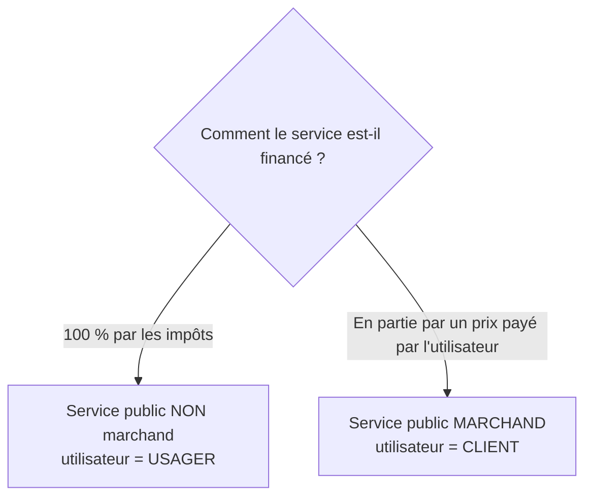

> [!note]
> **L'essentiel en simple**
> - Un **service public** sert l'**intérêt général**, souvent là où le marché ne le fait pas. Il doit respecter **3 principes** : égalité, continuité, adaptabilité.
> - Le **domaine public** = les biens dont on ne peut pas empêcher l'usage et que tout le monde peut utiliser en même temps (routes, phares...). Impossible de faire payer chaque utilisateur, donc la collectivité finance.
> - Selon qui paie : **impôts seulement** (service non marchand, l'utilisateur est un **usager**) ou **un prix** (service marchand, l'utilisateur est un **client**).

---

## 1. Le service public et ses 3 principes

📍 *Diapo 39*

> Un service public a pour but de satisfaire l'**intérêt général**. Il est rendu par les administrations lorsque le marché ne peut pas satisfaire ce besoin.

| Principe | Idée | Exemple (diapo) |
| --- | --- | --- |
| **Égalité** (et équité) | tous les citoyens sont traités de la même façon | les pompiers secourent tout le monde |
| **Continuité** | le service fonctionne sans interruption non prévue | préavis obligatoire avant une grève |
| **Adaptabilité** | le service évolue avec les besoins de l'intérêt général (évolutions sociales et technologiques) | création de la CNIL avec l'informatisation. Synthèse PDF : la Poste dessert un nouveau quartier |

---

## 2. Égalité contre équité

📍 *Diapo 40*

|   | Égalité | Équité |
| --- | --- | --- |
| Principe | tous traités de la **même façon**, sans tenir compte de la situation personnelle | l'État tient compte de la **situation de chacun** pour adapter le service ou l'aide |
| Exemples | pompiers : secours sans distinction de revenu, nationalité ou statut social | aides sociales selon le revenu du foyer, tarif réduit dans les transports pour les moins aisés, exonération de taxe foncière pour les personnes âgées |

- Depuis que l'État intervient dans le champ social, l'équité **coexiste** avec l'égalité : elle ne la remet pas en cause, c'est une évolution vers plus de justice.
- **Limite** : une situation n'est pas perçue comme équitable par tout le monde.

---

## 3. Le domaine public

📍 *Diapo 41*

Un bien est **public** s'il réunit **les deux** caractéristiques (cumulatives) :

1. **Non-exclusion** : on **ne peut pas empêcher** les gens de l'utiliser (impossible d'interdire une route à certains).
2. **Non-rivalité** : l'utilisation par une personne **n'empêche pas** les autres de s'en servir en même temps.

Exemples : routes nationales, fleuves, phares, parcs publics, monuments historiques, espace aérien. Comme on ne sait pas qui les utilise, **la collectivité finance leur entretien**.

---

## 4. Financement du service public

📍 *Diapos 42 à 44*

|   | Service public NON MARCHAND | Service public MARCHAND |
| --- | --- | --- |
| Financement | **entièrement** par les prélèvements obligatoires (impôts) | **en partie** par un **prix** payé par l'utilisateur, souvent inférieur au coût de revient |
| L'utilisateur est un… | **usager** : bénéficie du service en contrepartie des impôts déjà payés | **client** : paie directement pour accéder au service |
| Attentes de qualité | modérées : pas de lien direct perçu entre impôt et service | plus élevées, et souhait d'un prix proportionnel au service reçu, ce qui peut remettre en cause l'**égalité** |
| Exemples | éducation nationale, pompiers, justice, médiathèque financée par la mairie | RATP (EPIC), autoroutes (concession), SNCF |

**Qui peut gérer un service marchand ?** Une personne publique (EPIC, entreprise publique) **ou** une entreprise privée, par contrat public appelé **délégation de service public** ou **concession** (synthèse PDF). Exemple : les autoroutes appartiennent à l'État, mais l'entreprise privée Autoroutes du Sud de la France les entretient et touche les péages en contrepartie.

EPIC = Établissement Public à caractère Industriel ou Commercial, par exemple la RATP (transport en Île-de-France).

---

## ✅ Objectifs à maîtriser

- [ ] Définir le service public et citer ses 3 principes, avec un exemple chacun
- [ ] Distinguer égalité et équité
- [ ] Définir le domaine public et ses 2 caractéristiques
- [ ] Distinguer service marchand et non marchand, usager et client
- [ ] Définir une délégation de service public