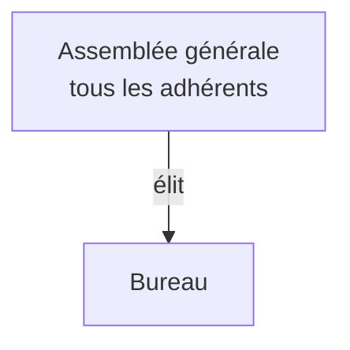

> [!note]
> **L'essentiel en simple**
> - Une **OBNL** (organisation à but non lucratif) rend un **service** à ses membres ou à la collectivité, **sans partager de bénéfices**. La plus courante : l'**association loi 1901**.
> - Le but du chapitre (diapo 1) : savoir remplir la **fiche descriptive** d'une OBNL, rubrique par rubrique.
> - Si les produits dépassent les charges, on parle de **surplus** (pas de bénéfice) : il est **réinvesti** dans la finalité, jamais distribué.
> - Elle est dirigée par une **assemblée générale** qui élit un **bureau**.

---

## La fiche descriptive d'une OBNL

📍 *Diapos 2 à 12 : le plan du cours*

Une fiche = 7 rubriques, dans cet ordre : **Finalité → Activité → Champ d'action → Nationalité → Type → Ressources → Organe de direction**.

| Rubrique | Question à se poser | Exemple fictif : un club de handball local |
| --- | --- | --- |
| **Finalité** | service rendu à qui ? (membres ou société) | service rendu à ses membres |
| **Activité** | que fait-elle concrètement ? | organise entraînements et matchs |
| **Champ d'action** | où intervient-elle ? (local, national, international) | local |
| **Nationalité** | pays de rattachement (selon les statuts) | France |
| **Type** | association déclarée, ONG, utilité publique, mutuelle... | association déclarée |
| **Ressources** | humaines, financières, matérielles | membres et bénévoles, cotisations et subventions, salle de sport |
| **Organe de direction** | qui décide ? | assemblée générale et bureau |

---

## I. Finalité

📍 *Diapo 3*

- Rendre un **service à ses membres** (ex : un club de sport).
- Rendre un **service à la société** (ex : les Restos du Cœur).
- **En cas de surplus ?** Il ne se partage pas entre les adhérents : il est utilisé pour réaliser la finalité de l'association.

## II. Activité

📍 *Diapo 4*

Ce que fait l'OBNL. Exemples du cours : les Restos du Cœur offrent de la nourriture, Médecins sans frontières soigne les personnes qui n'ont pas accès aux soins.

## III. Champ d'action

📍 *Diapo 5 (carte de France et globe)*

Zone géographique d'intervention : **local**, **national** ou **international**.

## IV. Nationalité

📍 *Diapo 6*

Pays auquel l'OBNL est rattachée. **Dépend de ses statuts.**

---

## V. Les types d'OBNL

📍 *Diapo 7*

La diapo liste : association déclarée, ONG, association déclarée d'utilité publique, mutuelle, coopérative. La synthèse PDF ajoute l'association de fait.

| Type | Ce qui le caractérise |
| --- | --- |
| **Association de fait** (PDF) | association **non déclarée**, **sans personnalité juridique** |
| **Association déclarée** | déclarée à la préfecture, **avec personnalité juridique** (droits et obligations) |
| **ONG** | juridiquement une association loi 1901, sans définition officielle. Elle cumule en général plusieurs de ces traits : champ d'action **international**, **indépendance** envers les gouvernements, finalité tournée vers la **société** plutôt que vers les membres, **grande taille** |
| **Association déclarée d'utilité publique** | association menée une action d'**intérêt général** |
| **Mutuelle** | financée par les **cotisations** de ses membres, elle leur offre une **protection sociale complémentaire** (santé, prévoyance) dans un esprit de **solidarité** |
| **Coopérative** | citée sur la diapo 7 et dans la synthèse parmi les autres OBNL, mais **non définie** dans les supports |

Les syndicats et les congrégations religieuses sont aussi des associations.

---

## VI. Les ressources

📍 *Diapos 8 à 11*

| Ressources | Contenu |
| --- | --- |
| **Humaines** (diapo 9) | **membres** (adhérents), **bénévoles**, **salariés** |
| **Financières** (diapo 10) | **dons**, **subventions**, **activités économiques** (ventes de biens ou de services), **cotisations**, **parrainage et sponsoring** |
| **Matérielles** (diapo 11) | tout ce que possède l'OBNL |

## VII. Organe de direction

📍 *Diapo 12*

- **Assemblée générale** : tous les adhérents se réunissent pour prendre les **décisions stratégiques** et **élire le bureau**.
- **Bureau** : **met en œuvre** les décisions de l'assemblée et **dirige l'OBNL** tout au long de l'année.

---

## Association ou entreprise ?

|   | Entreprise | OBNL |
| --- | --- | --- |
| Finalité | s'enrichir (finalité économique toujours présente) | rendre un service aux membres ou à la collectivité |
| Résultat positif | bénéfices : dividendes et/ou réserves | surplus : reste dans l'OBNL |
| Qui décide ? | propriétaires selon leurs titres (1 titre = 1 voix) | assemblée générale des adhérents, puis bureau |
| Ressources financières | capital, résultats non distribués, emprunts | dons, subventions, cotisations, sponsoring, ventes |

---

## ✅ Objectifs à maîtriser

- [ ] Définir une OBNL et la distinguer d'une entreprise
- [ ] Remplir la fiche descriptive d'une OBNL à partir d'une description
- [ ] Citer et distinguer les types d'OBNL (dont ONG et mutuelle)
- [ ] Distinguer membre, bénévole et salarié
- [ ] Expliquer le surplus et pourquoi il ne peut pas être distribué
- [ ] Décrire l'assemblée générale et le bureau