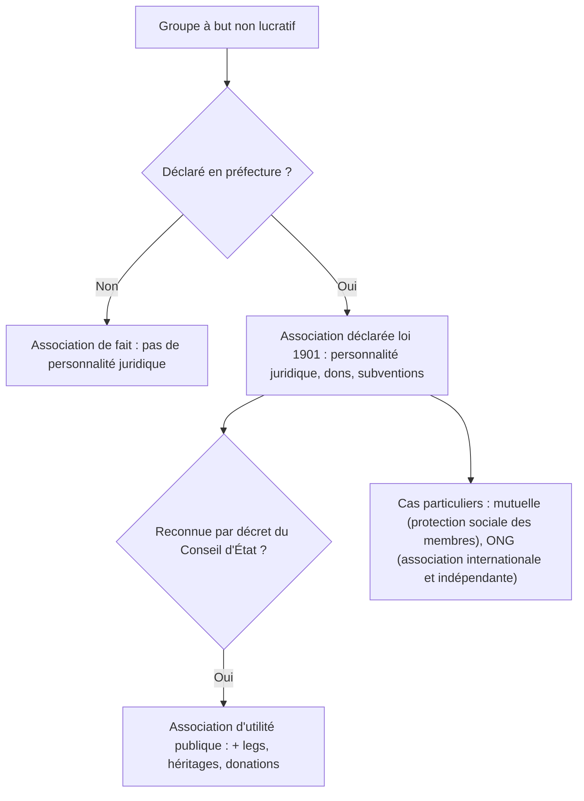
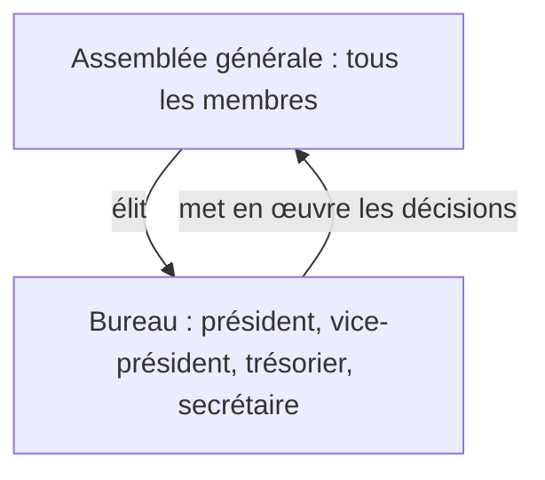

> [!note]
> **L'essentiel en simple**
> - Une **OBNL** (organisation à but non lucratif) rend un **service** à ses membres ou à la collectivité. La **loi interdit** de distribuer le surplus aux membres : il reste dans l'organisation. La plus courante : l'**association loi 1901**.
> - Le but du chapitre : savoir remplir la **fiche descriptive** d'une OBNL, rubrique par rubrique.
> - **5 types** à connaître : association de fait, association déclarée, association déclarée d'utilité publique, mutuelle, ONG. Ce qui les distingue : leur **niveau de formalisation juridique** et les droits qui en découlent.
> - Trois sortes de personnes la font vivre : **membres, bénévoles, salariés**. Elle a **5 sources d'argent** : dons, subventions, cotisations, activités économiques, parrainage.
> - Elle est dirigée par une **assemblée générale** (souveraine) qui élit un **bureau** (gestion au quotidien).

---

## La fiche descriptive d'une OBNL

📍 *Plan du cours (diapos 3 à 20)*

Une fiche = 7 rubriques, dans cet ordre : **Finalité → Activité → Champ d'action → Nationalité → Type → Ressources → Organe de direction**.

| Rubrique | Question à se poser | Exemple fictif : un club de handball local |
| --- | --- | --- |
| **Finalité** | service rendu à qui ? (membres ou société) | service rendu à ses membres |
| **Activité** | que fait-elle concrètement ? | organise entraînements et matchs |
| **Champ d'action** | où intervient-elle ? (local, national, international) | local |
| **Nationalité** | pays où elle a été créée et déclarée | France |
| **Type** | de fait, déclarée, utilité publique, mutuelle, ONG | association déclarée |
| **Ressources** | humaines, financières, matérielles | membres et bénévoles, cotisations et subventions, salle de sport |
| **Organe de direction** | qui décide ? | assemblée générale et bureau |

---

## I. Définition et finalités

📍 *Diapos 3 à 7*

### A. Qu'est-ce qu'une OBNL ? (diapo 4)

> **Définition** : une OBNL est une organisation pour laquelle la loi **interdit** de distribuer le surplus à ses membres. Le **surplus** (résultat positif) doit rester dans l'organisation pour **financer ses activités**.

- **Interdiction légale de distribuer** : contrairement à l'entreprise, l'OBNL ne peut pas reverser le surplus à ses membres.
- **Grande diversité de formes** (associations loi 1901, mutuelles, ONG...), mais toutes partagent cette règle.
- Les syndicats et les congrégations religieuses sont aussi des associations. La synthèse PDF cite aussi les **coopératives** parmi les autres OBNL, mais elles ne font pas partie des 5 types à connaître.

### B. Les 2 types de finalités (diapo 5)

| Finalité | Idée | Exemples (diapo) |
| --- | --- | --- |
| **Rendre service à ses membres** | l'OBNL existe d'abord pour les besoins de **ses propres membres**. Les membres adhèrent et paient une **cotisation** en échange des services | club sportif (cours, installations, compétitions), syndicat de salariés (défense des droits), association de parents d'élèves |
| **Rendre service à la société** | l'OBNL agit dans l'**intérêt général**, au-delà de ses seuls membres | MSF (soins dans les zones de crise), Apprentis d'Auteuil (aide aux jeunes), association de protection de l'environnement, Restos du Cœur (synthèse PDF) |

- Certaines OBNL **cumulent** les deux finalités.
- **Surplus** : il ne se partage pas entre les adhérents, il sert à réaliser la finalité de l'association.

> [!tip]
> **Réflexe d'examen** (exercice 1, diapos 6-7) : MSF → service à la **société** ; club de tennis → service à ses **membres**. L'excédent de MSF (2 M€) **doit rester** dans l'organisation, et le club de tennis **ne peut pas** distribuer ses 5 000 € de bénéfice à ses membres fondateurs, car la loi l'interdit. Corrigé complet dans [[Exercices corrigés R1.08 (diapos) + auto-test]].

---

## II. Activité, champ d'action, nationalité, types

📍 *Diapos 8 à 14*

### A. L'activité (diapo 9)

> L'**activité** est l'ensemble des actions que l'OBNL mène pour réaliser son **objet social** : la raison pour laquelle elle a été créée, inscrite dans ses **statuts**.

| Catégorie d'activité | Exemples |
| --- | --- |
| **Services aux membres** | cours, soins, accès aux équipements, défense des intérêts |
| **Actions d'intérêt général** | aide humanitaire, protection de l'environnement, action culturelle |
| **Activités économiques accessoires** | buvette, ventes, concerts, qui servent à **financer les activités principales** |

Exemples du cours : les Restos du Cœur offrent de la nourriture, MSF soigne les personnes qui n'ont pas accès aux soins.

### B. Le champ d'action (diapo 10)

Zone géographique sur laquelle l'OBNL exerce ses activités, très locale ou mondiale selon son objet social.

| Champ | Contenu | Exemple |
| --- | --- | --- |
| **Local** | commune, quartier, département | club sportif d'une ville |
| **National** | ensemble du territoire français | Restos du Cœur |
| **International** | plusieurs pays ou monde entier | MSF, Amnesty International |

### C. La nationalité (diapo 11)

Pays dans lequel l'OBNL a été **créée et déclarée**, **indépendamment** de la nationalité de ses membres, bénévoles ou dirigeants (la synthèse PDF dit : cela dépend de ses **statuts**).

- **OBNL française** : créée selon la loi du 1er juillet 1901 (associations) ou selon le droit des mutuelles, et déclarée en préfecture.
- **OBNL étrangère** : créée selon le droit du pays concerné. Exemple : Croix-Rouge internationale (droit suisse).

### D. Les 5 types d'OBNL (diapo 12)

| # | Type | Ce qui le caractérise | Ce que ça permet |
| --- | --- | --- | --- |
| 1 | **Association de fait** | groupe informel, **non déclaré** en préfecture, **pas de personnalité juridique** | rien de formel : pas de compte bancaire propre, par exemple |
| 2 | **Association déclarée** (loi 1901) | **déclarée en préfecture** + publication au **Journal Officiel** : **personnalité juridique** (droits et obligations) | compte bancaire, dons et subventions |
| 3 | **Association déclarée d'utilité publique** | association déclarée **+ reconnue par décret du Conseil d'État** : mène une action d'intérêt général | en plus : **legs, héritages, donations notariées** |
| 4 | **Mutuelle** | société à but non lucratif qui gère la **protection sociale de ses membres**, financée par leurs cotisations, dans un esprit de solidarité | assurance complémentaire santé, retraite, prévoyance |
| 5 | **ONG** | juridiquement une **association loi 1901**, sans statut spécifique | voir ci-dessous |

**ONG** : pas de définition officielle. Elle cumule en général plusieurs de ces 4 traits (synthèse PDF, la diapo 12 renvoie à une « section IV » absente du deck) : champ d'action **international**, **indépendance** envers les gouvernements, finalité tournée vers la **société** plutôt que vers ses membres, **grande taille**.

> [!tip]
> **Différence clé** (exercice 2) : une association **déclarée** peut recevoir des **dons et subventions**. Une association **d'utilité publique** va plus loin : reconnue par l'État, elle peut aussi recevoir des **legs et donations notariées**. Exemples du TD : voisins qui font des barbecues sans aucune démarche → association de fait ; Croix-Rouge française → déclarée d'utilité publique ; MAIF → mutuelle.

---

## III. Ressources et organe de direction

📍 *Diapos 15 à 22*

### A. Les 3 types de ressources (diapo 16)

**Humaines** (membres, bénévoles, salariés) • **Financières** (dons, subventions, cotisations, activités économiques, parrainage) • **Matérielles** (tous les biens possédés : locaux, matériel, véhicules...). Les ressources matérielles sont définies diapo 19.

### B. Les ressources humaines (diapo 17)

Trois types de personnes, dont **deux contribuent sans être rémunérées**.

| Type | Définition | À retenir |
| --- | --- | --- |
| **Membre** | **adhère** à l'OBNL et **paie une cotisation** en échange de l'accès aux services | a le **droit de vote** à l'assemblée générale |
| **Bénévole** | **pas forcément membre**, contribue **gratuitement** aux activités | **sans contrat ni rémunération** |
| **Salarié** | **rémunéré** par l'OBNL en contrepartie de son travail | **contrat de travail** + Code du travail (droit privé) |

### C. Les ressources financières (diapo 18)

| # | Ressource | Définition | Exemple (diapo) |
| --- | --- | --- | --- |
| 1 | **Dons** | versements **libres** de personnes physiques ou morales, **sans contrepartie directe** | un particulier verse 50 € à MSF |
| 2 | **Subventions** | versements des **pouvoirs publics** (État, collectivités) pour financer des missions d'intérêt général | la mairie subventionne le club de handball local |
| 3 | **Cotisations** | contributions **régulières des membres** en échange du droit d'accès aux services | 120 € par an pour un adhérent du club de tennis |
| 4 | **Activités économiques** | **vente de biens ou de services** par l'OBNL elle-même | buvette lors d'un tournoi, vente d'objets, concerts |
| 5 | **Parrainage / sponsoring** | versement **d'une entreprise** en échange d'une **visibilité** (logo, communication) | équipementier qui offre des maillots contre l'affichage de son logo |

- **Différence avec une entreprise** : l'entreprise vit de son capital, de ses résultats non distribués et d'emprunts. L'OBNL dispose de ressources spécifiques liées à son statut (dons, subventions, cotisations...).
- **Surplus** : quand les produits dépassent les charges, on parle de **surplus** (pas de bénéfice). Il ne doit pas être partagé entre les adhérents, il sert à réaliser la finalité de l'association.

> [!warning]
> **Piège** (exercice 3) : des ballons offerts par un équipementier contre son logo sont du **parrainage** (la contrepartie, c'est la visibilité). Mais les ballons eux-mêmes sont aussi des **ressources matérielles** : un même élément peut se lire sous deux angles, selon la question posée.

### D. Les ressources matérielles (diapo 19)

Tous les biens possédés par l'OBNL.

### E. L'organe de direction (diapo 20)

Un organe de direction est un groupe de personnes qui prend les décisions. Les OBNL s'organisent comme elles le veulent, mais on retrouve le plus souvent :

| | Assemblée générale (AG) | Bureau |
| --- | --- | --- |
| Composition | **tous** les membres de l'OBNL | membres **élus par l'AG** |
| Rôle | vote les décisions majeures (**budget, statuts, orientations**), **élit le bureau**, **approuve les comptes annuels** | **gère l'OBNL au quotidien**, dans le cadre défini par l'AG |
| Fréquence | au moins **une fois par an** | tout au long de l'année |
| Particularité | instance **souveraine** : ses décisions s'imposent au bureau | **président** (représente l'OBNL, signe les actes), **vice-président** (assiste le président), **trésorier** (finances), **secrétaire** (administratif) |

---

## Association ou entreprise ?

|   | Entreprise | OBNL |
| --- | --- | --- |
| Finalité | s'enrichir (finalité économique toujours présente) | rendre un service aux membres ou à la collectivité |
| Résultat positif | bénéfices : dividendes et/ou réserves | surplus : reste dans l'OBNL |
| Qui décide ? | propriétaires selon leurs titres (1 titre = 1 voix) | assemblée générale des adhérents, puis bureau |
| Ressources financières | capital, résultats non distribués, emprunts | dons, subventions, cotisations, sponsoring, ventes |

---

## ✅ Objectifs à maîtriser (Synthèse n°4, diapo 23)

- [ ] Distinguer OBNL et organisation lucrative (critère de distribution du résultat)
- [ ] Identifier les 2 types de finalités d'une OBNL
- [ ] Citer les caractéristiques d'une OBNL (finalité, activité, champ d'action, nationalité, type, ressources, direction)
- [ ] Citer et distinguer les **5 types** d'OBNL à partir d'un exemple
- [ ] Définir une **ONG** et citer ses **4 caractéristiques**
- [ ] Distinguer membres, bénévoles et salariés
- [ ] Citer et classer les **5 ressources financières**
- [ ] Expliquer pourquoi le surplus ne peut pas être distribué
- [ ] Expliquer le rôle de l'assemblée générale et du bureau
